# ضوابط المشروع

ضوابط المشروع (Project Controls) هي مساحة العمل على مستوى المشروع من **Projects → (المشروع) → Project Controls**، وتضم Plan وWBS & Progress وQS Support وCost Plan وApproval review وFunding. تسجل هذه الصفحة العمل المؤكد خطوة بخطوة في ضوابط المشروع، بدءًا بمشروع P1155.

## P1155 — الخطوات المؤكدة

### 1. الغرض

تسجل هذه الصفحة كل خطوة في تحقيق P1155 (المشروع 151، Shaft 1 & 2 – MOT) **اكتملت وتأكدت في النظام الحي**: ماذا عُمل، وأين، وما النتيجة. لا يظهر هنا إلا ما تأكد فعلًا، والعمل المخطط غير المؤكد مذكور في آخر الصفحة.

هدف التحقيق هو أن يصبح أمر الشراء **PEG-PO-26110011** (PR-26110009) قابلًا للاعتماد عبر محرك الموافقات المعتاد، بدون تجاوز الموافقات وبدون فقدان السجل.

| الخطوة | الاسم | الحالة |
|---|---|---|
| 1–4 | تحديد سلسلة PO → PR → RR → الميزانية والسجل والـhashes وسبب تقادم النطاق | تمت (تشخيص) |
| 5 | مراجعة النطاق الحاكم وتصحيح Cost Plan / تخطيط WBS | تمت |
| 6 | الاعتماد المالي عبر المعتمدين الأصليين + تسوية التمويل | تمت |
| 7 | اعتماد أمر الشراء وفحوص الإصدار | **جارية** |

### 2. الخطوات المؤكدة — 11 نوفمبر 2026

#### 2.1 حقلا المسؤول والمرجع صارا قوائم قابلة للبحث

- **أين:** Project Controls → Plan → **Governing Scope Review**.
- **التغيير:** **المسؤول** عن الافتراض يُختار من قائمة الموظفين النشطين، و**مرجع الافتراض** من قائمة مراجعات الرسم الموثقة لنفس حزمة العمل. الخادم يرفض مسؤولًا غير نشط أو مرجعًا خارج القائمة.
- **الإصدار:** prizm_project 1.101.0 (طلبا الدمج #3376 و#3377)، منشور على التجريبي والإنتاج.

#### 2.2 تسجيل Governing Scope v4

- **أين:** Project Controls → Plan → Governing Scope Review.
- **السبب:** النسخة v3 كانت قديمة فقط لأن أوزان مهام حزمة 2.2-PS-197 تغيرت في 7 نوفمبر.
- **قاعدة PS-201:** لم نحتج قرارًا جديدًا. أُعيد تسجيل افتراض المالك المسجل في v1 وv2 وv3 على الرسم P24050-24-85-76-1601 Rev 2C: قاعدة 1.5 × 0.5 × 1.0 م = 0.75 م³ + footing 3.0 م³ = 3.75 م³، المسؤول مصطفى محمد.
- **الطريقة:** املأ Engineering reference وReview reason وافتراض PS-201 ← **Preview engineering review** ← راجع الـ26 صفًا ← علّم التأكيد ← **Record reviewed scope**.
- **النتيجة:** نسخة المراجعة **4**، الحالة **Current**، 26 حزمة عمل، وكل الكميات مطابقة لـv3.

#### 2.3 التخصيصات الفيزيائية صارت حالية (34 تخصيصًا على 17 قاعدة)

- **أين:** Project Controls → QS Support → Planning Review → **Plan operation allocations**.
- **السبب:** بعد مراجعة نطاق جديدة يبقى كل تخصيص مربوطًا بالمراجعة السابقة.
- **الطريقة:** لكل حزمة من الحزم الـ17 احفظ نفس صفوف التخصيص من جديد، ثم أكّد مراجعة التخطيط.
- **النتيجة:** 34 تخصيصًا، الإجمالي **64.715 م³**، كلها حالية، بدون أي اعتماد للميزانية أو العميل أو الفوترة.

#### 2.4 تسوية Cost Plan (المراجعة 48)

- **أين:** Project Controls → Cost Plan → **Review source reconciliation**.
- **المشكلة:** صفوف تكلفة الخرسانة الـ34 كانت معلقة، والتسوية محجوبة بالرمز ALLOWANCE_SOURCE.
- **الإصلاح:** صارت التسوية تعيد ربط صف التكلفة بمراجعة التخصيص الحالية إذا كانت المهمة والمكوّن والكمية والوحدة وملف الرسم كلها بدون تغيير (prizm_project 1.102.0، طلبا الدمج #3382 و#3383).
- **النتيجة:** Cost Plan **المراجعة 48**، أعيد ربط 34 صفًا، لا شيء معلق، والقيمة المخصصة ثابتة AED 595,395.58. ما زالت مسودة.

#### 2.5 تخصيص كل أسطر الميزانيتين #790 و#794 (المراجعة 49)

- **أين:** Project Controls → Cost Plan.
- **الطريقة:** خُصص كل سطر من الأسطر الـ51 بنفس طريقة تخصيص البند ذاته في ميزانيات P1155 الأخرى: المواد المشتركة إلى مجمّعات المشروع، ومعدات الوقاية إلى 1.3، والآليات إلى 1.4، والخدمات إلى 1.2 و1.6، والعمل الإضافي إلى 1.5.
- **النتيجة:** Cost Plan **المراجعة 49**، 213 من 224 سطرًا مخصصة بالكامل، والقيمة المخصصة AED 822,609.58. الأسطر العشرة المتبقية أرصدة نقدية فقط مسجلة من ميزانيات أخرى. ما زالت مسودة، ولا اعتماد مالي.

#### 2.6 طلبات الموارد الجديدة تعمل من جديد للميزانيات المتداخلة

- **المشكلة:** لم يستطع م. مصطفى إضافة Backhoe أو Overtime Pay لطلب موارد جديد. الرسالة كانت "This budget source needs reconciliation before a new RR can consume it"، لكن السبب الحقيقي كان خللًا: قائمة البنود كانت تتجاهل الميزانية الإضافية الموجودة تحت الميزانية المختارة عندما يكون لتلك الميزانية أب.
- **الإصلاح:** prizmbudget 1.47.2 (طلبا الدمج #3387 و#3388)، منشور على الإنتاج.
- **النتيجة:** متاح الآن Backhoe 1 من 1، وOvertime Pay 55 من 55، وOvertime Pay for Sahara JP & HSE 25 من 25. Ready Mix بقي 111.5 من 131.5 م³.

##### طريقة إنشاء طلب موارد في P1155

1. افتح نوع الطلب: [مواد](https://ms.prizm-energy.com/MS/admin/prizmbudget/resource_request/1) · [عمالة](https://ms.prizm-energy.com/MS/admin/prizmbudget/resource_request/2) · [معدات](https://ms.prizm-energy.com/MS/admin/prizmbudget/resource_request/3) · [خدمات](https://ms.prizm-energy.com/MS/admin/prizmbudget/resource_request/6).
2. **Budget:** اختر **P1155 - Preliminary budget including the required materials to complete the project**. لا تختر **WBS budget draft** ولا **Budget for Shaft 1 & 2**.
3. **Budget / additional budgets:** اختر الميزانية التي فيها البند، مثل **Initial project budget**.
4. **Budget Items:** اختر البنود، ثم **Add selected items**.
5. اكتب الكميات المطلوبة ← **Save draft** ← **Submit for approval** في الشاشة التالية.

#### 2.7 تجميع مسودة Native WBS

- **أين:** Project Controls → WBS & Progress → **Native WBS budget**.
- **النتيجة:** مسودة جديدة مبنية على Cost Plan المراجعة 49، تغطي كل الأسطر المصدرية الـ224 (213 منها مخصصة بالكامل). لا توجد مشكلة "نطاق غير مخصص". مسودة فقط؛ لا شيء معتمد.

#### 2.8 تسجيل سطرين بوحدة N/A كمبلغ مالي فقط

- **أين:** Project Controls → Cost Plan.
- **السبب:** سطران في **Initial project budget** — **Accommodation, Engineers, Monthly** (AED 1,320) و**Trailer Rental 30–35 Tonne** (AED 4,500) — بوحدة N/A، وهذا يمنع الاعتماد.
- **الطريقة:** سُجّلا كمبلغ مالي كامل للسطر، بنفس طريقة تسجيل **Worker Accommodation** و**Bus Rental** في هذا المشروع من قبل. يبقيان مخصصين لحزم عملهما.
- **النتيجة:** Cost Plan **المراجعتان 50 و51**. لا شيء معتمد؛ سعتهما في الميزانية تبقى محجوزة.

#### 2.9 إعادة بناء مسودة Native WBS

- **النتيجة:** مسودة جديدة مبنية على Cost Plan المراجعة 51. مشكلة وحدة N/A لم تعد موجودة.

#### 2.10 تقديم مراجعة التكلفة

- **أين:** Project Controls → Approval review → **Submit for review**.
- **النتيجة:** الحالة **Submitted for review**. الفحص المالي جاهز بدون أي معوقات. فحص مواصفة سطر الخرسانة وثلاثة بنود تمويل (مقابلة بقيمة AED 92,334، وعجز AED 32,634، وسحب زائد AED 5,640) تُتابع بشكل منفصل وتُعالَج لاحقًا في الخطوة 6.

#### 2.11 اعتماد التكلفة للمسودة #796 وتطبيقه

- **المشكلة:** فشل **Submit cost approval** برسالة عامة (EXEC_TRANSACTION)، لأن وحدة الموافقات رفضت تمريره عبر سياسة Budget.
- **الإصلاح:** صار لموافقات Project Controls نوع مستند خاص بها اسمه **Project Controls** (طلبات السحب #3419 و#3420: prz_approvals 1.21.1 وprizmbudget 1.48.1 وprizm_project 1.106.0). وأي حفظ يفشل يظهر سببه الآن في تنبيه أحمر ويُكتب في الـ Activity Log.
- **الإعداد على الإنتاج:** في Approvals → Settings: المرحلة **Project Controls**، والحالة **Project Controls Approval**، والسياسة **Project Controls Approval — Project** (Context Type = Project، والمعتمد Role = Project Senior Manager، إلزامي).
- **القرار:** الطلب **#3** ذهب إلى مدير المشروع الأول Mostafa Mohammed. وافق عبر **Microsoft Teams**، وسجّل Mustafa Zaroug القرار نيابة عنه. الخطوة تقرأ "Decided by Mustafa Zaroug on behalf of Mostafa Mohammed"، والقيد موجود في الـ Activity Log.
- **النتيجة:** المسودة #796 صارت **APPROVED** وطُبّق الـ cost baseline.
- **ملاحظة:** الـ WBS أو الـ CBS الخاصة بأوبرتونتي ليس لها مشروع، فلا تستخدم هذه السياسة. تحتاج سياسة Project Controls خاصة بها بسياق Department أو General.

#### 2.12 إعادة تسوية التمويل على الـ baseline الجديد

- **أين:** Project Controls → Approval → **Funding trail**.
- **السبب:** تسوية التمويل المعتمدة في 3 نوفمبر (النسخة 2) صارت **Stale** بعد اعتماد الـ cost baseline الجديد، فتوقفت أوامر الشراء (PURCHASE_SOURCE_SPENDING_HELD).
- **الطريقة:** الـ worksheet المقترح طابق النسخة 2 تمامًا، فأُرسل بدون تغيير (**Submit worksheet**، النسخة 3) ثم اعتُمد (**Approve submitted worksheet**، النسخة 4). لم تُفترض أي قيمة جديدة.
- **القيم:** المبالغ المحررة 59,700 درهم، وصلاحية تمويل جديدة 32,634 درهم، وتصحيح سحب −5,640 درهم على السطر #7768. هذا ليس نقدًا في البنك.
- **النتيجة:** بوابة الصرف جاهزة بلا عوائق.

#### 2.13 اعتماد أمر الشراء PEG-PO-26110011

- **أين:** Prizm Purchase → أمر الشراء → **Approver And Stages Info**.
- **النتيجة:** اعتُمدت خطوة Mostafa Mohammed "Projects - UAE Suppl" الساعة 16:02، وسجّلها Mustafa Zaroug نيابة عنه ("Delegated Action By"). القيمة 8,232 درهم لـ Gulf Ready Mix Fujairah: ماء 240 درهم وخرسانة C40 بـ 7,600 درهم، زائد ضريبة القيمة المضافة.

### 3. الخطوات المؤكدة — 12 نوفمبر 2026

#### 3.1 سحب Helper #7956 من حالة المبلغ المالي فقط

- **أين:** Project Controls → Cost Plan → source allowance الخاص بـ **Helper #7956** (ميزانية #734، 400 M.DAY × 150 درهم).
- **السبب:** هذا السطر كان معلقًا كمبلغ مالي فقط منذ 25 أكتوبر 2026 ("هيلبر M.DAY مقابل سعة MH الحالية")، فلم يظهر كبند قابل للطلب في طلب موارد عمالة (Manpower).
- **القرار:** صاحب المشروع Mustafa Zaroug قرر إطلاقه ← **Withdraw**.
- **النتيجة:** Cost Plan **المراجعة 52**. السحب وحده يترك السطر غير مخصص (SCOPE_UNALLOCATED) ويبقى يمنع الصرف حتى يُخصص من جديد (انظر 3.2).

#### 3.2 تخصيص Helper #7956 كسطر خدمة بسعر يومي (المراجعة 53)

- **أين:** Project Controls → Cost Plan.
- **الطريقة:** خُصص لمجمّع المشروع كسطر بسعر يومي — عائلة المورد **SERVICE**، CBS **"S"**، Project Pool، بكامل الكمية 400 — بنفس طريقة تخصيص **Labour Accommodation #7768** (أيام) من قبل. لم يمكن أن يصبح سطر مجمّع Manpower، لأن سطر مجمّع Manpower يجب أن يكون بوحدة MANHOUR، وHelper مسجل بوحدة M.DAY.
- **النتيجة:** Cost Plan **المراجعة 53**.

#### 3.3 إعادة تجميع مسودة Native WBS (المسودة #797، المراجعة 30)

- **أين:** Project Controls → WBS & Progress → **Native WBS budget**.
- **النتيجة:** المسودة **#797، المراجعة 30**. قُدمت مراجعة التكلفة.

#### 3.4 اعتماد التكلفة وتطبيقه — baseline جديد

- **أين:** Project Controls → Approval review.
- **القرار:** الطلب **#4** (السياسة #2، Project Controls) اعتمده صاحب المشروع Mustafa Zaroug نيابة عن م. مصطفى محمد. السجل يذكر **قرار صاحب المشروع**، وليس اعتمادًا عبر Microsoft Teams.
- **النتيجة:** الحالة **APPLIED**. المسودة #797 صارت الآن الـ cost baseline المعتمد.

#### 3.5 إعادة تسوية التمويل على الـ baseline الجديد

- **أين:** Project Controls → Approval → **Funding trail**.
- **السبب:** الـ baseline الجديد جعل تسوية التمويل Stale وأوقف أوامر الشراء (PURCHASE_SOURCE_SPENDING_HELD).
- **الطريقة:** أُعيد تسجيلها بدون تغيير عن الخطة المعتمدة: **Submit worksheet** (النسخة 5)، **Approve submitted worksheet** (النسخة 6).
- **النتيجة:** بوابة الصرف جاهزة بلا عوائق؛ أوامر الشراء ليست متوقفة.

#### 3.6 Helper صار يظهر كقابل للطلب (تحقق فقط، لم يُحفظ)

- **أين:** **New → Manpower resource request** → الميزانية **"P1155 - Budget for Shaft 1 & 2"** → Budget Items.
- **النتيجة:** Budget Items يظهر الآن **Helper · M.DAY · 400**. فتح **Add selected items** يظهر سعر الوحدة 150 درهم، الإجمالي 400، والمتاح 394 (6 محجوزة لطلب سابق). هذا تحقق فقط؛ لم يُحفظ شيء.

#### 3.7 إبلاغ م. مصطفى وم. أسامة

- أُبلغ م. مصطفى محمد وم. أسامة بذلك عبر Microsoft Teams.
- **ما زال مفتوحًا:** هل الـ400 يوم هيلبر إضافية على ساعات الهيلبر المسجلة أصلًا تحت الطلبين #11336 و#11347، أم هي نفس الأشخاص — م. أسامة سيؤكد ذلك. تحويل M.DAY إلى MANHOUR (8 ساعات لليوم) غير مطبق في النظام. إلى أن يتأكد هذا، اطلب الهيلبر من سطر واحد فقط.

#### 3.8 درس: أي تغيير في Cost Plan بعد الاعتماد يحتاج دورة كاملة

تغيير Cost Plan بعد اعتماد تكلفة لا يسري من تلقاء نفسه. قبل أن تُطلق أوامر الشراء من جديد، كرر بالترتيب: إعادة تجميع مسودة Native WBS ← تقديمها للمراجعة ← اعتماد التكلفة ← إعادة تسجيل التمويل (تقديم ثم اعتماد).

### 4. الخطوات المؤكدة — 13 نوفمبر 2026

#### 4.1 "Report project work" (العائد اليومي) انتقل إلى داخل المشروع

- **أين:** Project Controls → Work → **Daily return**، بجانب **Daily plan** و**Daily reports**.
- **الرابط:** `/MS/admin/projects/view/151?group=wbs_progress&controls_view=daily_return&execution_date=YYYY-MM-DD`.
- **الرابط القديم:** `/MS/admin/prizm_reports/daily_execution/workday/151` يحوّل الآن إلى الصفحة الجديدة بنفس التاريخ وحزمة العمل والنشاط.
- **طريقة العمل:** تغيير التاريخ يبقيك داخل المشروع. الحفظ والإرسال يعملان كما كانا.
- **الإصدار:** prizm_reports 2.25.1 (طلبا الدمج #3500 و#3501، والإصلاح #3506 و#3507).

#### 4.2 اعتماد تغيير سعر سطر ميزانية (Equal Angle #14054، 400 ← 500)

- **ما حدث:** تعديل سطر ميزانية مربوط بـCost Plan ينشئ **budget line change** (تعديل أصلي) يحتاج اعتمادًا. التعديل #2 — رفع سعر وحدة Equal Angle #14054 من 400 إلى 500 درهم — اعتمده Mustafa Zaroug نيابة عن مصطفى محمد (13 نوفمبر، 09:57، الملاحظة "update price").
- **كيف ينفذ الاعتماد:** منذ prizmbudget 1.50.0، الاعتماد النهائي يكتب الكمية والسعر الجديدين مباشرة على سطر الميزانية. زر **Apply to budget line** في شاشة الاعتماد يغطي التغييرات المعتمدة سابقًا. تغيير السعر يُرفض ما دام طلب موارد لا يزال يحجز كمية بالسعر القديم.
- **أين تظهر:** شاشة الاعتماد تسرد كل قرار (المعتمد، مَن نفّذه، التاريخ، الملاحظة) وتُظهر **"On behalf of <المعتمد>"** عندما ينفّذ شخص آخر القرار نيابة عنه. صفحات الميزانية وطلب الموارد تُظهر صندوق **"Approvals still open"** أعلى الصفحة برابط لكل شاشة اعتماد.
- **تسوية Cost Plan بعد تغيير السعر:** Cost Plan **المراجعة 54** ← مسودة Native WBS **#798، المراجعة 31** جُمعت وقُدمت ← اعتماد التكلفة **الطلب #5** اعتُمد (قرار صاحب المشروع نيابة عن مصطفى محمد، وليس عبر Teams) ← إعادة تسجيل التمويل **النسخة 7 SUBMITTED / النسخة 8 APPROVED** بنفس الخطة (32,634 درهم من جديد). إلى أن تكتمل هذه السلسلة، طلبات موارد المواد للمشروع تبقى معلقة لمراجعة المصدر.
- **النتيجة:** طلب موارد جديد يظهر **Equal Angle بسعر 500 درهم**، والمتاح **50**.
- **متابعة (prizmbudget 1.50.1، طلبا الدمج #3516 و#3517):** تسمية "on behalf" في شاشة الاعتماد صارت تُظهر اسم المعتمد، مثلًا **"On behalf of Mostafa Mohammed"** (كانت 1.50.0 تُظهر "On behalf of" فقط). تحقق منها على التعديل #2، الذي صارت حالته تقرأ **"Approved and applied to the budget line"**.
- **إبلاغ م. مصطفى:** أُبلغ عبر Microsoft Teams (محادثة فردية) بأن سعر Equal Angle #14054 صار 500 درهم (كان 400)، بالكمية 50، واعتُمد نيابة عنه. طلبات الموارد الجديدة تأخذ السعر 500؛ أي طلب موارد فُتح قبل التغيير يجب إغلاقه وفتح طلب جديد. الاعتمادات المفتوحة تظهر الآن أعلى صفحات الميزانية وطلب الموارد.

### 5. عندما يتوقف اعتماد أمر شراء — أولًا اعرف الحالة

الضغط على **Approved** في أمر الشراء قد يتوقف لأسباب مختلفة. قبل إصدار المشتريات 4.23.2 كانت كلها تظهر بنفس الرسالة "PO approval is on hold…"، لذلك انظر إلى **الكود** تحت الرسالة (أو في تفاصيل الخطأ). ابتداءً من 4.23.2 يظهر مربع أعلى أمر الشراء يسمّي الحالة وفيه زر واحد يفتح الصفحة التي تحل المشكلة. لا يُحفظ شيء أثناء التوقف، ويبقى أمر الشراء في خطوته.

| الكود | الحالة | اذهب إلى |
|---|---|---|
| `PURCHASE_SOURCE_SPENDING_HELD` | **أ. اعتماد التمويل في ضوابط المشروع** — اعتماد تكلفة جديد جعل تسوية التمويل Stale. | سجل التمويل في ضوابط المشروع (الخطوات أ) |
| `PURCHASE_SOURCE_CHANGED` | **ب. طلب الشراء أو طلب الموارد خلف أمر الشراء تغيّر** — بند أُلغي أو رُفض أو حُذف أو عُدّل، أو طلب الشراء غير معتمد بالكامل. ليست مشكلة تمويل. | طلب الشراء المرتبط (الخطوات ب) |

#### الحالة أ — تسوية التمويل (PURCHASE_SOURCE_SPENDING_HELD)

هذا سيتكرر بعد **كل** اعتماد تكلفة جديد. مسؤول النظام مع صلاحية مراجعة ميزانية Project Controls:

1. اضغط **فتح سجل التمويل في ضوابط المشروع** في المربع، أو افتح المشروع ← **Project Controls ← Approval ← Funding trail**. ستظهر الحالة **Stale**.
2. قارن الـ worksheet المقترح بآخر نسخة معتمدة. إذا لم يتغير شيء فهو يكرر الخطة المعتمدة.
3. علّم على التأكيد واكتب السبب ← **Submit worksheet**.
4. اكتب سبب الاعتماد ← **Approve submitted worksheet**.
5. ارجع لأمر الشراء ← **Approved**.

إذا أظهر الـ worksheet تغييرًا حقيقيًا (مبلغ محرر جديد، أو مبلغ مختلف، أو سحب زائد جديد) فلا تعتمده كتكرار: صاحب المشروع يقرر أولًا.

#### الحالة ب — طلب الشراء أو طلب الموارد تغيّر (PURCHASE_SOURCE_CHANGED)

1. اضغط **فتح طلب الشراء المرتبط** في المربع، أو افتح طلب الشراء الظاهر في أمر الشراء تحت **Purchase Request**.
2. تأكد أن حالة طلب الشراء **Approved** وأن كل خطوات الاعتماد معتمدة. إذا بقيت خطوة مفتوحة فأكملها ثم اعتمد أمر الشراء من جديد.
3. افتح كل طلب موارد (RR) مذكور تحت **Resource Request** في طلب الشراء، وتأكد أن كل بند يستخدمه طلب الشراء حالته **Approved**.
4. إذا كان بند يستخدمه طلب الشراء قد أُلغي أو رُفض أو تغيّر، فلا يصلح طلب الشراء لهذا الأمر: جهّز طلب شراء جديدًا من طلب الموارد الحالي واعمل أمر الشراء منه.
5. بنود نفس طلب الموارد التي **لا** يستخدمها طلب الشراء لا تؤثر ابتداءً من 4.23.2. قبل 4.23.2 كانت توقف أمر الشراء بالخطأ (انظر PO-26110015 أدناه): بعد نشر 4.23.2 اضغط **Approved** مرة أخرى فقط.

### 6. التالي — لم يتأكد بعد

- **أمر الشراء PEG-PO-26110015 (من PR-26110012)، 13 نوفمبر 2026:** توقف بالكود `PURCHASE_SOURCE_CHANGED` وليس بسبب التمويل. طلب الشراء معتمد، ويأخذ Anchor Bolt من RR-MAT-26111216، الذي أُلغي فيه بندا Equal Angle (400 درهم) و Steel Insert Plate وطُلبا من جديد في RR-MAT-26111317 (Equal Angle بسعر 500 درهم). فحص أمر الشراء كان يراجع كل بنود طلب الموارد، فأوقفته البنود الملغاة. الإصلاح في المشتريات 4.23.2 ونُشر في 13 نوفمبر، ثم اعتُمد أمر الشراء بعد تجديد اعتماد التكلفة والتمويل (انظر القسم 8).

- مراجعة قيد المواصفات على مصدر الخرسانة #7775.
- التفعيل التشغيلي (صلاحية الصرف) منفصل ولم يُمنح بعد.
- التأكد من م. أسامة هل الـ400 يوم الخاصة بـHelper #7956 إضافية على الطلبين #11336/#11347 أم نفس الأشخاص، وتطبيق تحويل M.DAY ↔ MANHOUR.

### 7. شرح مصوّر: أمر شراء يتوقف بسبب بند طلب موارد ملغي (اختبار على ms_dev، 13 نوفمبر 2026)

> **موثّق بأثر رجعي.** خطوات ضوابط التكلفة في P1155 (Governing Scope و Cost Plan والميزانية الأصلية واعتماد التكلفة والتمويل) نُفّذت على الإنتاج بين 11 و13 نوفمبر بدون صور. الصور أدناه من مشروع اختبار على ms_dev (P2026، رقم 158) يكرر نفس المسار حتى تكون لكل خطوة صورة. الأرقام أرقام اختبار وليست أرقام P1155.

**1. ميزانية ببنود معتمدة من Resource Manager.** الميزانية #673 فيها بندان معتمدان: Anchor Bolt M16 (10 × 100 درهم) و Anchor Bolt M12 (10 × 50 درهم)، أُرسلت واعتُمدت.

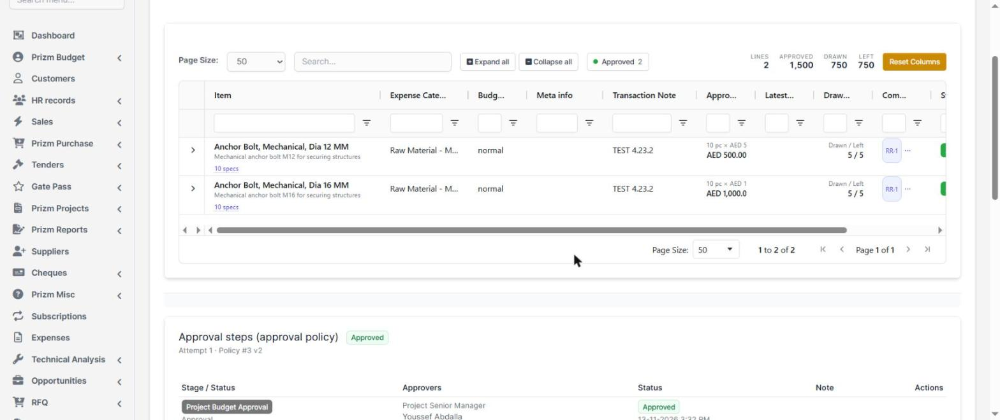

**2. طلب الموارد الأول مع إلغاء بند.** RR-MAT-261113599 طلب M16 ×5 و M12 ×5، واعتمده المعتمدون الثلاثة، ثم أُلغي بند M12. حالته **Revoked**، مثل RR-MAT-26111216 في P1155.

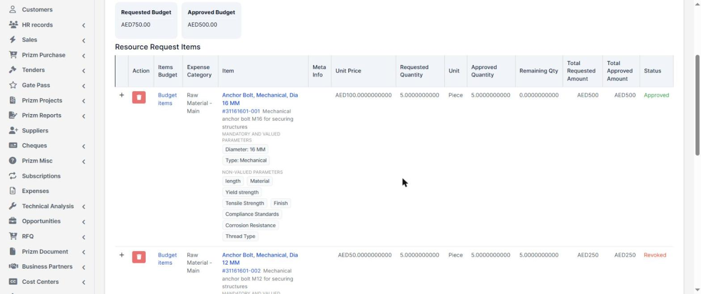

**3. طلب الموارد الثاني يطلب البند الملغي من جديد.** RR-MAT-261113600، M12 ×5، معتمد. يطابق RR-MAT-26111317 في P1155.

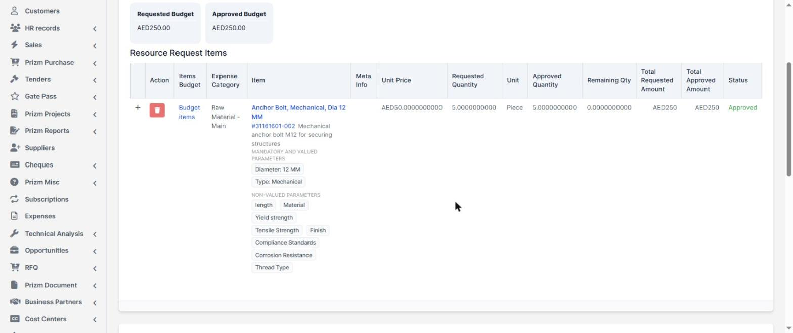

**4. ضوابط التكلفة: WBS.** Project Controls ← WBS & Progress: جذر واحد وحزمة عمل واحدة. سطر الـ Cost Plan يُربط فقط بحزمة عمل ليس تحتها عناصر.

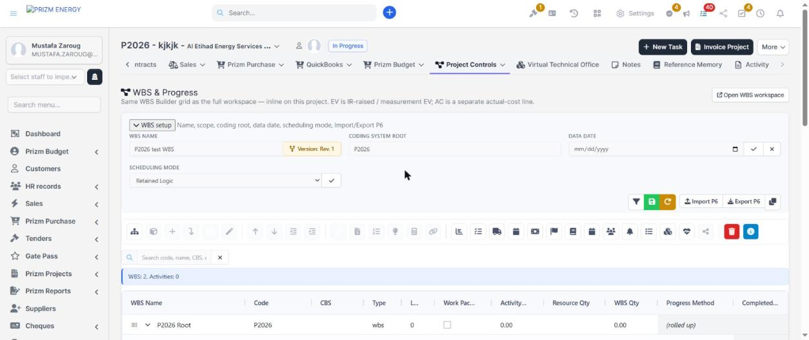

**5. ضوابط التكلفة: قائمة أكواد التكلفة.** Project Controls ← Cost plan ← Cost-code dictionary: الكود **M-MAT** (مواد)، قرار المراجعة **Approved**، معاينة، علامة التأكيد، ثم **Save reviewed dictionary locally**. اعتُمد الإصدار 1.

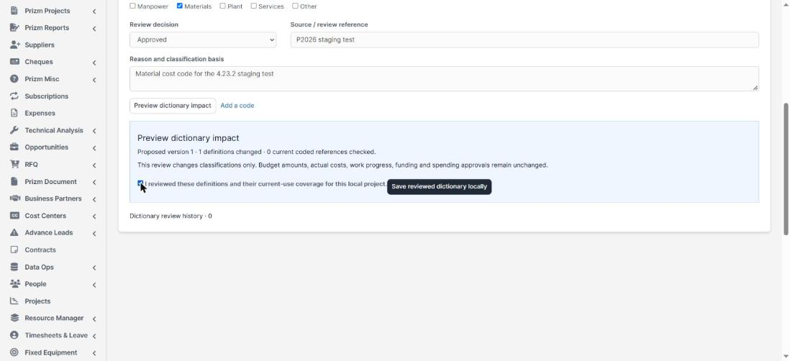

**6. تهيئة ضوابط المشروع.** بعد وضع ملف الـ seed الخاص بالمشروع، يضغط مسؤول النظام **Initialize** (من Projects 1.145.7 فأحدث). يحصل المشروع على أول إصدار لضوابط المشروع.

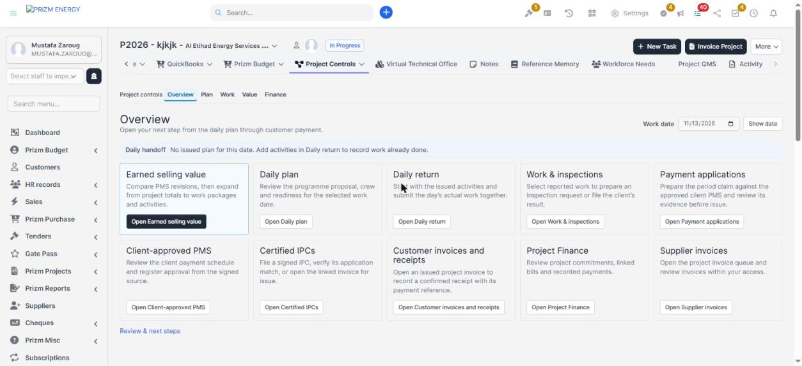

**7. خطة التكلفة.** يُربط بندا الميزانية بحزمة العمل P2026.01 بالكود M-MAT، ثم **Save**.

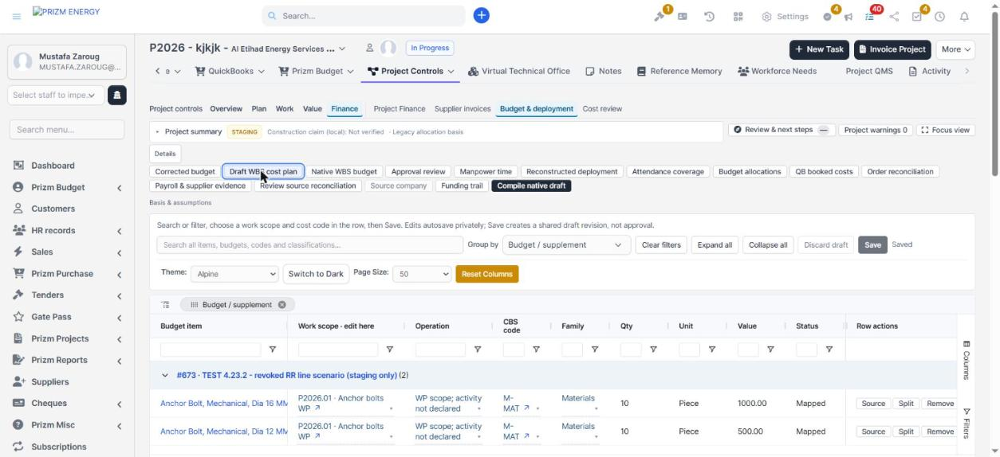

**8. تجميع الميزانية الأصلية.** اضغط **Compile native draft**. تظهر المسودة بحساب تكلفة واحد فيه البندان.

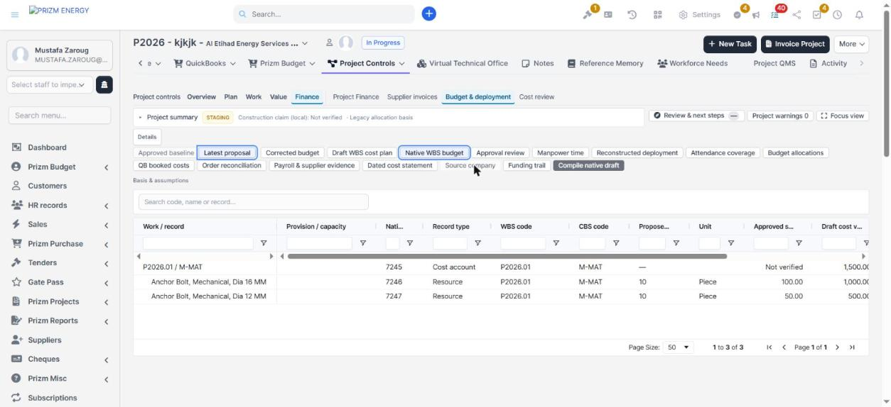

**9. مراجعة الاعتماد.** ظهر `PROJECT_COMPANY_SOURCE_INVALID` لأن المشروع بدون شركة. حدّد شركة المشروع (PRIZM ENERGY، نفس شركة الميزانية) من نموذج تعديل المشروع، ثم **Submit for review**.

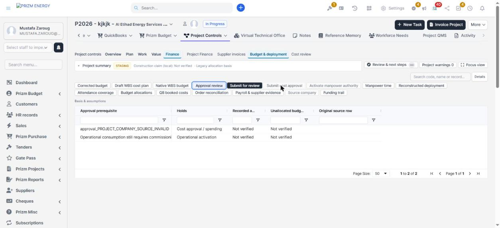

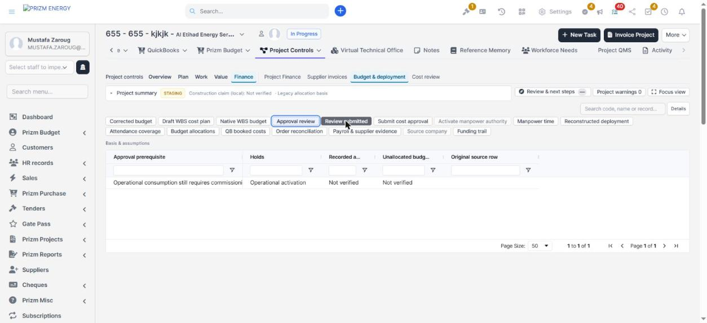

**10. اعتماد التكلفة.** اضغط **Submit cost approval**، افتح الطلب، اكتب السبب واضغط **Approve**. تصبح الحالة **Financially applied** وتصبح بوابة الصرف جاهزة. لم تلزم تسوية تمويل لأن المشروع ليس له سجلات تمويل سابقة.

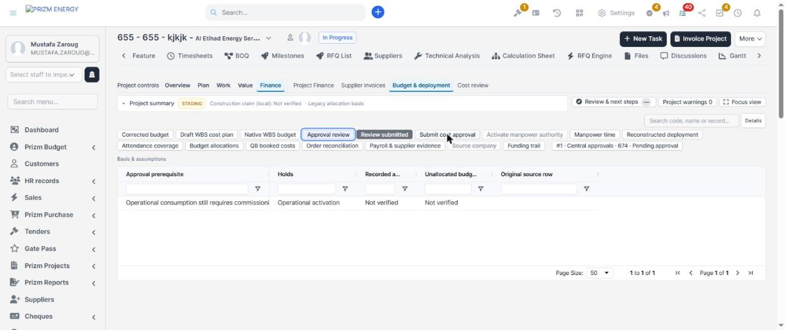

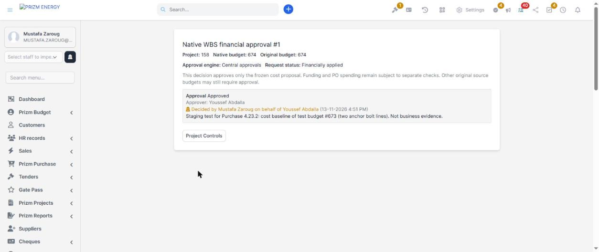

**11. طلب الشراء وأمر الشراء.** اعمل طلب شراء جديدًا **من طلب الموارد** (prepared) من RR 3 (M16) و RR 4 (M12)، والبند M12 في RR 3 ملغي. اعتمده، ثم اعمل أمر الشراء واضغط **Approved**. النتيجة في 13 نوفمبر 2026: اعتُمد m-PO-26110005 **بدون أي توقف**، وهذا تأكيد لإصلاح المشتريات 4.23.2. طلب الشراء الذي حُفظ قبل تفعيل ضوابط المشروع يبقى موقوفًا كـ"legacy"، وهذا سلوك صحيح؛ اعمل طلبًا جديدًا من طلب الموارد.

**ما اكتُشف في إعداد ms_dev أثناء الاختبار (13 نوفمبر 2026):**
- ضوابط المشروع كانت مقفولة على ms_dev. أُضيفت ثلاثة أسطر في ملف `app-config.php` الخاص به: الوضع `staging` ومجلد بيانات خاص به منفصل عن MS.
- موديول Manpower كان غير مفعّل على ms_dev، فكانت migration 102 لموديول Projects تفشل (الجدول `prz_manpower_plan_line` غير موجود). فُعّل Manpower، ثم نجح Upgrade Database لموديول Prizm Projects من Setup ← Modules.
- خطوة إعداد ضوابط المشروع ظلت تُرجع `PROJECT_MIGRATION_CURSOR_PENDING`، لأنها كانت تقرأ الإصدار المثبّت للموديول، وطابور الـ migrations لا يحدّثه أبدًا. أُصلح في Projects 1.145.5 (دُمج ونُشر، ومعه 1.145.6 و1.145.7 اكتُشفا في نفس المسار).

### 8. خطوة بخطوة: أمر الشراء لا يقبل الاعتماد بعد تغيير سعر في الميزانية (بالصور)

**متى تحتاج هذا:** المربع أعلى أمر الشراء يقول **Project Controls approval needed** (`PURCHASE_SOURCE_SPENDING_HELD`). يحدث بعد أي تغيير في سطر ميزانية معتمد، مثل تعديل سعر عن طريق amendment. مثال حقيقي في 13 نوفمبر 2026: سعر Steel Insert Plate تغيّر من 1,550 إلى 1,553 فتوقف PO-26110015 و PO-26110016. كل رقم أحمر في الصور هو الخانة التي تضغطها بالترتيب، وعلامة **OK** الخضراء هي النتيجة المتوقعة.

**من يقوم بها:** مسؤول النظام بصلاحيات ضوابط المشروع. افتح المشروع ثم **Project Controls ← Finance ← Budget & deployment**.

**الجزء أ: خطة التكلفة والميزانية الأصلية**

1. اضغط **Draft WBS cost plan** (1) بدون أي تعديل، ثم اضغط **Compile native draft** (2).

   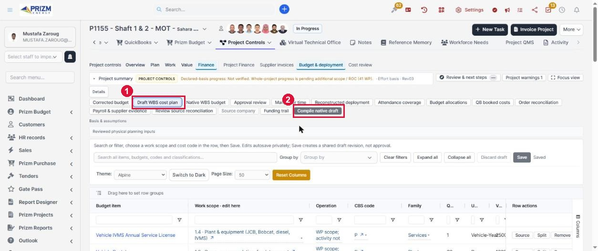
2. تظهر المسودة الجديدة تحت **Latest proposal**. اضغط **Approval review** (3).

   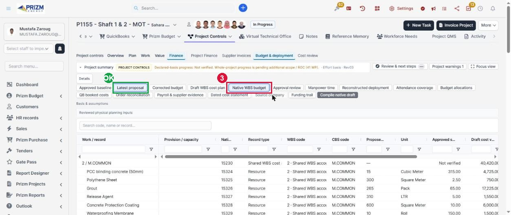
3. اقرأ القيود. صفوف "Spending only" عادية ويعالجها الجزء ج. اضغط **Submit for review** (5).

   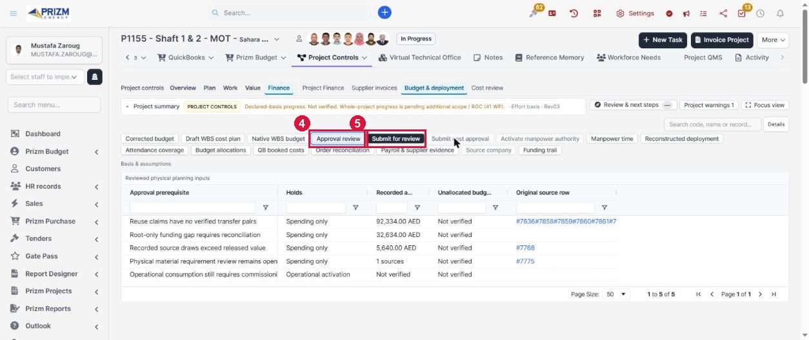
4. يصبح الزر **Review submitted**. اضغط **Submit cost approval** (6).

   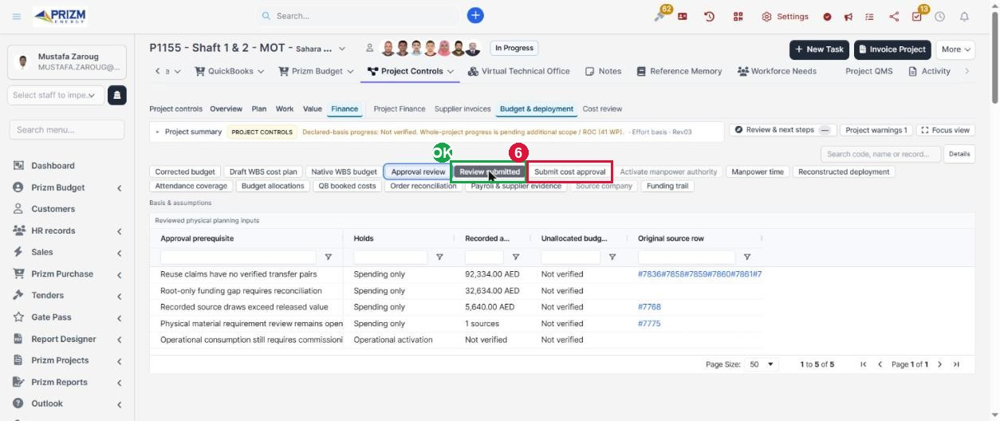

**الجزء ب: اعتماد التكلفة**

5. يظهر زر جديد **#… Central approvals … Pending approval** (7). اضغطه.

   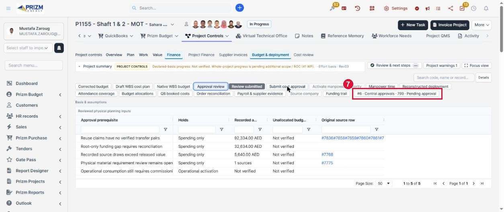
6. اكتب السبب في **Decision reason** (8): ما الذي تغيّر ومن قرر. اضغط **Approve** (9). إن لم تكن أنت المعتمد يسجّل النظام "نيابة عن".

   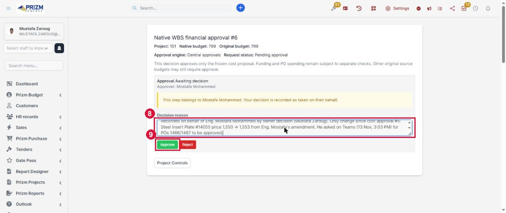
7. تصبح الحالة **Financially applied**.

   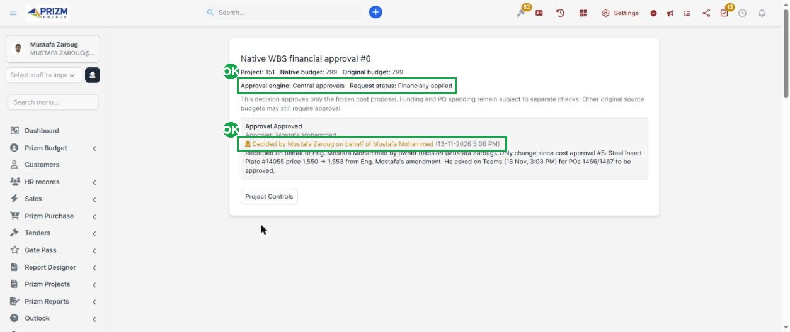

**الجزء ج: تسوية التمويل**

8. ارجع للمشروع واضغط **Funding trail**. تظهر رسالة **Source changed — review a new worksheet** (10).

   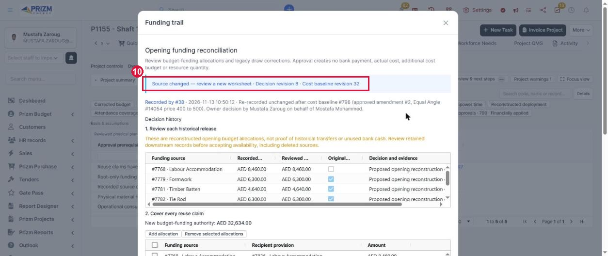
9. انزل لآخر النافذة: اكتب السبب (11)، علّم على التأكيد (12)، واضغط **Submit worksheet** (13). افعل ذلك فقط إذا كانت المبالغ كما كانت في المرة السابقة: نفس المبالغ المحررة، و**32,634 درهم** صلاحية تمويل جديدة، و**−5,640** على #7768. إذا اختلف أي مبلغ فتوقف: صاحب المشروع يقرر أولًا.

   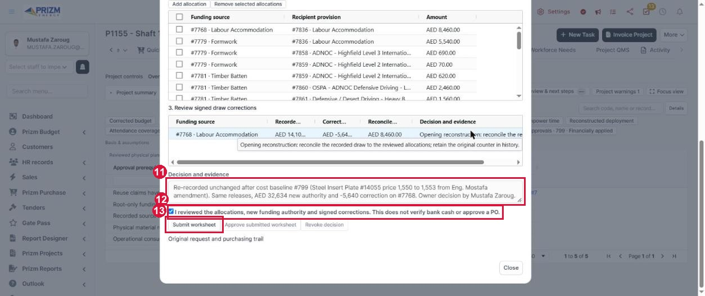
10. اكتب سبب الاعتماد (14)، علّم على التأكيد (15)، واضغط **Approve submitted worksheet** (16).

    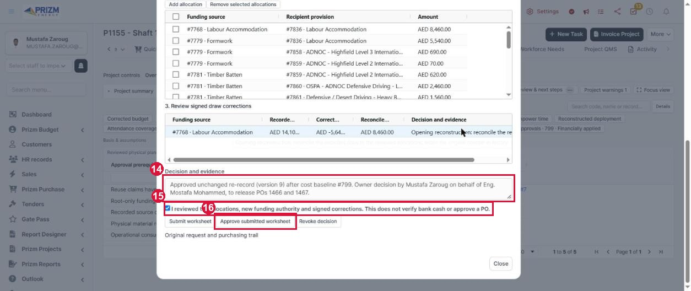
11. تظهر رسالة **Funding reconciliation approved**.

    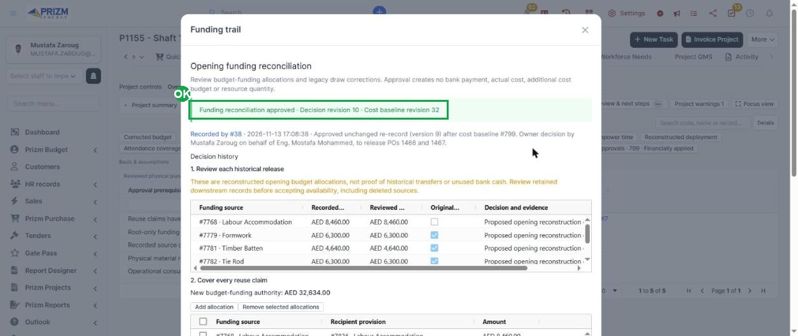

**الجزء د: أمر الشراء**

12. افتح أمر الشراء واضغط **Approved**. تظهر الحالة **Approved** (17).

    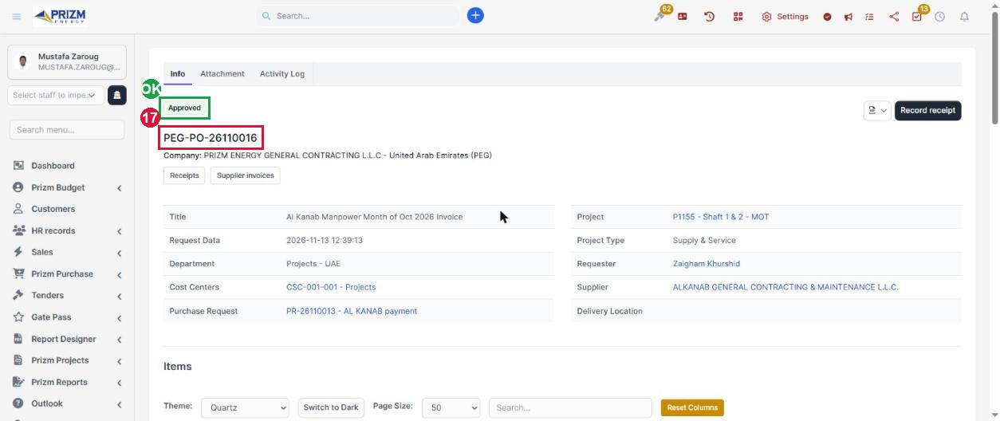

**ما تم في 13 نوفمبر 2026 (مؤكد على MS):** خطة التكلفة revision 55 ← الميزانية الأصلية #799 revision 32 ← اعتماد التكلفة #6 مطبّق (نيابة عن م. مصطفى بقرار صاحب المشروع) ← تسوية التمويل الإصدار 9 أُرسل والإصدار 10 اعتُمد بدون تغيير ← اعتُمد PO-26110015 (1466) و PO-26110016 (1467) الساعة 17:09 كإجراء مفوّض عن م. مصطفى. كما أزال إصدار المشتريات 4.23.2 التوقف القديم `PURCHASE_SOURCE_CHANGED` على PO-26110015.
