# Project Controls

Project Controls is the project-level workspace under **Projects → (project) → Project Controls**. It groups Plan, WBS & Progress, QS Support, Cost Plan, Approval review and Funding. This page records confirmed, step-by-step work done in Project Controls, starting with project P1155.

## P1155 — Confirmed Steps

### 1. Purpose

This page records every step of the P1155 investigation (Project 151, Shaft 1 & 2 – MOT) that has been **completed and confirmed in the live system**. It is the working log for the team: what was done, where, and what the result was. Only confirmed steps appear here. Planned or unconfirmed work is listed separately at the end.

The goal of the investigation is to make purchase order **PEG-PO-26110011** (PR-26110009) approvable through the normal approval engine, without bypassing approvals or losing history.

| Step | Name | Status |
|---|---|---|
| 1–4 | Identify the PO → PR → RR → budget chain, history, hashes and the cause of the stale scope | Done (diagnosis) |
| 5 | Review the governing scope and correct the Cost Plan / WBS planning | Done |
| 6 | Financial approval through the original approvers + funding reconciliation | Done |
| 7 | PO approval and release checks | **In progress** |

### 2. Confirmed steps — 11 November 2026

#### 2.1 Owner and reference fields became searchable lists

- **Where:** Project Controls → Plan → **Governing Scope Review**.
- **What changed:** the assumption **Owner** is chosen from a searchable list of active staff, and the **Assumption reference** from a searchable list of the work package's verified drawing revisions. The server refuses an inactive owner or an unlisted reference.
- **Release:** prizm_project 1.101.0 (pull requests #3376 and #3377), deployed to staging and production.

#### 2.2 Governing Scope v4 recorded

- **Where:** Project Controls → Plan → Governing Scope Review.
- **Why:** v3 was out of date only because the task weights of WP 2.2-PS-197 changed on 7 November.
- **PS-201 pedestal:** no new decision was needed. The Owner's assumption recorded in v1, v2 and v3 on drawing P24050-24-85-76-1601 Rev 2C was re-recorded: 1.5 × 0.5 × 1.0 m pedestal = 0.75 m³ plus 3.0 m³ footing = 3.75 m³, owner Mostafa Mohammed.
- **How:** fill Engineering reference, Review reason and the PS-201 assumption → **Preview engineering review** → check all 26 rows → tick the confirmation → **Record reviewed scope**.
- **Result:** Review version **4**, status **Current**, 26 work packages, every quantity unchanged from v3.

#### 2.3 Physical allocations made current (34 allocations, 17 foundations)

- **Where:** Project Controls → QS Support → Planning Review → **Plan operation allocations**.
- **Why:** after a new governing review, each allocation still pointed to the previous review.
- **How:** for each of the 17 foundation work packages, save the same allocation rows again, then confirm the planning review.
- **Result:** 34 allocations, **64.715 m³** in total, all current. Nothing was approved for budget, client or invoice.

#### 2.4 Cost Plan reconciled (revision 48)

- **Where:** Project Controls → Cost Plan → **Review source reconciliation**.
- **Problem:** the 34 concrete cost rows were held, and the reconciliation was blocked with ALLOWANCE_SOURCE.
- **Fix:** the reconciliation now re-links a cost row to the current allocation review when the task, component, quantity, unit and drawing file are unchanged (prizm_project 1.102.0, pull requests #3382 and #3383).
- **Result:** Cost Plan **revision 48**, 34 rows re-linked, none held, mapped value unchanged at AED 595,395.58. Still a draft.

#### 2.5 All lines of budgets #790 and #794 mapped (revision 49)

- **Where:** Project Controls → Cost Plan.
- **How:** each of the 51 unmapped lines was mapped following how the same item is already mapped in other P1155 budgets: shared materials to the project pools, PPE to 1.3, plant to 1.4, services to 1.2 and 1.6, overtime to 1.5.
- **Result:** Cost Plan **revision 49**, 213 of 224 lines fully mapped, mapped value AED 822,609.58. The 10 remaining lines are recorded monetary-only balances from other budgets. Still a draft; nothing financially approved.

#### 2.6 New resource requests work again for nested budgets

- **Problem:** Eng. Mostafa could not add Backhoe or Overtime Pay to a new resource request. The message was "This budget source needs reconciliation before a new RR can consume it", but the real cause was a defect: the item list ignored an additional budget placed under the selected budget when that budget has its own parent.
- **Fix:** prizmbudget 1.47.2 (pull requests #3387 and #3388), deployed to production.
- **Result:** Backhoe 1 of 1, Overtime Pay 55 of 55 and Overtime Pay for Sahara JP & HSE 25 of 25 are available. Ready Mix stays at 111.5 of 131.5 m³.

##### How to create a resource request for P1155

1. Open the request type: [Material](https://ms.prizm-energy.com/MS/admin/prizmbudget/resource_request/1) · [Manpower](https://ms.prizm-energy.com/MS/admin/prizmbudget/resource_request/2) · [Equipment](https://ms.prizm-energy.com/MS/admin/prizmbudget/resource_request/3) · [Service](https://ms.prizm-energy.com/MS/admin/prizmbudget/resource_request/6).
2. **Budget:** choose **P1155 - Preliminary budget including the required materials to complete the project**. Do not choose a **WBS budget draft** or **Budget for Shaft 1 & 2**.
3. **Budget / additional budgets:** choose the budget that holds the item, for example **Initial project budget**.
4. **Budget Items:** select the items, then **Add selected items**.
5. Enter the required quantities → **Save draft** → **Submit for approval** on the next screen.

#### 2.7 Native WBS draft compiled

- **Where:** Project Controls → WBS & Progress → **Native WBS budget**.
- **Result:** a new draft built from Cost Plan revision 49, covering all 224 source lines (213 of them fully mapped). No "unallocated scope" problem. Draft only; nothing approved.

#### 2.8 Two lines with unit N/A recorded as money-only

- **Where:** Project Controls → Cost Plan.
- **Why:** two lines in **Initial project budget** — **Accommodation, Engineers, Monthly** (AED 1,320) and **Trailer Rental 30–35 Tonne** (AED 4,500) — have unit N/A, which blocks approval.
- **How:** recorded as whole-line money amounts, the same way this project already records **Worker Accommodation** and **Bus Rental**. They stay mapped to their work packages.
- **Result:** Cost Plan **revisions 50 and 51**. Nothing approved; their budget capacity stays held.

#### 2.9 Native WBS draft rebuilt

- **Result:** a new draft built from Cost Plan revision 51. The unit N/A problem is gone.

#### 2.10 Cost review submitted

- **Where:** Project Controls → Approval review → **Submit for review**.
- **Result:** status **Submitted for review**. The financial check is ready with no blockers. The concrete line's specification check and three funding items (a pairing of AED 92,334, a deficit of AED 32,634, and an overdraw of AED 5,640) are tracked separately and handled later in Step 6.

#### 2.11 Cost approval for draft #796 approved and applied

- **Problem:** **Submit cost approval** failed with a general error (EXEC_TRANSACTION). The Approvals module refused to route it through the Budget policy.
- **Fix:** Project Controls approvals now have their own document type, **Project Controls** (pull requests #3419 and #3420: prz_approvals 1.21.1, prizmbudget 1.48.1, prizm_project 1.106.0). A failed save now shows its reason in a red alert and is written to the Activity Log.
- **Setup on production:** in Approvals → Settings: stage **Project Controls**, status **Project Controls Approval**, and policy **Project Controls Approval — Project** (Context Type Project, approver Role Project Senior Manager, required).
- **Decision:** request **#3** was routed to the Project Senior Manager, Mostafa Mohammed. He approved via **Microsoft Teams**, and Mustafa Zaroug recorded the decision on his behalf. The step reads "Decided by Mustafa Zaroug on behalf of Mostafa Mohammed", and the Activity Log holds the entry.
- **Result:** draft #796 is **APPROVED** and its cost baseline is applied.
- **Note:** an opportunity's WBS or CBS has no project, so it does not use this policy. It needs its own Project Controls policy with a Department or General context.

#### 2.12 Funding reconciled again on the new baseline

- **Where:** Project Controls → Approval → **Funding trail**.
- **Why:** the funding reconciliation approved on 3 November (version 2) became **Stale** when the new cost baseline was approved, and purchase orders were held (PURCHASE_SOURCE_SPENDING_HELD).
- **How:** the suggested worksheet matched version 2 exactly, so it was submitted unchanged (**Submit worksheet**, version 3) and approved (**Approve submitted worksheet**, version 4). No new value was assumed.
- **Values:** releases AED 59,700; new budget-funding authority AED 32,634; draw correction −AED 5,640 on line #7768. Not bank cash.
- **Result:** the spending gate is ready with no blockers.

#### 2.13 Purchase order PEG-PO-26110011 approved

- **Where:** Prizm Purchase → the purchase order → **Approver And Stages Info**.
- **Result:** Mostafa Mohammed's step "Projects - UAE Suppl" approved at 16:02, recorded by Mustafa Zaroug on his behalf ("Delegated Action By"). AED 8,232 to Gulf Ready Mix Fujairah: water AED 240 and C40 concrete AED 7,600, plus VAT.

### 3. Confirmed steps — 12 November 2026

#### 3.1 Helper #7956 withdrawn from its monetary-only hold

- **Where:** Project Controls → Cost Plan → source allowance for **Helper #7956** (budget #734, 400 M.DAY × AED 150).
- **Why:** this line had been held as monetary-only since 25 October 2026 ("helper M.DAY vs existing MH capacity reconciliation"), so it did not appear as requestable in a Manpower resource request.
- **Decision:** the project owner, Mustafa Zaroug, decided to release it → **Withdraw**.
- **Result:** Cost Plan **revision 52**. Withdrawing alone leaves the line unallocated (SCOPE_UNALLOCATED) and still blocks spending until it is mapped again (see 3.2).

#### 3.2 Helper #7956 mapped as a day-rate service line (revision 53)

- **Where:** Project Controls → Cost Plan.
- **How:** mapped to the project pool as a day-rate line — resource family **SERVICE**, CBS **"S"**, Project Pool, full 400 quantity — the same pattern already used for **Labour Accommodation #7768** (days). It could not become a Manpower pool line, because a Manpower pool line must be in MANHOUR, and Helper is recorded in M.DAY.
- **Result:** Cost Plan **revision 53**.

#### 3.3 Native WBS draft recompiled (draft #797, revision 30)

- **Where:** Project Controls → WBS & Progress → **Native WBS budget**.
- **Result:** draft **#797, revision 30**. Cost review submitted.

#### 3.4 Cost approval applied — new baseline

- **Where:** Project Controls → Approval review.
- **Decision:** request **#4** (policy #2, Project Controls) was approved by the project owner, Mustafa Zaroug, on behalf of Eng. Mostafa Mohammed. The record notes an **owner decision**, not an approval given through Microsoft Teams.
- **Result:** status **APPLIED**. Draft #797 is now the approved cost baseline.

#### 3.5 Funding reconciled again on the new baseline

- **Where:** Project Controls → Approval → **Funding trail**.
- **Why:** the new cost baseline made the funding reconciliation stale and held purchase orders (PURCHASE_SOURCE_SPENDING_HELD).
- **How:** re-recorded unchanged from the approved plan: **Submit worksheet** (version 5), **Approve submitted worksheet** (version 6).
- **Result:** the spending gate is ready with no blockers; purchase orders are not held.

#### 3.6 Helper now shows as requestable (checked, not saved)

- **Where:** **New → Manpower resource request** → Budget **"P1155 - Budget for Shaft 1 & 2"** → Budget Items.
- **Result:** Budget Items now shows **Helper · M.DAY · 400**. Opening **Add selected items** shows unit price AED 150, total 400, and 394 available (6 already held by an earlier request). This was checked only; nothing was saved.

#### 3.7 Eng. Mostafa and Eng. Osama informed

- Eng. Mostafa Mohammed and Eng. Osama were told about this on Microsoft Teams.
- **Still open:** whether the 400 helper-days are additional to the helper hours already recorded under requests #11336 and #11347, or the same people — Eng. Osama is to confirm. The conversion between M.DAY and MANHOUR (8 hours per day) is not implemented in the system. Until this is confirmed, request helpers from one line only.

#### 3.8 Lesson: a Cost Plan change after approval needs a full cycle

A Cost Plan change made after a cost approval does not take effect by itself. Before purchase orders can be released again, repeat in order: recompile the Native WBS draft → submit it for review → get cost approval → re-record funding (submit, then approve).

### 4. Confirmed steps — 13 November 2026

#### 4.1 "Report project work" (Daily return) moved inside the project

- **Where:** Project Controls → Work → **Daily return**, next to **Daily plan** and **Daily reports**.
- **URL:** `/MS/admin/projects/view/151?group=wbs_progress&controls_view=daily_return&execution_date=YYYY-MM-DD`.
- **Old link:** `/MS/admin/prizm_reports/daily_execution/workday/151` now forwards to the new page with the same date, work package and activity.
- **How it behaves:** changing the date keeps you inside the project. Saving and submitting a return work the same as before.
- **Release:** prizm_reports 2.25.1 (pull requests #3500 and #3501, fix #3506 and #3507).

#### 4.2 Budget line price change approved (Equal Angle #14054, 400 → 500)

- **What happened:** editing a Cost-Plan-mapped budget line creates a **budget line change** (a native amendment) that needs approval. Amendment #2 — raising the unit price of Equal Angle #14054 from AED 400 to AED 500 — was approved by Mustafa Zaroug on behalf of Mostafa Mohammed (13 Nov, 09:57, note "update price").
- **How approval takes effect:** since prizmbudget 1.50.0, the final approval writes the new quantity and price straight to the budget line. An **Apply to budget line** button on the approval screen covers changes that were approved earlier. A price change is refused while a resource request still holds quantity at the old price.
- **Where to see it:** the approval screen lists each decision (approver, done by, date, note) and shows **"On behalf of \<approver\>"** when someone else acted. Budget and resource request pages show an **"Approvals still open"** box at the top with a link to each approval screen.
- **Reconciling the Cost Plan after the price change:** Cost Plan **revision 54** → Native WBS draft **#798, revision 31** compiled and submitted → cost approval **request #5** approved (an owner decision on behalf of Mostafa Mohammed, not through Teams) → funding re-recorded **version 7 SUBMITTED / version 8 APPROVED** with the same plan (a fresh AED 32,634). Until this chain finishes, material resource requests for the project are held for source review.
- **Result:** a new resource request shows **Equal Angle at AED 500**, with **50** available.
- **Follow-up (prizmbudget 1.50.1, pull requests #3516 and #3517):** the approval screen's on-behalf label now shows the approver's name, for example **"On behalf of Mostafa Mohammed"** (1.50.0 showed only "On behalf of"). Verified on amendment #2, whose status now reads **"Approved and applied to the budget line"**.
- **Eng. Mostafa informed:** told on Microsoft Teams (1:1 chat) that Equal Angle #14054 is now AED 500 (was 400), quantity 50, approved on his behalf. New resource requests pick up AED 500; a resource request opened before the change should be closed and a new one opened. Open approvals now show at the top of the budget and resource request pages.

### 5. When a PO approval is held — first see which case

Pressing **Approved** on a purchase order can be held for different reasons. Before Purchase 4.23.2 they all showed the same message "PO approval is on hold…", so look at the **code** under the message (or in the error details). From Purchase 4.23.2 the box at the top of the PO names the case and has one button that opens the page where you fix it. Nothing is saved while it is held; the PO waits at its step.

| Code | Case | Go to |
|---|---|---|
| `PURCHASE_SOURCE_SPENDING_HELD` | **A. Project Controls funding approval** — a new cost approval made the funding reconciliation Stale. | Project Controls funding trail (steps A below) |
| `PURCHASE_SOURCE_CHANGED` | **B. The PR or RR behind the PO changed** — a line was revoked, rejected, deleted or edited, or the PR is not fully approved. Not a funding problem. | The linked PR (steps B below) |

#### Case A — funding reconciliation (PURCHASE_SOURCE_SPENDING_HELD)

This will happen again after **every** new cost approval. Administrator with Project Controls budget review permission:

1. Press **Open the Project Controls funding trail** in the box, or open the project → **Project Controls → Approval → Funding trail**. It shows **Stale**.
2. Compare the suggested worksheet with the last approved version. When nothing changed, it repeats the approved plan.
3. Tick the confirmation, write a reason → **Submit worksheet**.
4. Write the approval reason → **Approve submitted worksheet**.
5. Go back to the purchase order → **Approved**.

If the worksheet shows a real change (a new release, a different amount, a new overdraw), do not approve it as a repeat: the project owner decides first.

#### Case B — the PR or RR changed (PURCHASE_SOURCE_CHANGED)

1. Press **Open the linked PR** in the box, or open the PR shown on the PO under **Purchase Request**.
2. Check the PR's status is **Approved** and every approval step is approved. If a step is still open, finish it, then approve the PO again.
3. Open each RR listed under **Resource Request** on the PR. For each line the PR uses, check its status is **Approved**.
4. If a line the PR uses was revoked, rejected or changed, the PR cannot feed this PO: prepare a new PR from the current RR and make the PO from it.
5. Lines of the same RR that the PR does **not** use do not matter from Purchase 4.23.2 on. Before 4.23.2 they held the PO by mistake (see PO-26110015 below): after 4.23.2 is deployed, just press **Approved** again.

### 6. Next, not yet confirmed

- **PO PEG-PO-26110015 (from PR-26110012), 13 November 2026:** held with `PURCHASE_SOURCE_CHANGED`, not a funding hold. The PR is approved. It takes the Anchor Bolt from RR-MAT-26111216, whose Equal Angle (AED 400) and Steel Insert Plate lines were revoked and requested again in RR-MAT-26111317 (Equal Angle at AED 500). The PO check looked at every line of the RR, so the revoked lines held it. Fixed in Purchase 4.23.2, deployed 13 November. The PO was then approved after the cost baseline and funding were renewed (see section 8).

- Review the specification hold on concrete source #7775.
- Operational activation (spending authority) remains separate and is not yet granted.
- Confirm with Eng. Osama whether Helper #7956's 400 days are additional to requests #11336/#11347 or the same people; implement the M.DAY ↔ MANHOUR conversion.

### 7. Illustrated walkthrough: a PO held by a revoked RR line (staging test, 13 November 2026)

> **Documented retroactively.** The P1155 Cost Control steps (Governing Scope, Cost Plan, native budget, cost approval and funding) were done on production on 11–13 November without screenshots. The images below come from a test project on staging (P2026, id 158) that repeats the same path, so each step has a picture. The numbers are test numbers, not P1155.

**1. Budget with approved Resource Manager items.** Budget #673, two approved items: Anchor Bolt M16 (10 × AED 100) and Anchor Bolt M12 (10 × AED 50), submitted and approved.

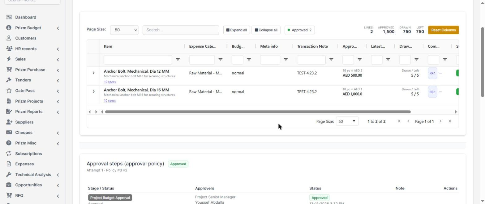

**2. RR 1 with one line revoked.** RR-MAT-261113599 requested M16 ×5 and M12 ×5, all three approvers approved, then the M12 line was revoked. It shows **Revoked**, the same as RR-MAT-26111216 on P1155.

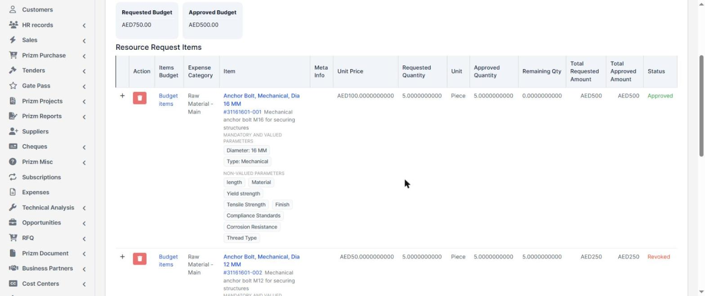

**3. RR 2 requests the revoked item again.** RR-MAT-261113600, M12 ×5, approved. This matches RR-MAT-26111317 on P1155.

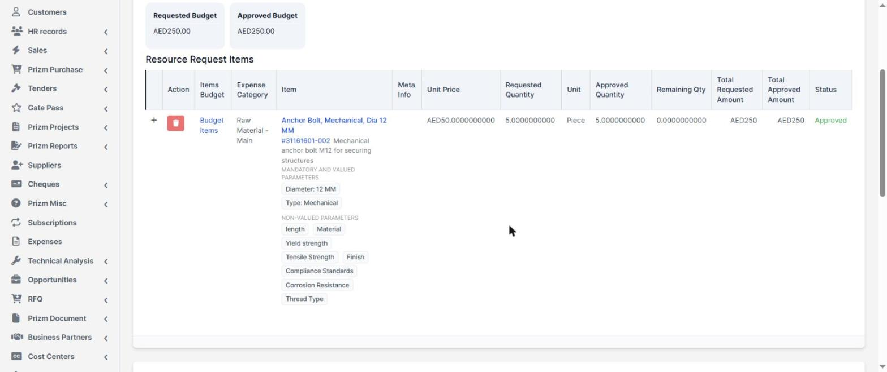

**4. Cost Control: WBS.** Project Controls → WBS & Progress: one root and one work package. A Cost Plan line can only map to a work package with no children.

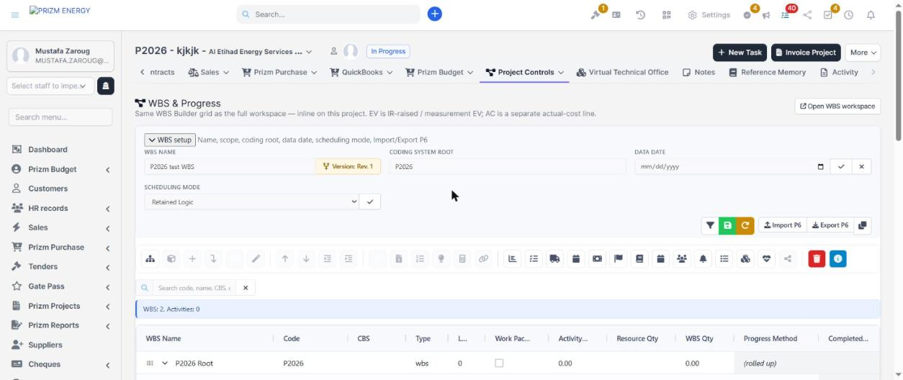

**5. Cost Control: cost-code list.** Project Controls → Cost plan → Cost-code dictionary: code **M-MAT** (Materials), review decision **Approved**, preview, tick the confirmation, **Save reviewed dictionary locally**. Version 1 is approved.

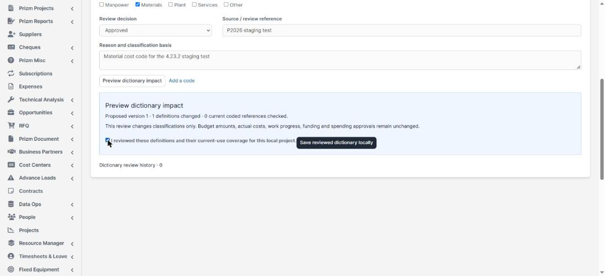

**6. Initialize Project Controls.** With the project's seed file in place, an administrator presses **Initialize** (Projects 1.145.7 and later). The project gets its first Project Controls version.

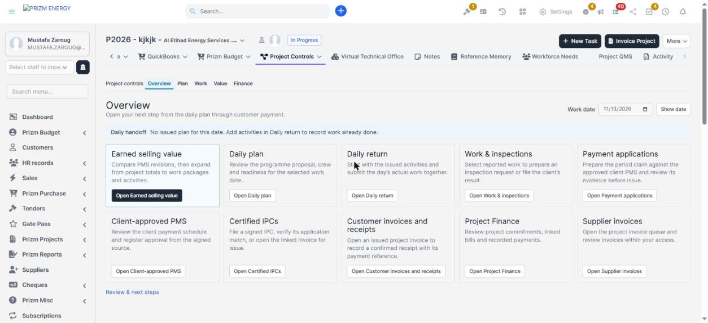

**7. Cost Plan.** Both budget lines are mapped to work package P2026.01 with code M-MAT, then **Save**.

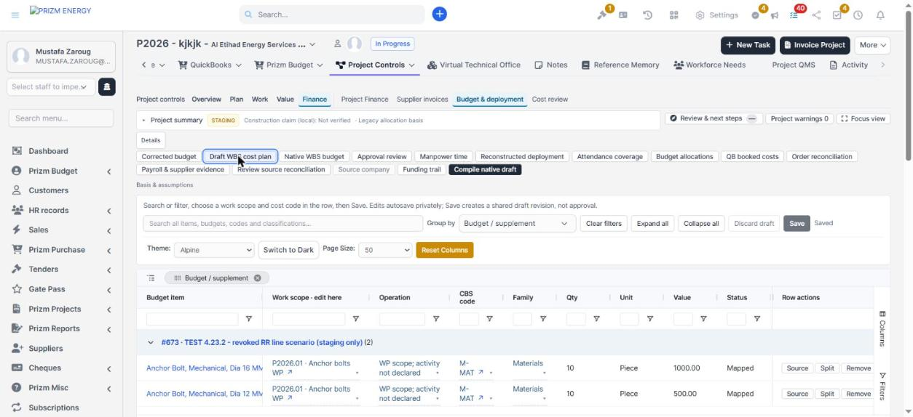

**8. Compile the native budget.** Press **Compile native draft**. The draft shows one cost account with both lines.

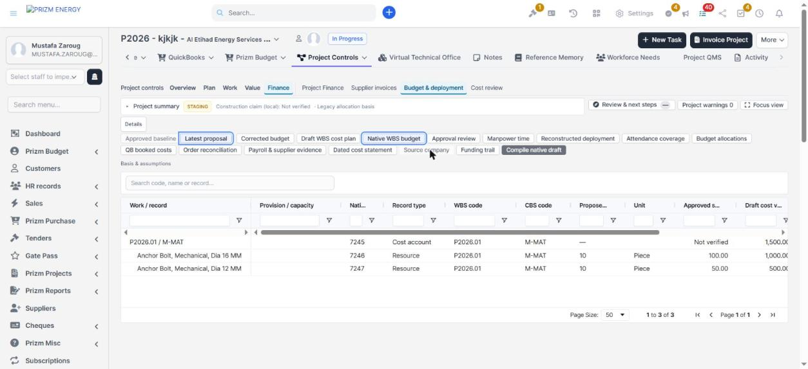

**9. Approval review.** It showed `PROJECT_COMPANY_SOURCE_INVALID`: the project had no company. Set the project's company (PRIZM ENERGY, the same as its budget) in the project edit form, then **Submit for review**.

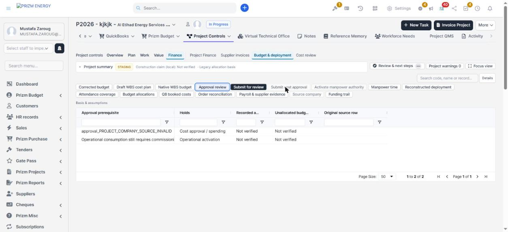

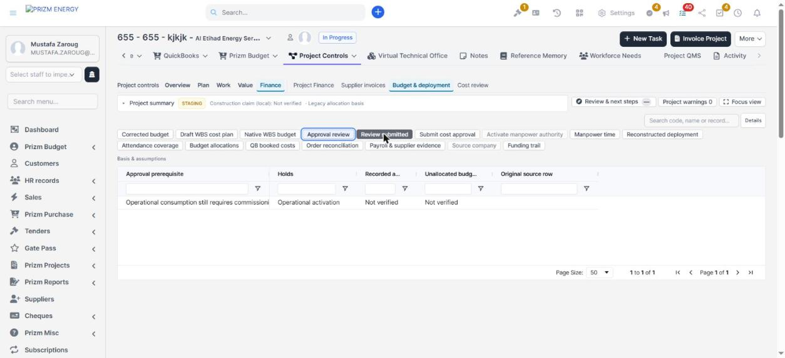

**10. Cost approval.** Press **Submit cost approval**, open the request, write the reason and press **Approve**. The status becomes **Financially applied**. The spending gate is then ready. No funding reconciliation was needed, because the project had no earlier funding records.

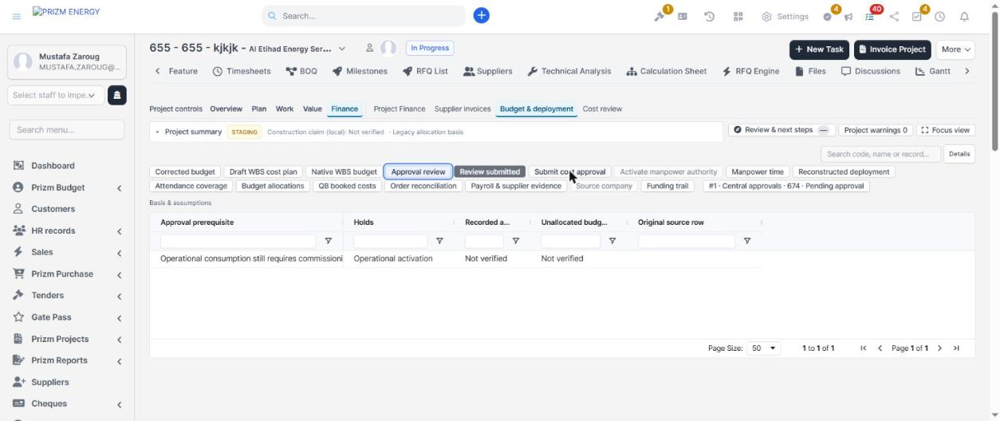

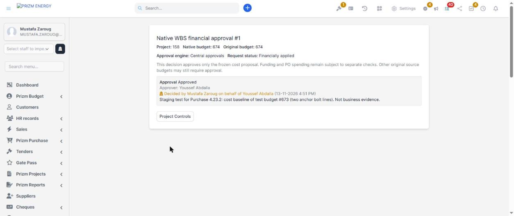

**11. PR and PO.** Make a new **prepared** PR from RR 3 (M16) and RR 4 (M12), where RR 3's M12 line is revoked, approve it, make the PO and press **Approved**. Result on 13 November 2026: PO m-PO-26110005 was **approved with no hold**. That confirms Purchase 4.23.2. A PR saved before Project Controls was on stays held as "legacy", which is correct. Make a new one from the RR instead.

**Staging setup found on the way (13 November 2026):**
- Project Controls was switched off on ms_dev. Three lines were added to its private `app-config.php`: mode `staging` and its own data folder, separate from MS.
- The Manpower module was deactivated on ms_dev, so Projects migration 102 failed (`prz_manpower_plan_line` missing). Manpower was activated, then Setup → Modules → **Upgrade Database** for Prizm Projects passed.
- The Project Controls setup step still reported `PROJECT_MIGRATION_CURSOR_PENDING`, because it read the module's installed version, which the migration queue never updates. Fixed in Projects 1.145.5 (merged and deployed; plus 1.145.6 and 1.145.7 found on the same path).

### 8. Step by step: a PO won't approve after a budget price changed (with pictures)

**When you need this:** the box at the top of the PO says **Project Controls approval needed** (`PURCHASE_SOURCE_SPENDING_HELD`). That happens after any change to an approved budget line, such as a price change through an amendment. Real example, 13 November 2026: the Steel Insert Plate price went from 1,550 to 1,553, and PO-26110015 and PO-26110016 were held. Each red number in the pictures is the box to press, in order. A green **OK** shows the result you should see.

**Who:** an administrator with Project Controls rights. Open the project, then **Project Controls → Finance → Budget & deployment**.

**Part A: Cost Plan and native budget**

1. Press **Draft WBS cost plan** (1). You change nothing. Then press **Compile native draft** (2).

   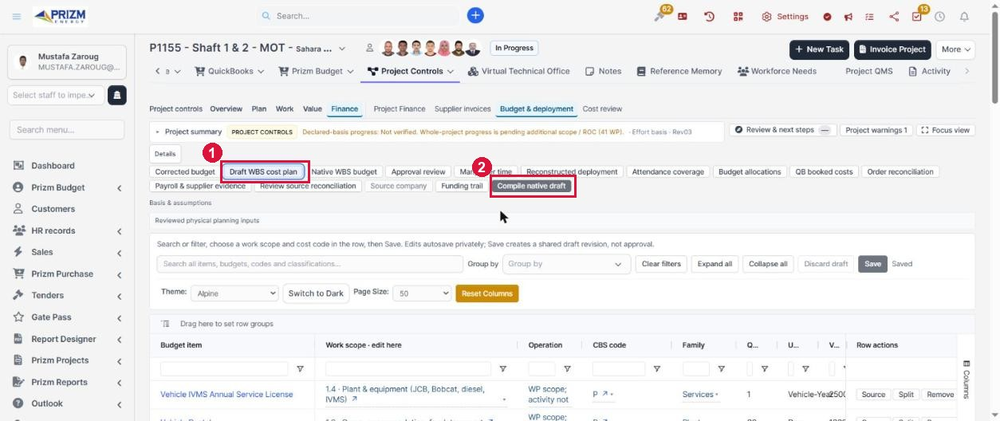
2. The new draft opens under **Latest proposal**. Press **Approval review** (3).

   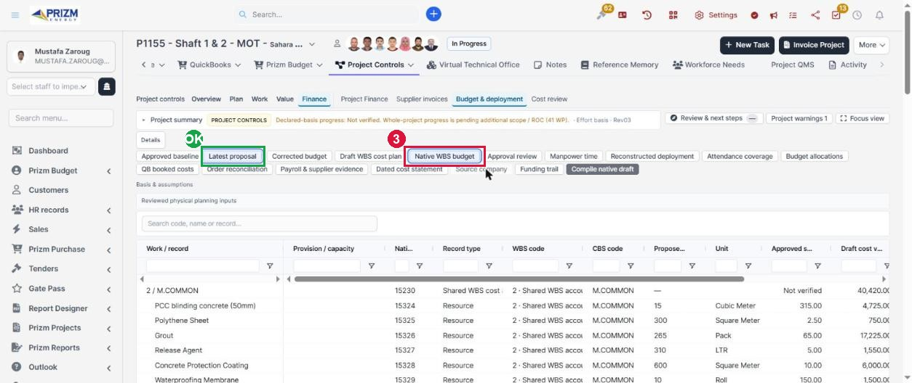
3. Read the holds. "Spending only" rows are normal and are handled in Part C. Press **Submit for review** (5).

   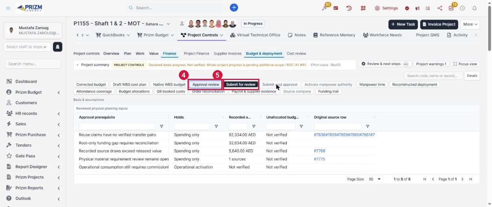
4. The button changes to **Review submitted**. Press **Submit cost approval** (6).

   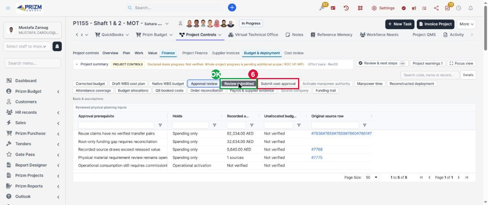

**Part B: Cost approval**

5. A new button appears: **#… Central approvals … Pending approval** (7). Press it.

   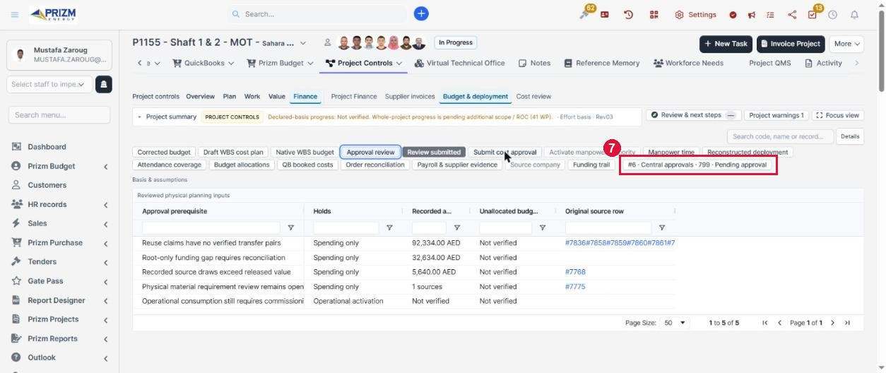
6. Write the reason in **Decision reason** (8): what changed and who decided. Press **Approve** (9). If you are not the approver, the system records "on behalf of".

   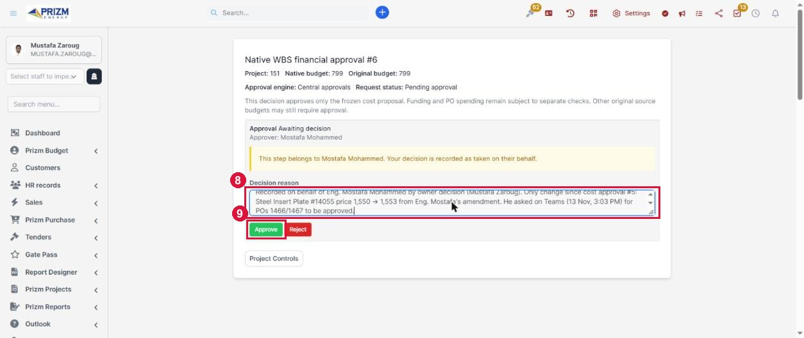
7. The status becomes **Financially applied**.

   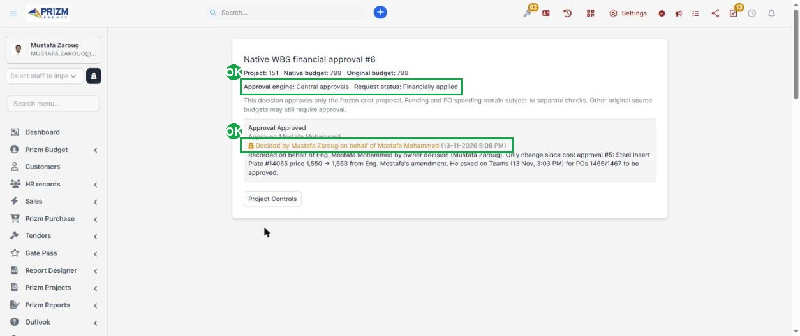

**Part C: Funding reconciliation**

8. Back on the project, press **Funding trail**. The window says **Source changed — review a new worksheet** (10).

   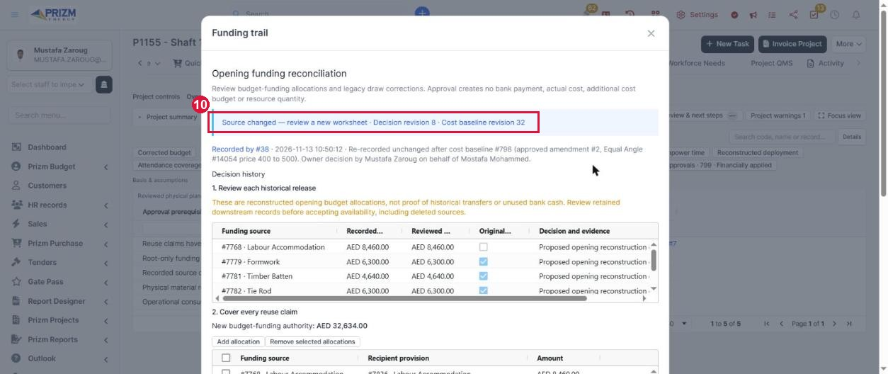
9. Scroll to the bottom. Write the reason (11), tick the confirmation (12) and press **Submit worksheet** (13). Only do this if the amounts are the same as last time: the same releases, **AED 32,634** of new authority and **−5,640** on #7768. If anything differs, stop: the project owner decides first.

   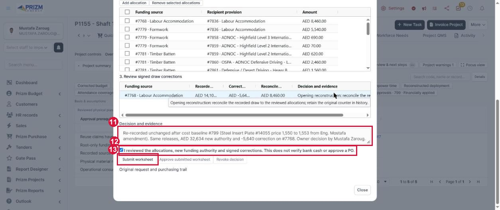
10. Write the approval reason (14), tick the confirmation (15) and press **Approve submitted worksheet** (16).

    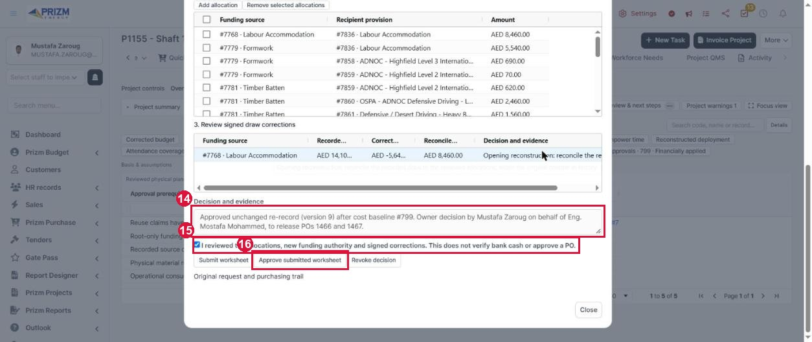
11. The window shows **Funding reconciliation approved**.

    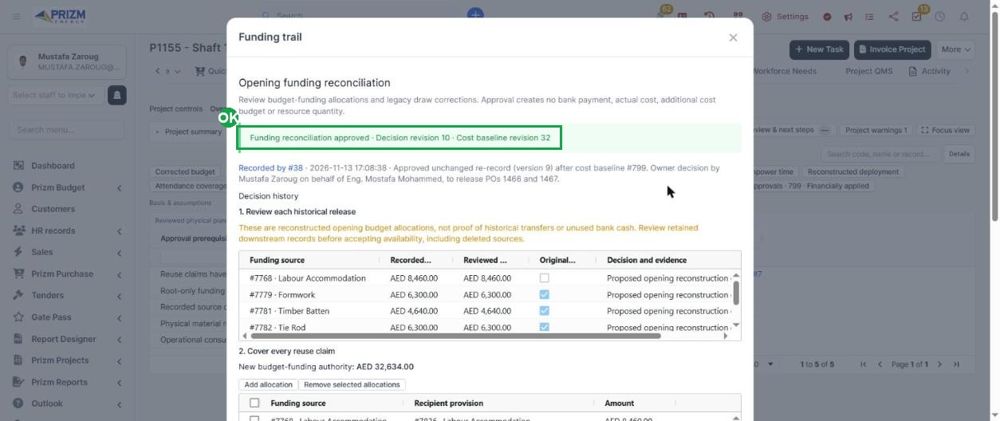

**Part D: The PO**

12. Open the PO and press **Approved**. The PO shows **Approved** (17).

    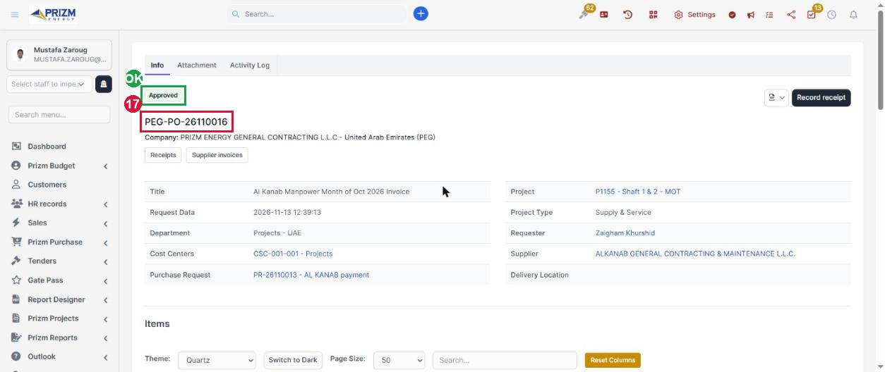

**Done on 13 November 2026 (confirmed on MS):** Cost Plan revision 55 → native draft #799 revision 32 → cost approval #6 financially applied (on behalf of Eng. Mostafa, owner decision) → funding version 9 submitted, version 10 approved, unchanged → PO-26110015 (1466) and PO-26110016 (1467) approved at 17:09 as a delegated action for Eng. Mostafa. Purchase 4.23.2 also removed the old `PURCHASE_SOURCE_CHANGED` hold on PO-26110015.
