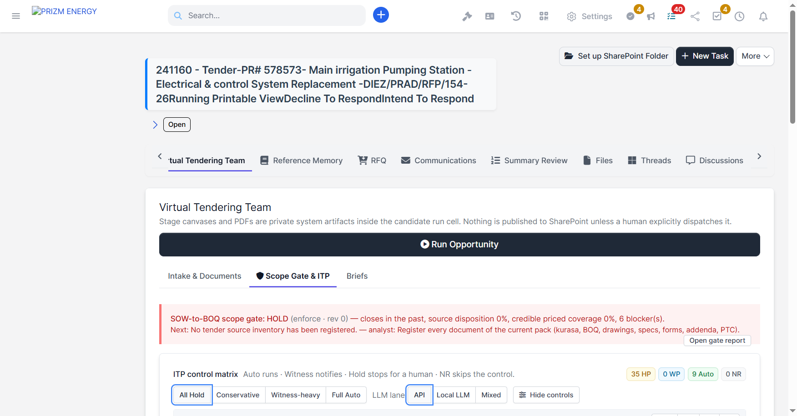
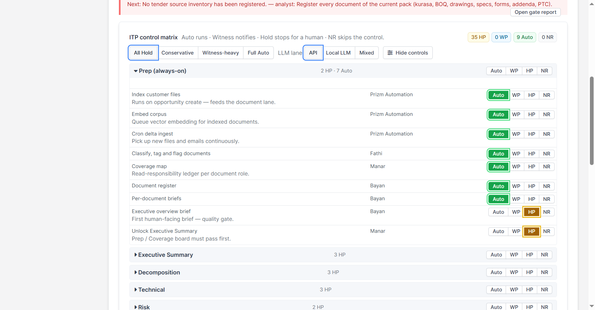
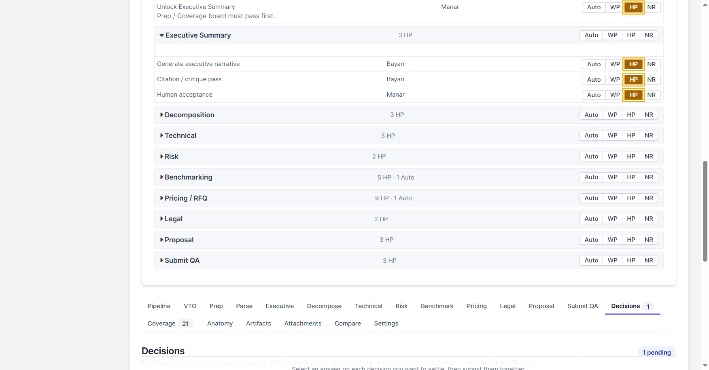
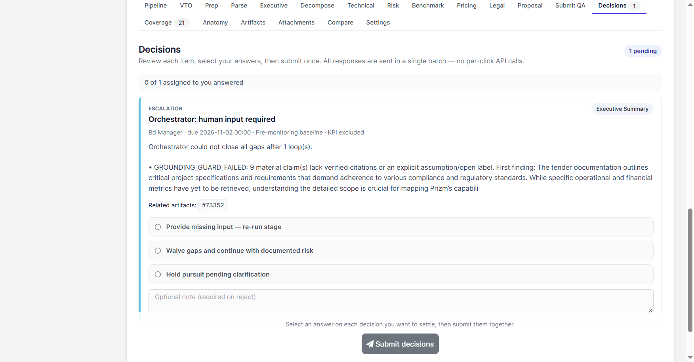

# من العطاء إلى العرض (T2B)

## 1. المقدمة

**من العطاء إلى العرض (T2B)** هو البرنامج الذي ينقل العطاء من مستنداته إلى عرض مُقدَّم داخل بوابة
PRIZM ENERGY. يتم العمل في تبويب **فريق العطاءات الافتراضي** (Virtual Tendering Team) داخل الفرصة:
فريق من وكلاء الذكاء الاصطناعي يُعدّ كل مرحلة من مراحل العرض (الملخص التنفيذي، والتفكيك، والحل الفني،
والمخاطر، والمقارنة المرجعية، والتسعير، والمراجعة القانونية، والعرض، وفحص الجودة قبل التقديم)، ثم
يعتمد الموظفون النتيجة عند نقاط تحكم متفق عليها.

يتوسع هذا القسم مع تقدم البرنامج. كلما اكتمل جزء من خطة T2B تُضاف هنا التغييرات التي تخصك.

يستفيد من هذا الدليل:

- مديرو العطاءات والعروض
- فرق تطوير الأعمال
- المهندسون والمقدّرون الذين يراجعون مخرجات المراحل
- المديرون الذين يعتمدون العروض

## 2. تقدم البرنامج

| الجزء | ما يحققه | الحالة |
|---|---|---|
| **الخطوة 0 — إصلاح الضوابط** | التوقيعات البشرية النهائية لا يمكن تحويلها إلى Auto، ونقطة التوقف لا تُفك إلا بموافقة حقيقية في نفس التشغيل. | ✅ أُغلقت في 10 نوفمبر 2026 |
| PH0 — التشخيص وتجميد المواصفات | يوضح أين تنتظر العروض فعلاً وعلى من، مع مواصفات مجمّدة. | قيد التنفيذ |
| PH1 — المعتمد الصحيح والانتظار الصحيح | يصل كل قرار إلى الشخص الصحيح مع مدة انتظار واضحة. | مخطط |
| P00–P06 | مراحل العرض نفسها، من الأساس حتى التقديم. | مخطط |

## 3. أين تجده

افتح الفرصة واختر تبويب **Virtual Tendering Team**.

- زر **Run Opportunity** يبدأ تشغيلاً: يمر الفريق الافتراضي على المراحل بالترتيب ويتوقف فقط عندما
  يلزم قرار من شخص.
- تبويبات **Intake & Documents** و**Scope Gate & ITP** و**Briefs** تحتوي إعدادات الفرصة.
- تحتها تبويب لكل مرحلة يعرض مخرجاتها، وتبويب **Decisions** يعرض ما ينتظر قرارك.

## 4. الخطوة 0 — إصلاح الضوابط (ما الذي تغيّر عليك)

تضمن الخطوة 0 ألا يتجاوز أي عرض شخصاً يجب أن يعتمده. اكتملت في 10 نوفمبر 2026.

### 4.1 أوضاع التحكم (مصفوفة ضوابط ITP)

لكل مرحلة ضوابط تظهر في **Scope Gate & ITP ← ITP control matrix**. لكل ضابط أحد أربعة أوضاع:

| الوضع | المعنى |
|---|---|
| **Auto** | يواصل الفريق الافتراضي دون توقف. |
| **WP** (نقطة إشعار) | يواصل الفريق الافتراضي ويُشعر صاحب الضابط. |
| **HP** (نقطة توقف) | يتوقف التشغيل حتى يعتمد شخص. |
| **NR** | يُتخطى الضابط. |

الإعدادات الجاهزة في الأعلى (**All Hold** و**Conservative** و**Witness-heavy** و**Full Auto**) تضبط عدة
ضوابط دفعة واحدة، والعدادات على اليمين تعرض عدد الضوابط في كل وضع.

### 4.2 التوقيعات النهائية تبقى دائماً على Hold

خمسة ضوابط هي **توقيعات بشرية نهائية**. تبقى على **HP** في كل الإعدادات الجاهزة، حتى **Full Auto**،
ولا يمكن تغييرها منفردة:

| المرحلة | الضابط |
|---|---|
| Executive Summary | Human acceptance |
| Benchmarking | Accept benchmarks |
| Pricing / RFQ | Margin and contingency gate |
| Proposal | Human acceptance |
| Submit QA | Human sign-off (بوابة نظامية) |

كل تغيير في وضع ضابط، وكل محاولة مرفوضة لإخراج توقيع نهائي من Hold، يُسجَّل في سجل تدقيق TenderOps.

### 4.3 نقطة التوقف لا تُفك إلا بموافقة في نفس التشغيل

عندما يصل التشغيل إلى نقطة توقف يظهر قرار في **Decisions**. اختر **Release hold — continue** ثم
**Submit decisions**.

- الموافقة تخص **ذلك التشغيل فقط**. إذا شُغّلت الفرصة مرة أخرى لاحقاً فإن نفس نقطة التوقف توقف
  التشغيل الجديد وتطلب الموافقة من جديد. موافقة تشغيل سابق لا تفك تشغيلاً لاحقاً أبداً.
- لا يُحتسب إلا اختيار **Release hold** الصريح. اختيار **Keep on hold** لا يفك أي شيء.
- قد تحتوي المرحلة على عدة نقاط توقف. فك إحداها يُظهر التالية، ولا تُفك معاً.

### 4.4 "Re-approval required after control fix"

الموافقات التي أُعطيت **قبل** الخطوة 0 لم تكن مرتبطة بتشغيل، لذلك لم تعد تفك نقطة التوقف. في أول
مرة تعود فيها نقطة التوقف هذه ينتهي عنوانها بعبارة **"Re-approval required after control fix"**
ويذكر نصها القرار السابق، مثل: *"decision #5 approved this hold before the control fix"*.

وافق عليها مرة أخرى للمتابعة. يحدث هذا مرة واحدة لكل ضابط وفرصة، وبعدها تظهر نقاط التوقف بشكلها
العادي.

### 4.5 الرد على القرارات

1. افتح تبويب **Decisions**. يعرض العداد عدد القرارات المنتظرة.
2. لكل قرار تريد حسمه اختر إجابة واحدة، وأضف ملاحظة عند الحاجة.
3. اضغط **Submit decisions** مرة واحدة، فتُرسل كل إجاباتك معاً.

هناك نوعان من القرارات:

| النوع | متى يظهر | الإجابات |
|---|---|---|
| **Blocker** (نقطة توقف) | وصل التشغيل إلى نقطة توقف. | Release hold — continue · Provide input and re-run this stage · Keep on hold |
| **Escalation** (تصعيد) | لم يستطع الفريق الافتراضي سد كل الفجوات بنفسه، مثل ادعاءات بلا مصدر. | Provide missing input — re-run stage · Waive gaps and continue with documented risk · Hold pursuit pending clarification |

**من يستطيع الرد:** الشخص المُسند إليه القرار، وأي مدير نظام (administrator).

## 5. أسئلة شائعة

**وافقت على نقطة التوقف هذه أمس، لماذا تطلب الموافقة مرة أخرى؟**
إما أن الفرصة شُغّلت مرة أخرى (كل تشغيل يحتاج موافقته)، أو أن موافقتك أُعطيت قبل الخطوة 0
(وعندها تظهر عبارة "Re-approval required after control fix").

**هل يمكنني تحويل التوقيعات النهائية إلى Auto لتوفير الوقت؟**
لا. التوقيعات النهائية الخمسة تبقى على Hold في كل الإعدادات الجاهزة، وهذا مقصود.

**ماذا يحدث إذا اخترت "Keep on hold"؟**
يبقى التشغيل متوقفاً، ولا يتحرك شيء حتى يفك أحدهم نقطة التوقف.
