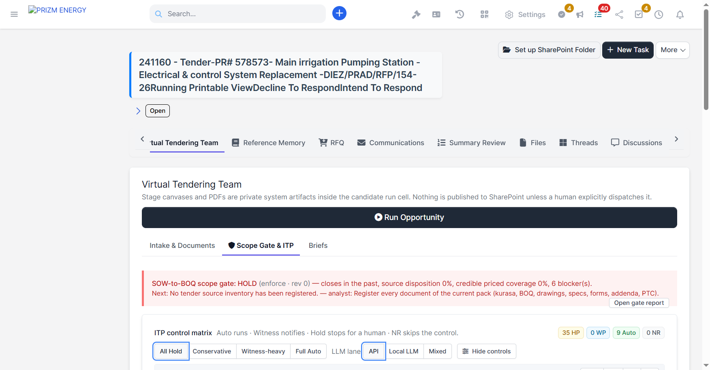
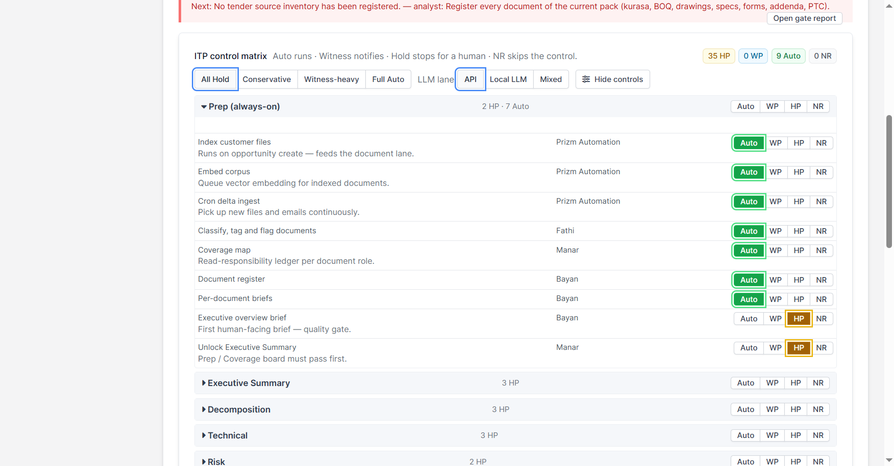
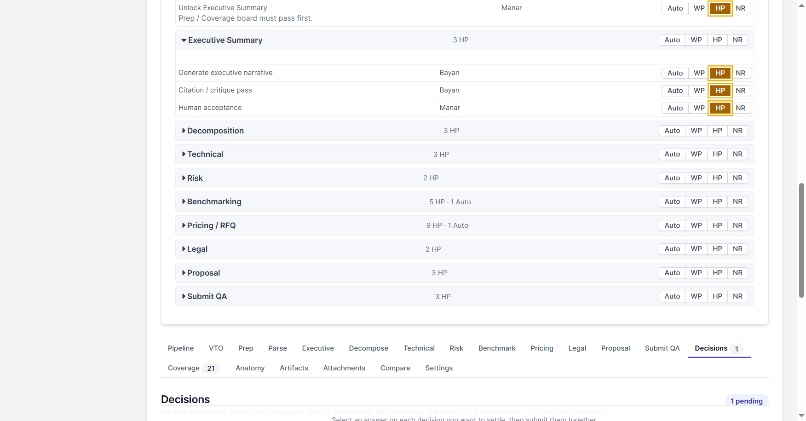
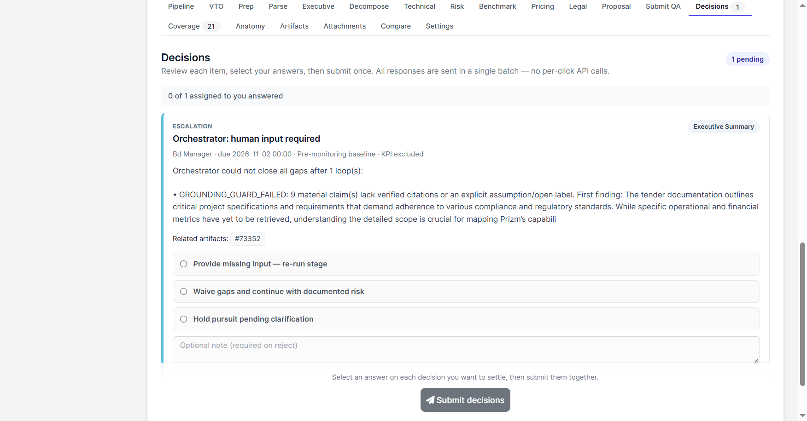

# Tender to Bid (T2B)

## 1. Introduction

**Tender to Bid (T2B)** is the programme that takes a tender from its documents to a
submitted bid inside the PRIZM ENERGY portal. The work happens in the **Virtual Tendering
Team** of an opportunity: a team of AI agents prepares each stage of the bid (executive
summary, decomposition, technical solution, risk, benchmarking, pricing, legal, proposal and
submission QA), and people approve the result at agreed control points.

This section grows with the programme. Each time a part of the T2B plan is finished, what it
changes for you is added here.

This guide is for:

- Tender and bid managers
- Business Development teams
- Engineers and estimators who review stage outputs
- Managers who approve bids

## 2. Programme progress

| Part | What it delivers | Status |
|---|---|---|
| **Step 0 — Control fixes** | Final human sign-offs can't be switched to Auto, and a hold is released only by a real approval in the current run. | ✅ Closed on 10 November 2026 |
| **PH0 — Diagnose & freeze** | Shows where bids actually wait and on whom, with a frozen specification. | ✅ Closed on 11 November 2026 |
| PH1 — Right approver, right wait | Each decision goes to the right person, with a clear waiting time. | In progress |
| **P00 — Automation** | The run starts on its own, every TenderOps setting is on one tab, and decisions alert people inside the ERP. | In progress — first parts live |
| P01–P06 | The bid stages themselves, from foundation to submission. | Planned |

## 3. Where to find it

Open an opportunity and select the **Virtual Tendering Team** tab.

- **Run Opportunity** starts a run: the virtual team works through the stages in order and
  pauses only when a person has to decide.
- **Intake & Documents**, **Scope Gate & ITP** and **Briefs** hold the set-up of the
  opportunity.
- Below them, one tab per stage shows its output, and **Decisions** lists what is waiting for
  you.

## 4. Step 0 — Control fixes (what changed for you)

Step 0 makes sure no bid moves past a person who must approve it. It was finished on
10 November 2026.

### 4.1 Control modes (the ITP control matrix)

Every stage has controls, listed in **Scope Gate & ITP → ITP control matrix**. Each control has
one of four modes:

| Mode | Meaning |
|---|---|
| **Auto** | The virtual team carries on without stopping. |
| **WP** (Witness point) | The virtual team carries on and notifies the owner. |
| **HP** (Hold point) | The run stops until a person approves. |
| **NR** | The control is skipped. |

The presets at the top (**All Hold**, **Conservative**, **Witness-heavy**, **Full Auto**) set many
controls at once. The counters on the right show how many controls are in each mode.

### 4.2 Final sign-offs always stay on Hold

Five controls are **final human sign-offs**. They stay on **HP** under every preset, including
**Full Auto**, and can't be changed one by one:

| Stage | Control |
|---|---|
| Executive Summary | Human acceptance |
| Benchmarking | Accept benchmarks |
| Pricing / RFQ | Margin and contingency gate |
| Proposal | Human acceptance |
| Submit QA | Human sign-off (statutory gate) |

Every change of a control's mode, and every refused attempt to move a final sign-off off Hold,
is recorded in the TenderOps audit trail.

### 4.3 A hold is released only by an approval in the same run

When a run reaches a Hold point, a decision appears in **Decisions**. Choose
**Release hold — continue** and select **Submit decisions**.

- The approval belongs to **that run only**. If the opportunity is run again later, the same
  hold stops the new run and asks again. An approval from an earlier run never releases a later
  one.
- Only an explicit **Release hold** counts. **Keep on hold** never releases anything.
- A stage can have several holds. Releasing one shows the next; they are not released together.

### 4.4 "Re-approval required after control fix"

Approvals given **before** Step 0 were not tied to a run, so they no longer release a hold. The
first time such a hold comes back, its title ends with **"Re-approval required after control
fix"** and its text names the earlier decision, for example *"decision #5 approved this hold
before the control fix"*.

Approve it again to continue. This happens once per control and opportunity; after that, holds
look normal.

### 4.5 Answering decisions

1. Open the **Decisions** tab. The counter shows how many decisions are waiting.
2. For each decision you want to settle, choose one answer and, if needed, add a note.
3. Select **Submit decisions** once. All your answers are sent together.

There are two kinds of decisions:

| Kind | When it appears | Answers |
|---|---|---|
| **Blocker** (a hold) | The run reached a Hold point. | Release hold — continue · Provide input and re-run this stage · Keep on hold |
| **Escalation** | The virtual team could not close all gaps itself, for example claims without a source. | Provide missing input — re-run stage · Waive gaps and continue with documented risk · Hold pursuit pending clarification |

**Who can answer:** the person the decision is assigned to, and any administrator.

## 5. PH0 — Where bids wait (what changed for you)

PH0 measured where bids wait and on whom, before any new feature is built. It was finished on
11 November 2026.

### 5.1 The "Where bids wait" screen

Open **Opportunities → Where bids wait** in the left menu. The screen is read-only and is shown
to administrators and to staff with the TenderOps *view audit* permission.

It lists every **wait** since the date you choose (the default is the last 180 days):

- a **decision** waiting for, or answered by, a person;
- a **run that failed** without raising a decision;
- a **stage review** that nobody has approved or rejected yet.

Each wait shows its **blocker class**, its **owner**, who answered it and how many days it
waited.

| Class | Meaning |
|---|---|
| **H** | A person has to act: a hold, AI output waiting for review, a stage review, or a missing sign-off. |
| **E** | Evidence: a red-flag blocker. |
| **W** | A worker or software fault. |
| **C** | A configuration or connection problem, for example with the AI provider. |

At the top, four cards summarise the period:

- **Waits**, and how many are still open.
- **Median wait**, in days.
- **Technical faults sent to a business owner:** W and C waits that waited on a person instead
  of IT. PH1 is about bringing this number down.
- **Answered by someone else:** decisions answered by someone other than their owner, usually
  an administrator.

Below the cards, two small tables group the waits **by class** and **by owner**, and the large
table lists every wait. Select an opportunity to open it.

A failed run stops at once, so its waiting time is unknown: it is listed, but left out of the
medians.

### 5.2 A dismissed tender can't be converted

A tender **dismissed** in triage can no longer be converted to an opportunity or marked as
converted. Reopen it in triage first. The dismissal and its reason stay on record.

### 5.3 The lowest quote is chosen among eligible quotes

In a quotation comparison, the **lowest** quote and the price score now come only from quotes
that can be selected. A cheaper quote that is expired or doesn't comply no longer lowers the
score of the compliant quotes, and the compliant leader can be selected automatically.

## 6. P00 — Automation (what changed for you)

P00 makes the bid move on its own and stop only where a person has to decide. Its first parts
were released on 11 and 12 November 2026.

### 6.1 The run starts on its own

When a tender is converted and pursued, the Opportunity Run starts by itself as soon as its
checks pass. You no longer need to press **Run Opportunity**. The final sign-offs still wait for
a person. If the run can't start within 24 hours, the problem goes to IT or to the opportunity
owner.

### 6.2 Decision alerts inside the ERP

When the virtual team needs a decision, you are told inside the ERP. You don't need Teams.

| Who | Where the alert appears |
|---|---|
| The opportunity's **responsible person** (its owner, if the responsible person is inactive) | The **Opportunities** bell (megaphone icon) in the top bar |
| The decision's **named authority**, the person who may answer it | The **Opportunities** bell |
| **Administrators** | The **Tender Alerts** bell (gavel icon), marked *TenderOps · decision requested* |

The alert reads, for example, *"Decision needed — OPP-262863 · Opportunity name: Source lane:
switch to Storage Box? Due 19 Nov 2026 00:00."* It comes from **Prizm automation**.

1. Select the alert. It opens the opportunity's **Decisions** tab with the decision waiting.
2. Answer it as described in 4.5 and select **Submit decisions**.
3. The alert is marked read for everyone who received it, so the bell shows only what is still
   waiting.

If the responsible person is also the named authority, they get one alert, not two. The
responsible person is told even when only the authority or an administrator may answer, so the
person running the bid knows it is waiting.

### 6.3 TenderOps settings (administrators)

Administrators, and staff with the TenderOps *manage settings* permission, find every TenderOps
setting in **Opportunities → Settings → TenderOps**. The settings are in seven sections:
automation, approvals and gates, pricing and suppliers, AI review, integrations, people, and
display.

- **Decision alerts inside the ERP**, in the Automation section, switches the alerts in 6.2 on or
  off. It is on by default.
- Sending events to n8n, for example Teams cards, is optional and is set in the same section.

### 6.4 One tender, one opportunity

A tender can be converted from the tender screen, through the API or from the eSupply extension.
If two of them convert the same tender at the same moment, for example two people, or a double
click, you still get **one** opportunity:

- The first conversion runs. The second one waits for it.
- The second one then shows *"Tender already exists in opportunities"*. Open the tender to reach
  the opportunity.
- If the first conversion takes longer than 30 seconds, the second one stops without creating
  anything and shows *"This tender is being converted by another request. Wait a moment and try
  again."* Try again after a moment.

### 6.5 The conversion receipt

After a tender is converted, several steps finish the work around the new opportunity. Each
conversion now leaves a **Conversion receipt** that shows whether they all finished. Open the
converted tender: the receipt is on its **Main** tab.

The receipt shows:

- who converted the tender, when, and how: *Converted on the Tenders screen*, *Converted through
  the Tenders API* or *Converted from the eSupply extension*;
- a mark for each step: ✓ done, ⚠ needs a look, ✗ failed;
- the conversion's **Warnings**, for example when the SharePoint record folder could not be
  prepared.

| Step | What it does |
|---|---|
| SharePoint access for the opportunity team | Gives the opportunity team access to the bid folder. |
| Bid decision recorded on the opportunity | Records that converting the tender was the decision to bid. |
| Triage record marked converted | Moves the tender to *Converted* in tender triage. |
| eSupply details capture | Collects the full tender details from eSupply (eSupply tenders only). |
| TenderOps conversion event and preparation | Prepares the opportunity for the virtual tendering team. |

At the top, the receipt says **every step finished** or **needs attention**. A receipt that needs
attention also raises one **Tender Alert** (gavel icon) titled *"Conversion of tender … to …
needs attention"*. Select it to open the tender.

If a step did not finish, tell an administrator. They can run the steps again; this never
creates a second opportunity. The receipt then shows the new result and how many times the steps
were run again.

Tenders converted before 13 November 2026 have no receipt.

### 6.6 Tenders the ERP marks as converted for you

Every hour the ERP checks the tenders you marked **Pursue** in triage. When it finds the
opportunity a tender became, it moves the tender to **Converted** by itself. Since 13 November
2026 it does this only when it is sure:

- it uses only opportunities that are not deleted;
- it never takes an opportunity that already belongs to another tender;
- **exactly one** opportunity must match the tender's number.

When more than one opportunity matches, the tender stays in **Pursue** and you get one **Tender
Alert**: *"Tender … matches more than one opportunity"*, with the candidate opportunities.
Open them, decide which one is the tender's bid, and link it by hand. The alert is not repeated
for the same tender.

Every tender the ERP marks as converted is written to the activity log.

### 6.7 Who works tender triage, and the rules for each action

Since 14 November 2026 tender triage is no longer for administrators only. An administrator gives
access in **Setup → Staff → Roles** (or on the staff member), under **Tenders - Tender Triage**:

| Permission | What you can do |
|---|---|
| **View** | Open **Tenders → Triage** and read the queue and each tender's details. You see no action buttons. |
| **Edit** | Everything in View, plus **Pursue**, **Watch**, **To inbox**, **Dismiss**, **Reopen**, **Link opportunity**, **Not converted** and **Undo**. |

Administrators can always do everything. Staff without either permission don't see **Triage** in
the menu. Muting an authority or a sub-division stays with administrators, because it hides every
future tender from it.

The same rules apply on the triage screen and in the mobile app. Each action is offered only from
the right status:

| Action | Available when the tender is in |
|---|---|
| Pursue | Inbox, Watch |
| Watch | Inbox |
| To inbox | Watch |
| Dismiss | Inbox, Watch, Pursue |
| Reopen | Dismissed |
| Link opportunity (mark converted) | Pursue |
| Not converted | Converted |

- **Link opportunity** needs a live (not deleted) opportunity of this tender that no other tender
  is linked to.
- **Not converted** is refused when the tender was really converted into that opportunity. It
  still removes a wrong link made by hand or by the hourly check.
- **Undo** reverses only the last decision, and only the person who made it or an administrator
  can undo it.
- If someone else changed the same tender a moment before you, you see *"This item was changed
  elsewhere in the meantime. Refresh the page and try again."* Nothing was changed; refresh and
  look again.

Every decision, and every refused attempt, is written to the activity log.

## 7. Frequently asked questions

**I can open Tender Triage but there are no action buttons.**
You have the **View** permission only. Ask an administrator for **Edit** under *Tenders - Tender
Triage*.

**Why can't I undo a decision?**
Only the person who made the last decision, or an administrator, can undo it.

**I approved this hold yesterday. Why is it asking again?**
Either the opportunity was run again (each run needs its own approval), or your approval was
given before Step 0 (the hold then says "Re-approval required after control fix").

**Can I set the final sign-offs to Auto to save time?**
No. The five final sign-offs stay on Hold under every preset. This is intentional.

**What happens if I choose "Keep on hold"?**
The run stays paused. Nothing moves until someone releases the hold.

**I can't see "Where bids wait" in the menu.**
It is shown to administrators and to staff with the TenderOps *view audit* permission. Ask an
administrator for access.

**I received a decision alert but can't answer the decision.**
Only the decision's named authority and administrators can answer. As the responsible person,
you are told so you know the bid is waiting. Follow up with the authority named on the decision.

**The decision is answered. Why don't I see the alert any more?**
Once a decision is answered, its alerts are marked read automatically. The answer stays on the
**Decisions** tab.

**I pressed Convert and got "This tender is being converted by another request".**
Someone else, or the API, is converting the same tender right now. Wait a moment and try again;
you will reach the same opportunity.

**The receipt says "needs attention". What do I do?**
Look at the step marked ⚠ or ✗ and at the warnings. If a step did not finish, tell an
administrator; they can run the steps again without creating a second opportunity.

**Why didn't my pursued tender move to Converted by itself?**
Either no opportunity carries its number yet, or more than one does. In the second case you have a
Tender Alert listing them; link the right one by hand.

**Why does a failed run show "unknown" days?**
A failed run stops at once, and nothing records when the bid moved again, so its waiting time
can't be measured. It is counted, but left out of the medians.
