# هيكل تجزئة العمل (WBS)

## 1. المقدمة

يُعد هيكل تجزئة العمل (Work Breakdown Structure - WBS) محرك التخطيط والتحكم في وحدة **مشاريع Prizm**. فهو يتيح لفِرَق المشاريع تقسيم المشروع إلى هيكل هرمي من المخرجات وحزم العمل والأنشطة، ثم قياس التقدم والتكلفة والجدول الزمني والتوريد مقابل هذا الهيكل من شاشة واحدة.

وإلى جانب قوائم المهام البسيطة، تجمع وحدة WBS بين إدارة القيمة المكتسبة، وبناء الأسعار المركّبة، ومطابقة جدول الكميات (BOQ)، وتخطيط التوريد، واعتماد الدفعات، وخطوط الأساس، والاستيراد والتصدير من Primavera P6 — مما يمنح فِرَق الأعمال والتخطيط والتنفيذ مصدراً موحّداً للحقيقة حول تقدّم المشروع.

يشرح هذا الدليل كل شاشة ونافذة في وحدة WBS، مُجمّعة حسب الغرض.

تتكامل هذه الوحدة مع:

- المشاريع والفرص
- الميزانية وهيكل تجزئة التكلفة (CBS)
- مدير الموارد
- التوريد
- Primavera P6

## 2. نظرة عامة على الوحدة

توفر وحدة WBS أدوات شاملة لـ:

- بناء تجزئة هرمية لأعمال المشروع (عناصر، حزم عمل، أنشطة)
- قياس التقدم الفعلي بعدة طرق (نسبة يدوية، قاعدة الاستحقاق، ثنائي، الكمية، النشاط الموزون)
- تشغيل تحليل إدارة القيمة المكتسبة (EVM) ومنحنيات S
- فحص صحة الجدول الزمني وفق معيار DCMA المكوّن من 14 نقطة
- تخطيط التوريد بتنبيهات المهل الطويلة وحزم التوريد
- اعتماد التقدم عبر الفترات وطلبات الدفع
- تجميد خطوط الأساس وإعادة استخدام الهياكل عبر القوالب
- الاستيراد من Primavera P6 والتصدير إليه

## 3. الوصول إلى WBS

### كيفية الوصول

1. سجّل الدخول إلى بوابة إدارة PRIZM ENERGY
2. من الشريط الجانبي، افتح **Prizm Projects** (مشاريع Prizm)
3. افتح مشروعاً واختر علامة تبويب **WBS** الخاصة به
4. تُفتح شاشة بناء WBS، وتعرض حقول إعداد المشروع وشريط أدوات المزايا وشبكة WBS

---

## 4. بنّاء WBS — الصفحة الرئيسية

### 4.1 نظرة عامة على البنّاء

بنّاء WBS هو الشاشة الرئيسية للوحدة بالكامل. في الأعلى تُعدّ الهيكل — **اسم WBS**، و**نوع العلاقة** (مثل الفرصة)، و**الفرصة** المرتبطة، و**جذر نظام الترميز**، و**تاريخ البيانات**، و**وضع الجدولة**. أسفل ذلك يوجد شريط أدوات المزايا (الاستيراد/التصدير، إضافة/إزاحة الصفوف، نوافذ التقارير والتوريد، والمزيد)، يليه **شبكة WBS** حيث يُبنى هيكل العمل فعلياً.

كل صف في الشبكة هو إما عنصر WBS أو نشاط. الأعمدة مُجمّعة حسب الغرض كما هو موضّح أدناه.

### 4.2 أعمدة الشبكة — الهوية

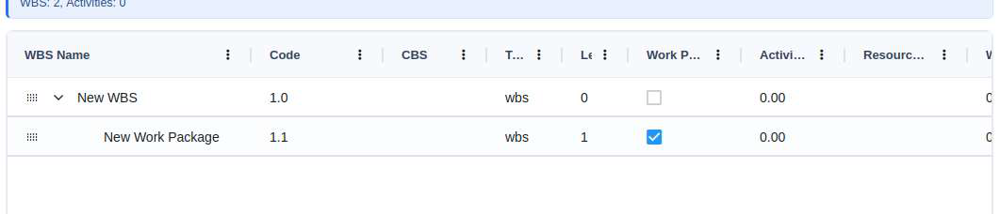

تُعرّف هذه الأعمدة كل صف: **اسم WBS**، و**الرمز** (مثل 1.0، 1.1)، ورابط رمز التكلفة **CBS**، و**نوع** العنصر، و**المستوى** الهرمي، وعلامة **حزمة العمل**، وأعداد **الأنشطة** و**الموارد** المُجمّعة.

### 4.3 أعمدة الشبكة — قياس التقدم

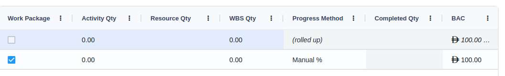

تتحكم هذه الأعمدة في كيفية قياس التقدم: **كميات النشاط / المورد / WBS**، و**طريقة التقدم** المختارة (نسبة يدوية، قاعدة الاستحقاق، ثنائي، الكمية، أو النشاط الموزون)، و**الكمية المكتملة**، و**الميزانية عند الإنجاز (BAC)**.

### 4.4 أعمدة الشبكة — القيمة المكتسبة

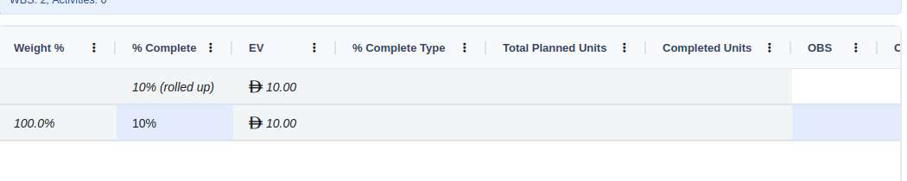

تغطي مجموعة القيمة المكتسبة **نسبة الوزن %**، و**نسبة الإنجاز %**، و**القيمة المكتسبة (EV)**، إلى جانب **نوع نسبة الإنجاز**، و**إجمالي الوحدات المخططة**، و**الوحدات المكتملة**، وملكية **OBS** (هيكل التجزئة التنظيمي).

### 4.5 أعمدة الشبكة — الملكية والتوريد

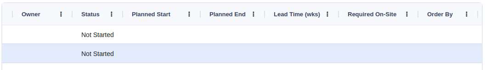

تلتقط هذه الأعمدة **المالك**، و**الحالة**، وتواريخ **البدء/الانتهاء المخططة**، وحقول تخطيط التوريد — **مهلة التوريد** (أسابيع)، وتاريخ **المطلوب في الموقع**، وتاريخ **الطلب بحلول** المحسوب.

### 4.6 أعمدة الشبكة — تفاصيل الجدولة

تُظهر مجموعة الجدولة ما إذا كان العنصر قد **طُلب**، و**مورد P6** المرتبط به، وعلامتي **الفائض الزمني** و**المسار الحرج**، و**نوع النشاط**، و**الأولوية**، وتواريخ **البدء/الانتهاء المتوقعة**.

### 4.7 أعمدة الشبكة — الفعليات والمعالم

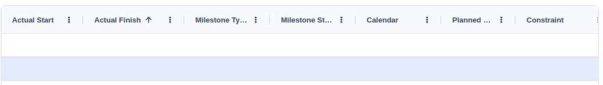

تسجّل هذه الأعمدة تواريخ **البدء/الانتهاء الفعلية**، و**نوع المعلم** و**حالته**، و**التقويم** المُعيّن، وإعدادات **القيود** التي توجّه منطق الجدولة.

### 4.8 أعمدة الشبكة — الملاحظات والوصف

تحمل الأعمدة المرجعية المتبقية **التقويم**، والتواريخ **المخططة**، وتفاصيل **القيود**، و**الملاحظات** الحرة، و**وصف** كل عنصر.

---

## 5. التقدم والتكلفة

### 5.1 قاعدة الاستحقاق (Rule of Credit)

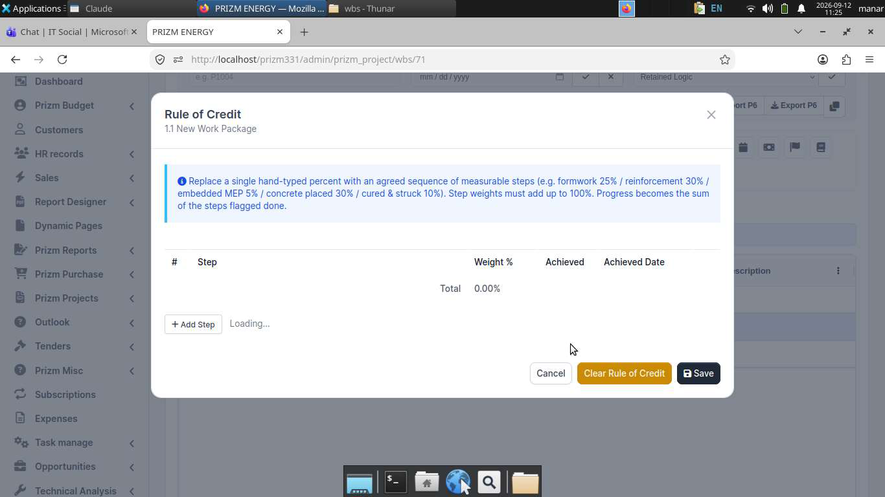

تستبدل قاعدة الاستحقاق نسبةً مئوية واحدة مُدخلة يدوياً بتسلسل متفق عليه من الخطوات القابلة للقياس — مثل الشدّة 25%، والتسليح 30%، وصبّ الخرسانة 30%، والمعالجة 10%. يجب أن يبلغ مجموع أوزان الخطوات 100%، ويصبح التقدم مجموع الخطوات المُعلَّمة كمُنجَزة. هذا يجعل التقدم موضوعياً وقابلاً للتدقيق بدلاً من كونه تقديراً شخصياً.

### 5.2 اقتراح طريقة التقدم (بالذكاء الاصطناعي)

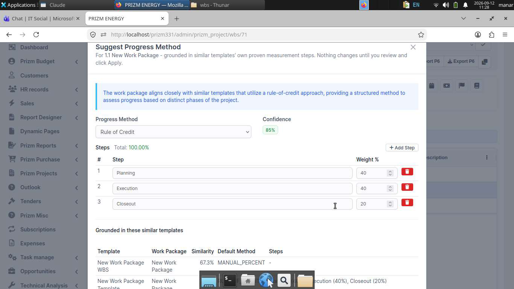

يوصي هذا المساعد الذكي بأنسب طريقة لقياس التقدم لحزمة عمل من خلال مقارنتها بقوالب تاريخية مماثلة. يعرض درجة الثقة والخطوات المقترحة مسبقاً، لتتمكن من مراجعة التوصية قبل تطبيق أي شيء.

### 5.3 بناء السعر (Rate Build-up)

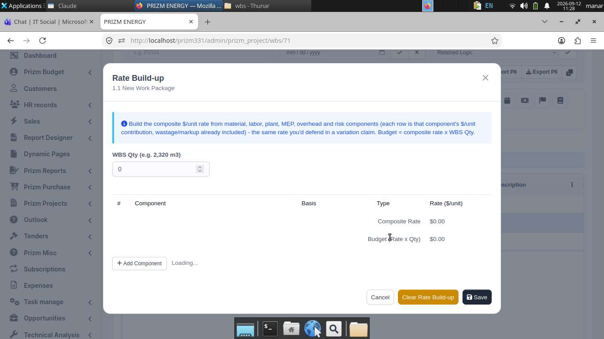

يجمّع بناء السعر سعر وحدة مركّباً من مكوّنات تكلفته — المواد والعمالة والمعدات والمصاريف العامة والمخاطر. تُحسب الميزانية تلقائياً بعد ذلك بضرب السعر المركّب في كمية WBS، مُنتِجاً سعراً يمكن الدفاع عنه في مطالبة تغيير.

### 5.4 مطابقة جدول الكميات (BOQ Mapping)

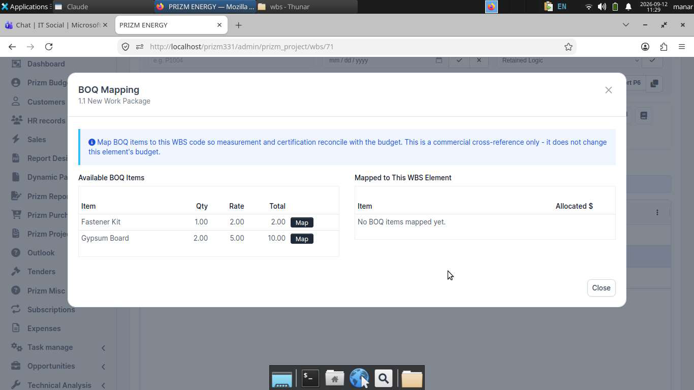

تربط مطابقة BOQ بنود جدول الكميات برمز WBS بحيث يمكن التوفيق بين القياس والاعتماد مقابل الميزانية. هذه مجرد إشارة مرجعية تجارية — ربط بند لا يغيّر ميزانية العنصر نفسه.

### 5.5 مطابقة القوالب (Match Templates)

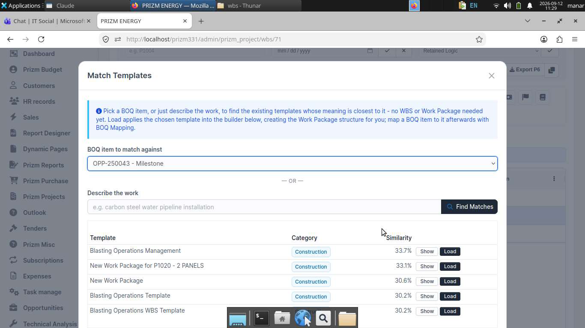

تساعدك مطابقة القوالب في العثور على قالب WBS موجود يناسب عملاً جديداً — إما باختيار بند BOQ للمطابقة معه، أو بوصف العمل بنص حر. تُرتَّب القوالب المرشّحة حسب التشابه ويمكن تحميلها مباشرة في البنّاء.

---

## 6. التقارير والتحليل

### 6.1 تقرير القيمة المكتسبة

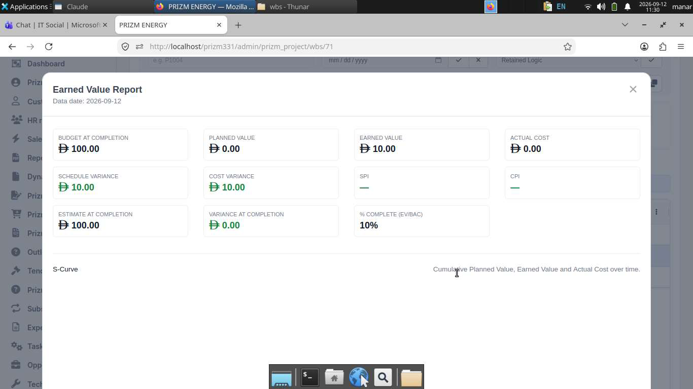

لوحة معلومات كاملة لإدارة القيمة المكتسبة (EVM). تعرض **الميزانية عند الإنجاز**، و**القيمة المخططة**، و**القيمة المكتسبة**، و**التكلفة الفعلية**، و**انحرافي الجدول والتكلفة**، ومؤشري الأداء **SPI/CPI**، و**التقدير عند الإنجاز**، و**نسبة الإنجاز** الإجمالية — إضافةً إلى منطقة مخطط منحنى S للتتبع البصري.

### 6.2 تقرير القيمة المكتسبة — سجل حزم العمل

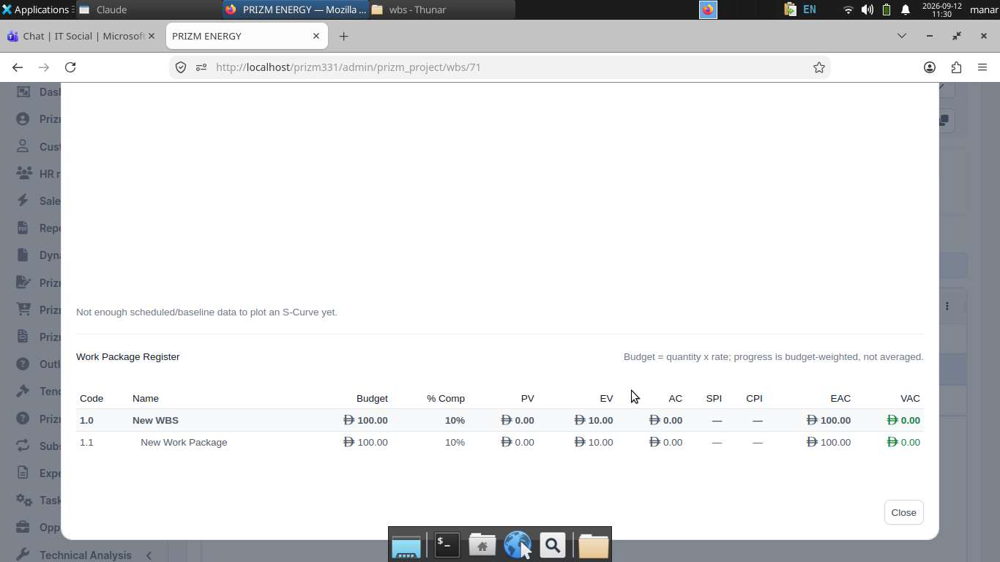

يقدّم النصف السفلي من تقرير القيمة المكتسبة تفصيلاً لكل حزمة عمل: **الميزانية**، و**نسبة الإنجاز**، و**PV**، و**EV**، و**AC**، و**SPI**، و**CPI**، و**EAC** (التقدير عند الإنجاز)، و**VAC** (الانحراف عند الإنجاز).

### 6.3 مخطط جانت للأنشطة (كامل WBS المُحمّل)

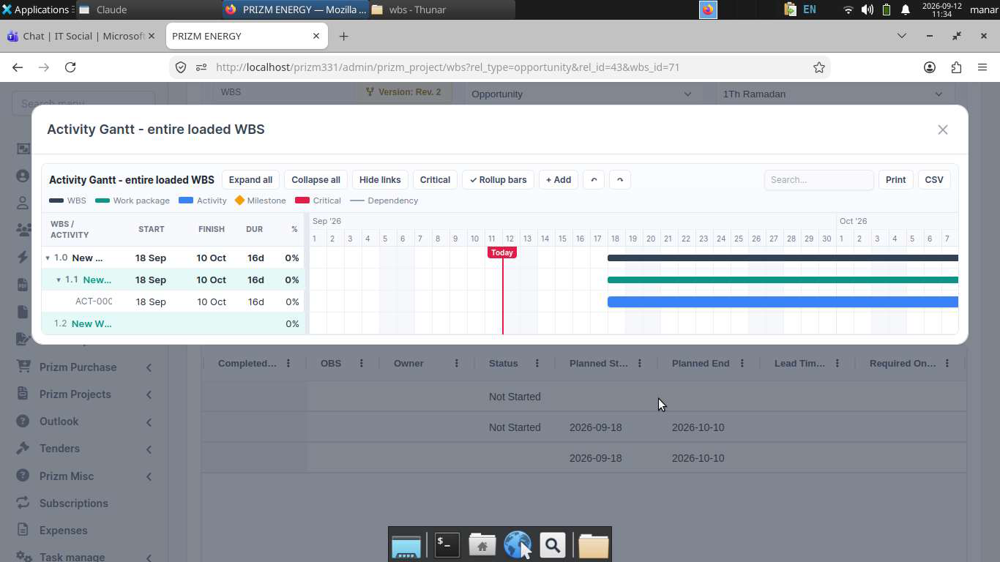

مخطط جانت لكامل هيكل WBS وأنشطته. يتضمن علامة **"اليوم"**، و**توسيع/طي الكل**، وتمييز **المسار الحرج**، وأشرطة التجميع — مفيد لفحص بصري سريع للجدول الزمني.

### 6.4 فحص صحة الجدول DCMA المكوّن من 14 نقطة

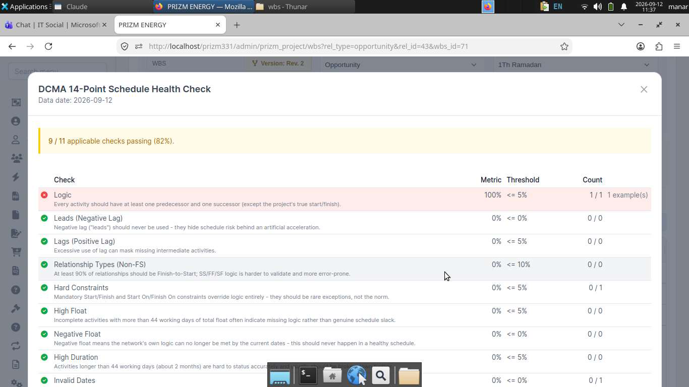

يشغّل قائمة DCMA المعيارية المكوّنة من 14 نقطة على الجدول الزمني — المنطق، والمهل المتقدمة/المتأخرة، والقيود، والفائض الزمني، والمدة، والتواريخ، والمزيد. لكل فحص يُبلّغ عن **المقياس** و**العتبة** و**عدد البنود الفاشلة**، إضافةً إلى عدد الفحوص الناجحة إجمالاً.

### 6.5 استغلال الموارد

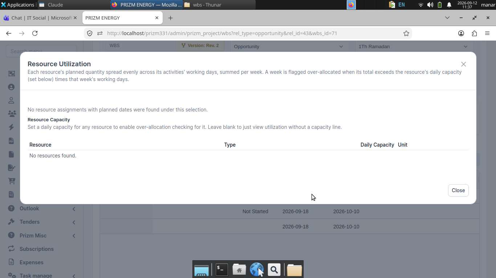

يوزّع الكمية المخططة لكل مورد بالتساوي على أيام العمل الخاصة بأنشطته ويجمعها أسبوعياً. يُعلَّم أي أسبوع يتجاوز فيه الإجمالي الطاقة اليومية المحددة للمورد على أنه **تخصيص زائد**.

### 6.6 العرض المسطّح

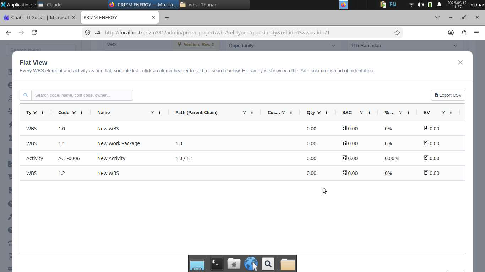

يعرض كل عنصر WBS ونشاط كقائمة مسطّحة واحدة قابلة للترتيب بدلاً من شجرة متداخلة. يُحفَظ التسلسل الهرمي عبر عمود **"المسار (سلسلة الأصل)"**، ويمكن النقر على أي رأس عمود للترتيب أو التصفية.

### 6.7 سجل حزم العمل

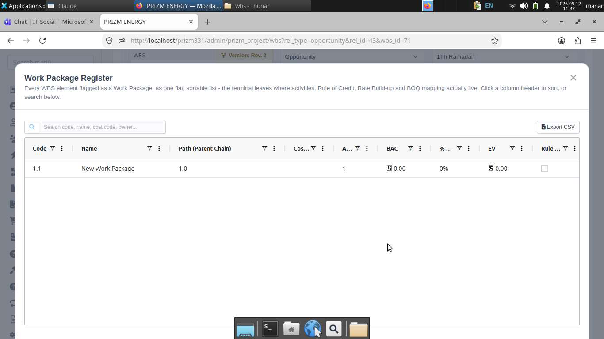

نفس العرض المسطّح، لكن مُصفّى ليقتصر على العناصر المُعلَّمة كـ **حزم عمل** — الأوراق الطرفية حيث توجد فعلياً الأنشطة وقاعدة الاستحقاق وبناء السعر ومطابقة BOQ.

### 6.8 قاموس WBS

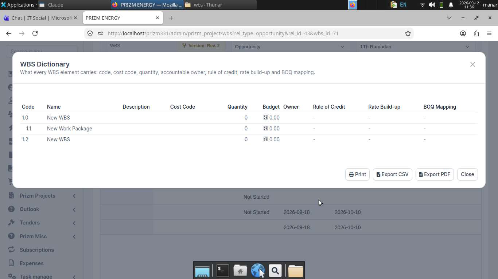

جدول مرجعي يصف ما يحمله كل عنصر WBS — الرمز، والوصف، ورمز التكلفة، والكمية، والميزانية، والمالك، وما إذا كانت قاعدة الاستحقاق أو بناء السعر أو مطابقة BOQ قد هُيّئت. يمكن طباعته أو تصديره إلى CSV/PDF.

---

## 7. التوريد

### 7.1 تنبيهات المهل الطويلة

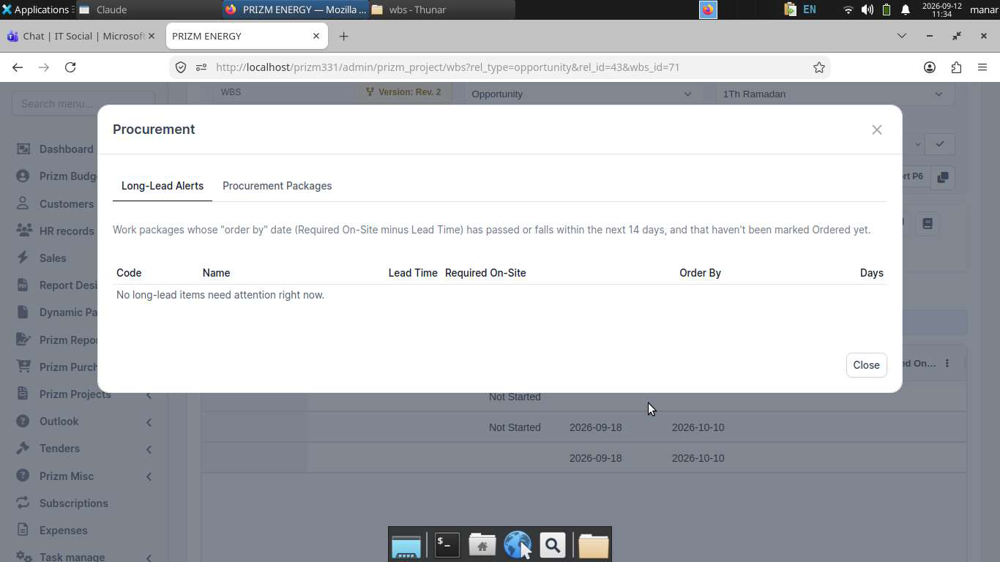

يُعلّم حزم العمل التي مرّ تاريخ **"الطلب بحلول"** الخاص بها (المطلوب في الموقع ناقص مهلة التوريد)، أو يقع خلال الأيام الـ14 القادمة، ولم يُعلَّم بعد كمطلوب. يعمل كإنذار مبكر للمواد التي يستغرق وصولها وقتاً طويلاً.

### 7.2 حزمة توريد — حزمة جديدة

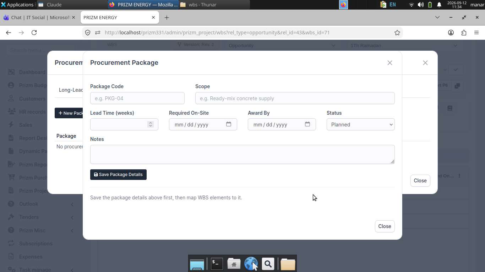

نموذج لإنشاء حزمة توريد جديدة: **رمز الحزمة**، و**نطاق التوريد**، و**مهلة التوريد** (أسابيع)، وتاريخ **المطلوب في الموقع**، وتاريخ **الترسية بحلول**، و**الحالة**، و**الملاحظات** الحرة.

### 7.3 التوريد — قائمة الحزم

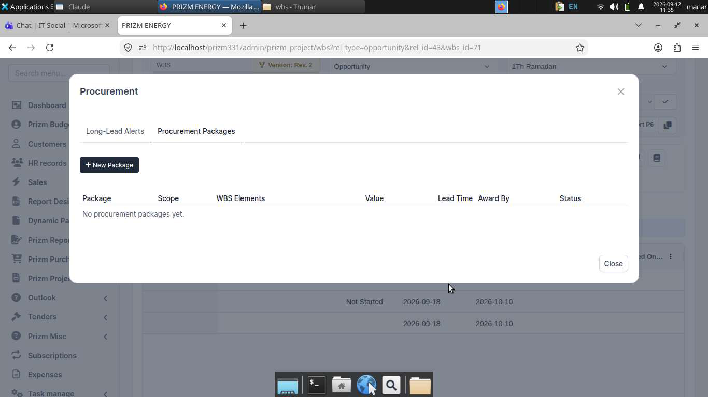

تعرض علامة تبويب حزم التوريد كل حزمة أُنشئت للمشروع، مع نطاقها، وعناصر WBS المرتبطة بها، وقيمتها، ومهلة توريدها، وتاريخ ترسيتها، وحالتها.

---

## 8. فترات التقدم وطلبات الدفع

### 8.1 فترات التقدم

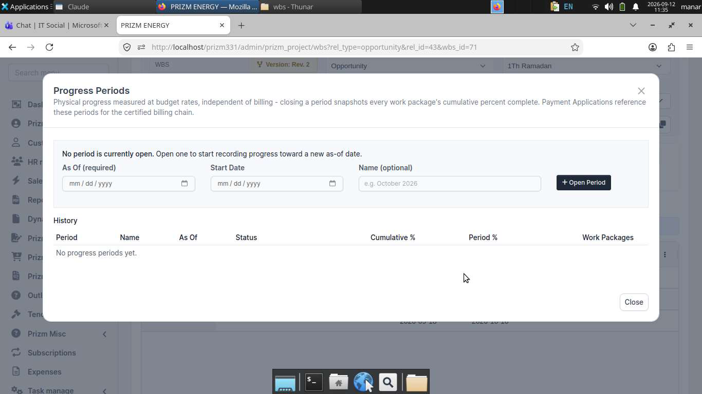

يُقاس التقدم الفعلي بأسعار الميزانية، بشكل مستقل عن الفوترة. يؤدي إغلاق فترة إلى التقاط لقطة لنسبة الإنجاز التراكمية لكل حزمة عمل حتى تاريخ مختار. تشير طلبات الدفع لاحقاً إلى هذه الفترات لبناء سلسلة الفوترة المعتمدة.

### 8.2 طلبات الدفع — السجل

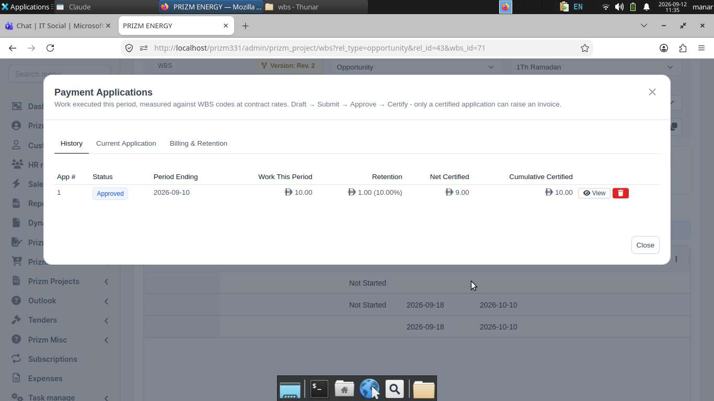

يسرد كل طلب دفع صادر مقابل WBS، مع حالته، وتاريخ نهاية الفترة، والعمل المُنفَّذ، والمحتجز المستبقى، والمبلغ الصافي المعتمد، والإجمالي التراكمي المعتمد.

### 8.3 طلبات الدفع — الطلب الحالي

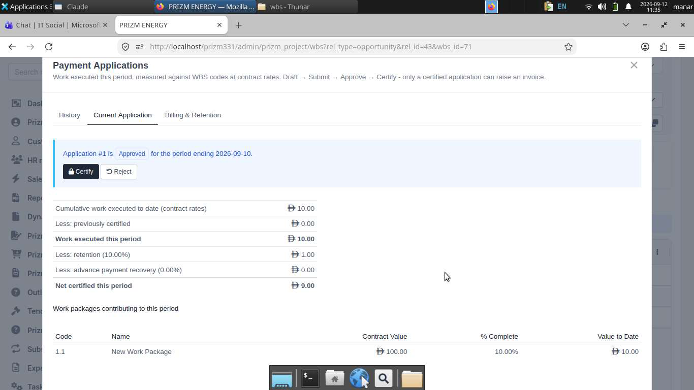

يُظهر سير عمل الطلب النشط — **مسودة ← تقديم ← اعتماد ← تصديق** — مع إجراءات التصديق/الرفض وتفصيل كامل: العمل المُنفَّذ التراكمي، والمعتمد سابقاً، والمحتجز المستبقى، والمبلغ الصافي المعتمد لهذه الفترة.

### 8.4 طلبات الدفع — الفوترة والمحتجز

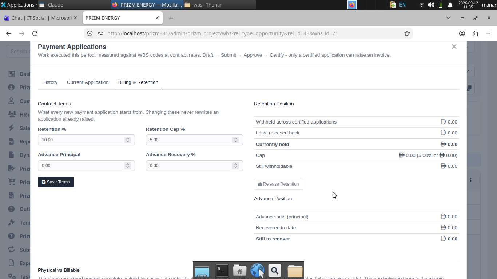

يحمل شروط الفوترة على مستوى العقد — **نسبة المحتجز %**، و**سقف المحتجز %**، و**أصل الدفعة المقدمة**، و**نسبة الاسترداد %** — التي يبدأ منها كل طلب دفع جديد، إلى جانب رصيدي **وضع المحتجز** و**وضع الدفعة المقدمة** الحاليين.

---

## 9. خطوط الأساس والتقويمات والقوالب

### 9.1 خطوط أساس WBS

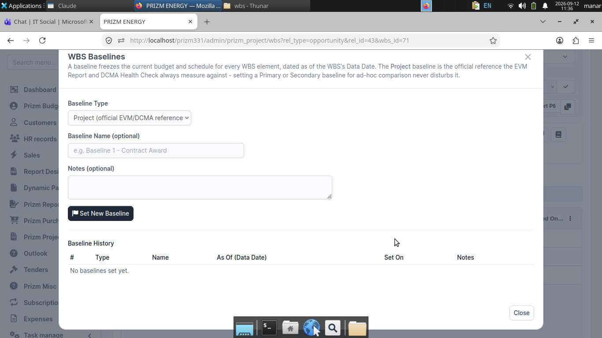

يُجمّد خط الأساس الميزانية والجدول الحاليين لكل عنصر WBS حتى تاريخ البيانات. خط الأساس **"المشروع"** هو المرجع الرسمي الذي تقارن به دائماً تقارير EVM وفحص صحة DCMA؛ ويمكن ضبط خطوط أساس إضافية للمقارنة المؤقتة دون المساس به.

### 9.2 التقويمات

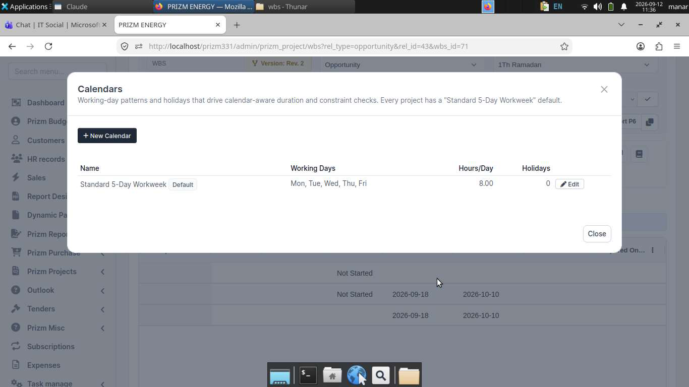

تدير أنماط أيام العمل والعطلات التي توجّه فحوص المدة والقيود المدركة للتقويم. يبدأ كل مشروع بتقويم افتراضي **"أسبوع عمل قياسي من 5 أيام"** (الاثنين–الجمعة، 8 ساعات/يوم)، ويمكن إضافة المزيد.

### 9.3 الحفظ كقالب

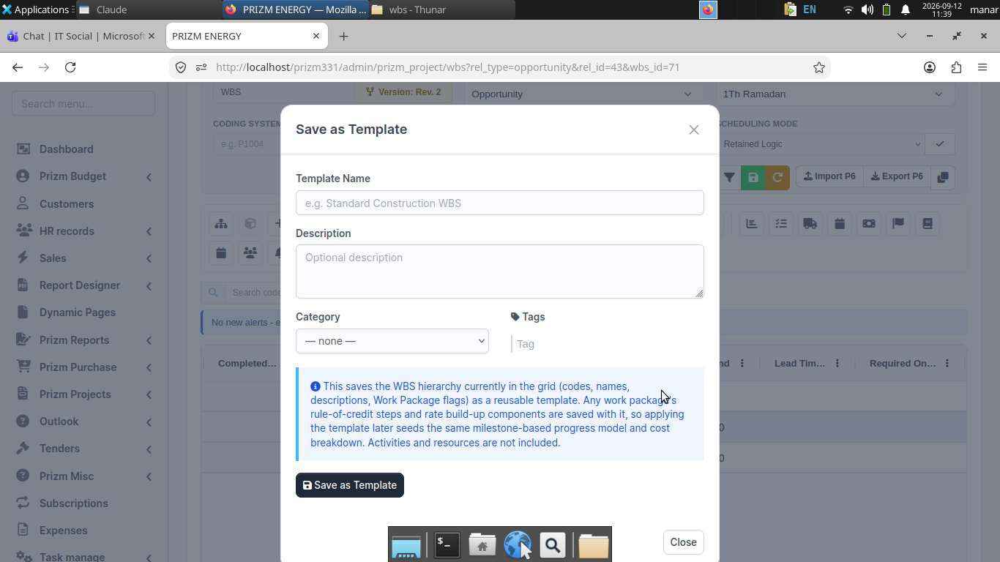

يحفظ هيكل WBS الموجود حالياً في الشبكة — الرموز والأسماء والأوصاف وعلامات حزم العمل وخطوات قاعدة الاستحقاق ومكوّنات بناء السعر — كقالب قابل لإعادة الاستخدام في المشاريع المستقبلية. الأنشطة والموارد غير مُضمّنة.

### 9.4 مكتبة قوالب WBS

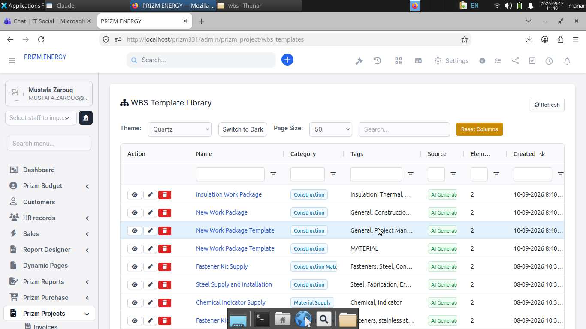

مكتبة لجميع قوالب WBS المحفوظة، تسرد اسم كل قالب وفئته وتاريخ إنشائه، مع إجراءات سريعة للعرض أو التعديل أو الحذف.

### 9.5 عرض القالب

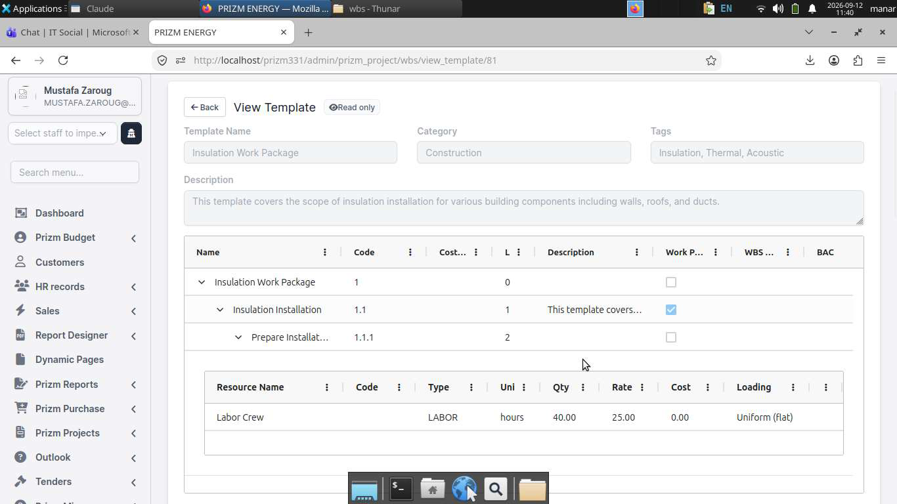

معاينة للقراءة فقط لهيكل قالب محفوظ — تسلسله الهرمي من حزم العمل والأنشطة، إضافةً إلى أي موارد مُهيّأة مسبقاً (مثل طاقم عمالة بنوعه وكميته وسعره وتكلفته).

### 9.6 طابور توليد القوالب بالذكاء الاصطناعي

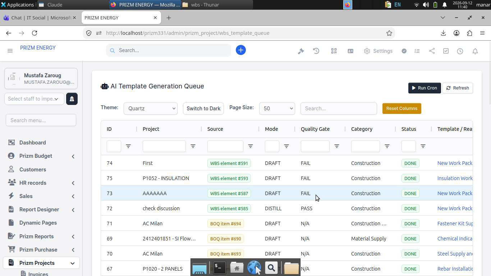

يتتبع المهام الخلفية التي يولّد فيها الذكاء الاصطناعي قالب WBS جديداً من عنصر مصدر (عنصر WBS أو بند BOQ). يعرض المصدر، والوضع، ونتيجة بوابة الجودة (نجاح/فشل)، وروابط للقالب الناتج.

---

## 10. الاستيراد والتصدير

### 10.1 استيراد WBS من Primavera P6

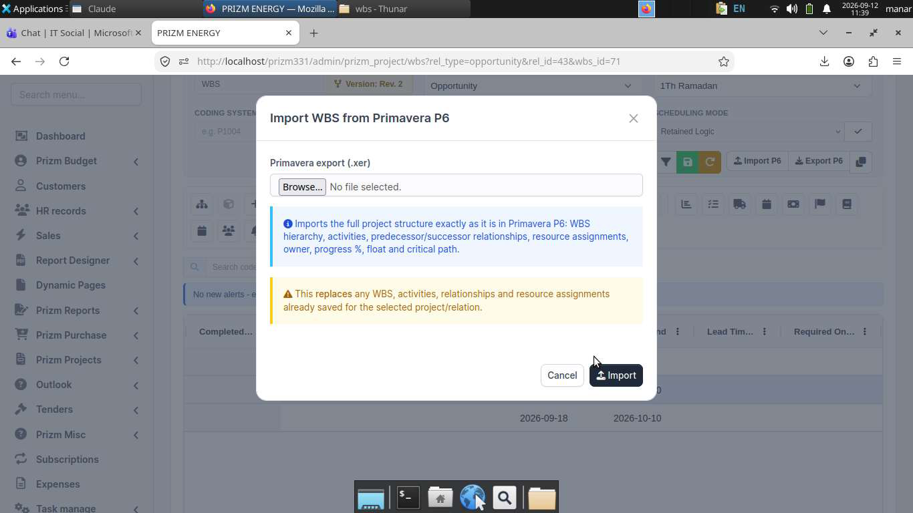

يستورد هيكل مشروع كاملاً من ملف تصدير Primavera P6 بصيغة `.xer` — هيكل WBS، والأنشطة، وعلاقات السابق/اللاحق، وتعيينات الموارد، والمُلّاك، ونسبة التقدم، والفائض الزمني، والمسار الحرج.

!!! warning "يستبدل البيانات الموجودة"
    يستبدل الاستيراد من P6 أي WBS وأنشطة محفوظة بالفعل للمشروع. استخدمه على هيكل جديد، أو تأكد من وضع خط أساس للعمل الموجود أولاً.

### 10.2 استيراد الأنشطة (بالذكاء الاصطناعي) — الرفع

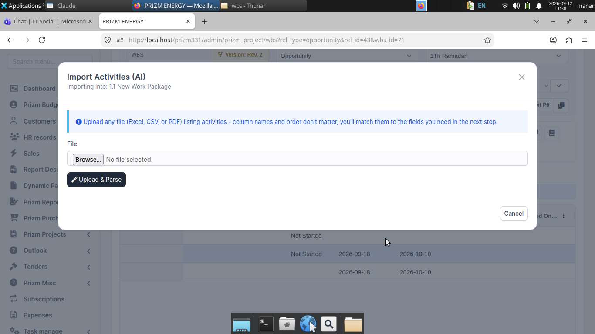

يتيح لك رفع أي ملف (Excel أو CSV أو PDF) يسرد الأنشطة لاستيرادها إلى حزمة عمل. أسماء الأعمدة وترتيبها لا يهمّان — تُطابَق بالحقول الصحيحة في الخطوة التالية.

### 10.3 استيراد الأنشطة (بالذكاء الاصطناعي) — مطابقة الأعمدة

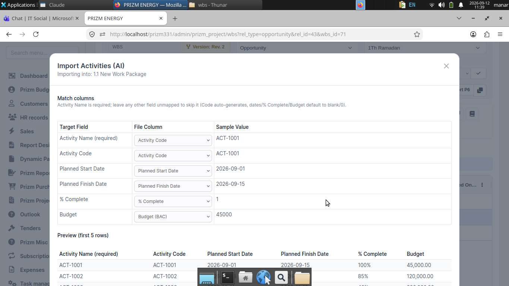

بعد الرفع، يقترح الذكاء الاصطناعي مطابقة بين كل عمود مرفوع والحقول المستهدفة (**اسم النشاط**، و**الرمز**، و**البدء/الانتهاء المخطط**، و**نسبة الإنجاز**، و**الميزانية**)، مع معاينة حية لأول خمسة صفوف قبل التأكيد.

---

## 11. سجل النشاط

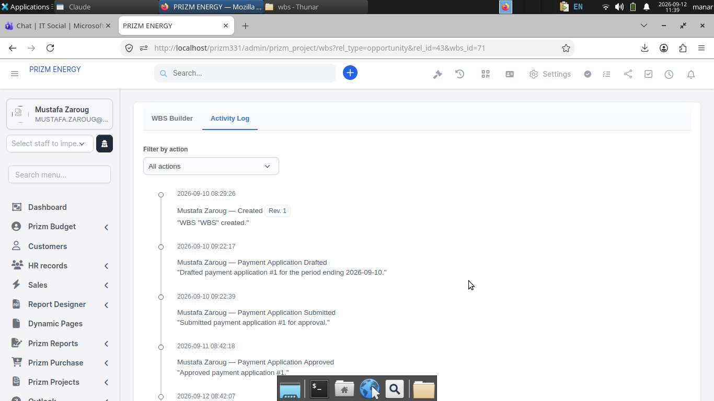

مسار تدقيق كامل لكل ما حدث على WBS — الإنشاء، والمراجعات، ومسودات طلبات الدفع وتقديمها واعتمادها، وغيرها. كل إدخال مُوقّت ومنسوب إلى الموظف الذي نفّذه، ويمكن تصفية السجل حسب نوع الإجراء.
