# WBS (Work Breakdown Structure)

## 1. Introduction

The Work Breakdown Structure (WBS) is the planning and control engine of the **Prizm Projects** module. It lets project teams break a project down into a structured hierarchy of deliverables, work packages, and activities — then measure progress, cost, schedule, and procurement against that structure from a single screen.

Beyond simple task lists, the WBS module brings together earned-value management, rate build-ups, Bill of Quantities (BOQ) reconciliation, procurement planning, payment certification, baselines, and Primavera P6 import/export — giving commercial, planning, and delivery teams one shared source of truth for how a project is progressing.

This guide walks through every WBS screen and dialog, grouped by purpose.

This module is integrated with:

- Projects & Opportunities
- Budget & CBS (Cost Breakdown Structure)
- Resource Manager
- Procurement
- Primavera P6

## 2. Module Overview

The WBS module provides comprehensive tools for:

- Building a hierarchical breakdown of project work (elements, work packages, activities)
- Measuring physical progress using several methods (Manual %, Rule of Credit, Binary, Quantity, Weighted Activity)
- Running Earned Value Management (EVM) analysis and S-curves
- Checking schedule health against the DCMA 14-point standard
- Planning procurement with long-lead alerts and packages
- Certifying progress through periods and payment applications
- Freezing baselines and reusing structures through templates
- Importing from and exporting to Primavera P6

## 3. Navigation to WBS

### How to Access

1. Log in to the PRIZM ENERGY Admin Portal
2. From the sidebar, open **Prizm Projects**
3. Open a project and select its **WBS** tab (or navigate directly to the project's WBS builder)
4. The WBS Builder opens, showing the project setup fields, the feature toolbar, and the WBS grid

---

## 4. WBS Builder — Main Page

### 4.1 Builder Overview

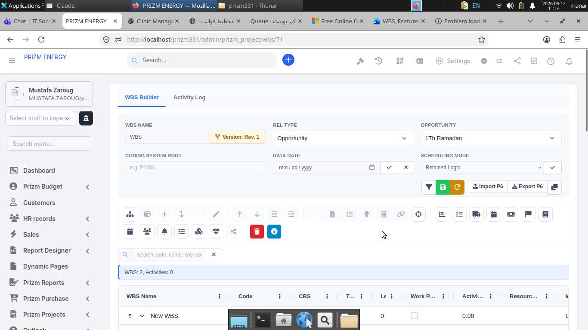

The WBS Builder is the home screen for the whole module. Across the top you set up the structure — the **WBS Name**, **Relation Type** (e.g. Opportunity), the linked **Opportunity**, the **Coding System Root**, the **Data Date**, and the **Scheduling Mode**. Below that sits a toolbar of feature buttons (import/export, add/indent rows, the reporting and procurement modals, and more), followed by the **WBS grid** where the hierarchy of work is actually built.

Each row in the grid is either a WBS element or an activity. The columns are grouped by purpose, described below.

### 4.2 Grid Columns — Identity

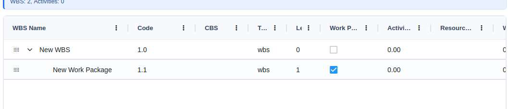

These columns identify each row: the **WBS Name**, its **Code** (for example 1.0, 1.1), the **CBS** cost-code link, the element **Type**, its hierarchy **Level**, a **Work Package** flag, and rolled-up **Activity** and **Resource** counts.

### 4.3 Grid Columns — Progress Measurement

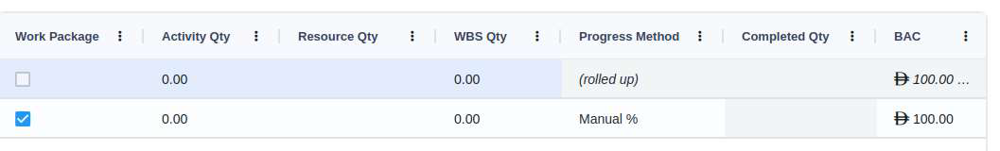

These columns control how progress is measured: **Activity / Resource / WBS quantities**, the chosen **Progress Method** (Manual %, Rule of Credit, Binary, Quantity, or Weighted Activity), **Completed Qty**, and the **Budget at Completion (BAC)**.

### 4.4 Grid Columns — Earned Value

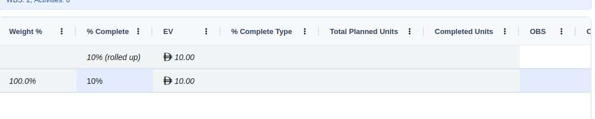

The earned-value group covers **Weight %**, **% Complete**, and **Earned Value (EV)**, alongside **% Complete Type**, **Total Planned Units**, **Completed Units**, and **OBS** (Organizational Breakdown Structure) ownership.

### 4.5 Grid Columns — Ownership & Procurement

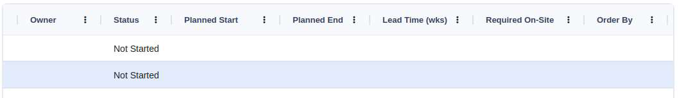

These columns capture **Owner**, **Status**, **Planned Start/End** dates, and the procurement-planning fields — **Lead Time** (weeks), the **Required On-Site** date, and the calculated **Order By** date.

### 4.6 Grid Columns — Scheduling Detail

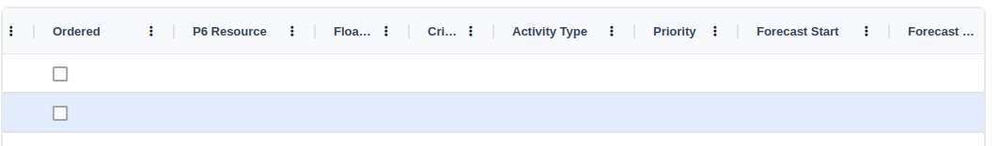

The scheduling group shows whether an item has been **Ordered**, its linked **P6 Resource**, **Float** and **Critical**-path flags, **Activity Type**, **Priority**, and **Forecast Start/Finish** dates.

### 4.7 Grid Columns — Actuals & Milestones

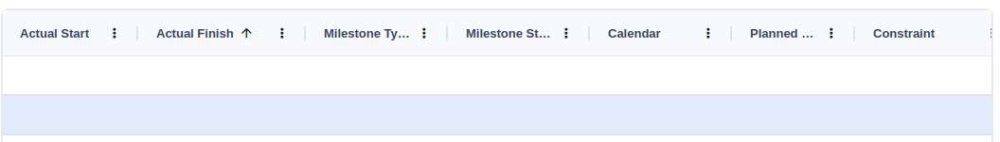

These columns record **Actual Start/Finish** dates, **Milestone Type** and **Status**, the assigned **Calendar**, and **Constraint** settings that steer the scheduling logic.

### 4.8 Grid Columns — Notes & Description

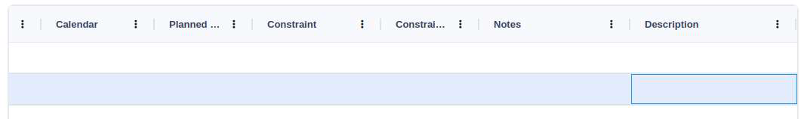

The remaining reference columns hold the **Calendar**, **Planned** dates, **Constraint** details, free-text **Notes**, and a **Description** for each element.

---

## 5. Progress & Costing

### 5.1 Rule of Credit

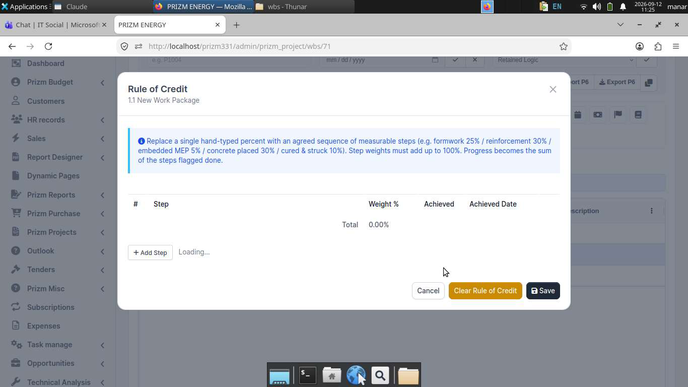

Rule of Credit replaces a single hand-typed percentage with an agreed sequence of measurable steps — for example formwork 25%, reinforcement 30%, concrete pour 30%, cured 10%. The step weights must add up to 100%, and progress is then the sum of the steps that have been marked as achieved. This makes progress objective and auditable instead of a subjective estimate.

### 5.2 Suggest Progress Method (AI)

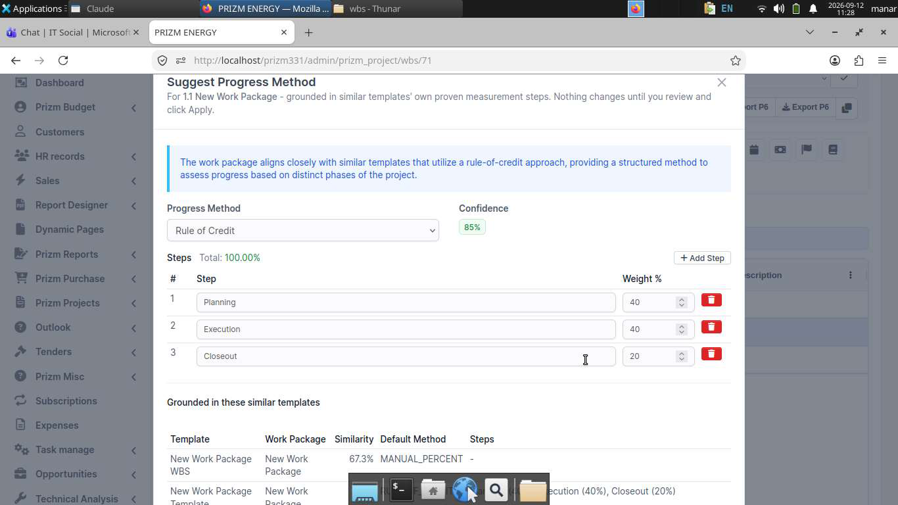

This AI assistant recommends the most suitable progress-measurement method for a work package by comparing it against similar historical templates. It shows a confidence score and the suggested steps up front, so you can review the recommendation before applying anything.

### 5.3 Rate Build-up

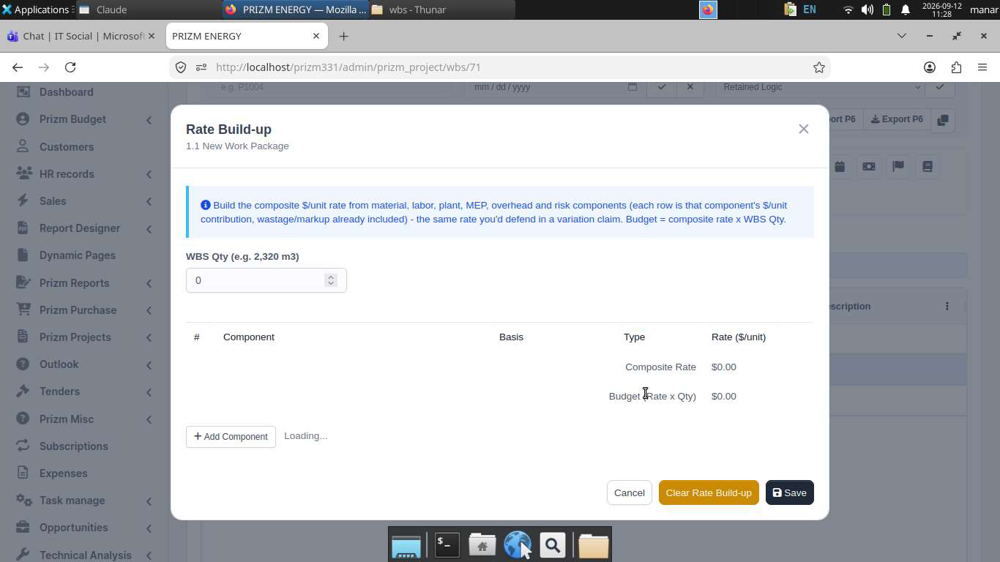

Rate Build-up assembles a composite unit rate from its component costs — material, labour, plant, overhead, and risk. The budget is then calculated automatically as the composite rate multiplied by the WBS quantity, producing a defensible rate that can stand up in a variation claim.

### 5.4 BOQ Mapping

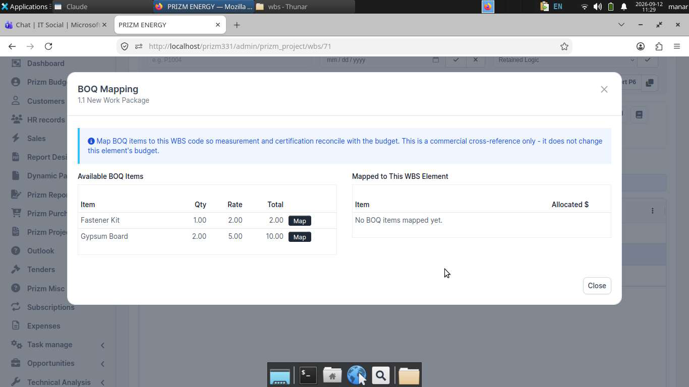

BOQ Mapping links Bill of Quantities line items to a WBS code so that measurement and certification can be reconciled against the budget. This is purely a commercial cross-reference — mapping an item does not change the element's own budget.

### 5.5 Match Templates

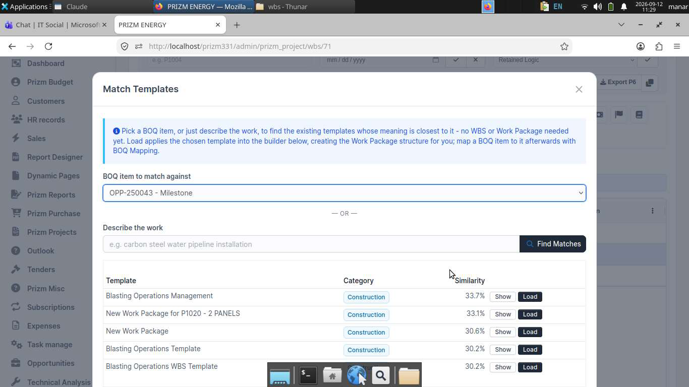

Match Templates helps you find an existing WBS template that fits new work — either by choosing a BOQ item to match against, or by describing the work in plain text. Candidate templates are ranked by similarity and can be loaded straight into the builder.

---

## 6. Reporting & Analysis

### 6.1 Earned Value Report

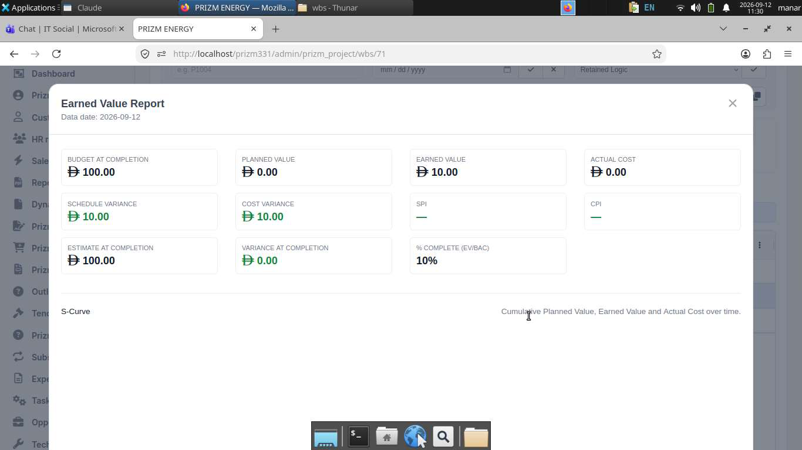

A full EVM (Earned Value Management) dashboard. It shows **Budget at Completion**, **Planned Value**, **Earned Value**, and **Actual Cost**, the **Schedule** and **Cost Variances**, the **SPI/CPI** performance indices, the **Estimate at Completion**, and overall **% Complete** — plus an S-Curve chart area for visual tracking.

### 6.2 Earned Value Report — Work Package Register

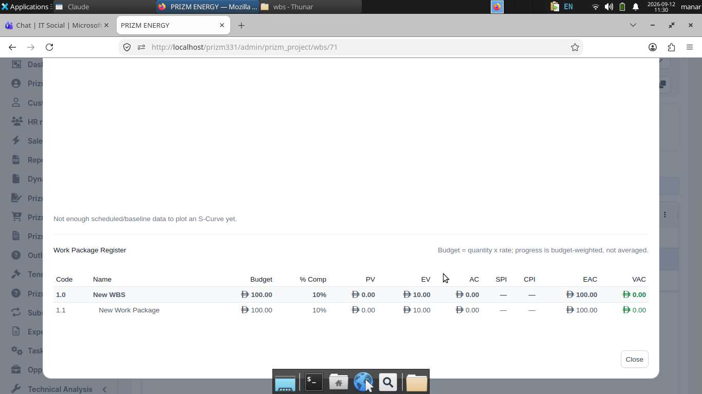

The lower half of the Earned Value Report gives a per-work-package breakdown: **Budget**, **% Complete**, **PV**, **EV**, **AC**, **SPI**, **CPI**, **EAC** (Estimate at Completion), and **VAC** (Variance at Completion).

### 6.3 Activity Gantt (Entire Loaded WBS)

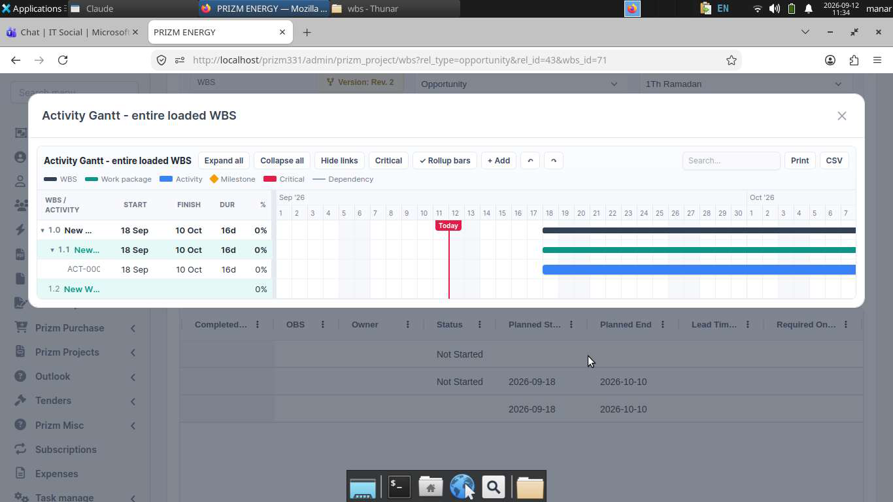

A Gantt chart of the whole WBS hierarchy and its activities. It includes a **"Today"** marker, **Expand/Collapse All**, **Critical-path** highlighting, and roll-up bars — handy for a quick visual check of the schedule.

### 6.4 DCMA 14-Point Schedule Health Check

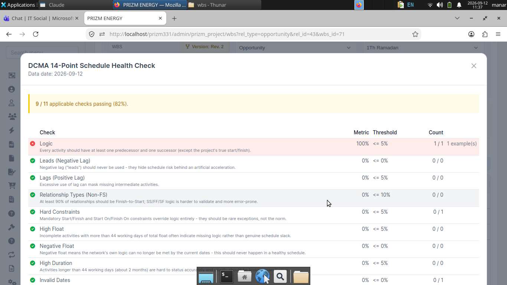

Runs the industry-standard DCMA 14-point checklist against the schedule — logic, leads/lags, constraints, float, duration, dates, and more. For each check it reports the **metric**, the **threshold**, and the **count of failing items**, along with how many checks pass overall.

### 6.5 Resource Utilization

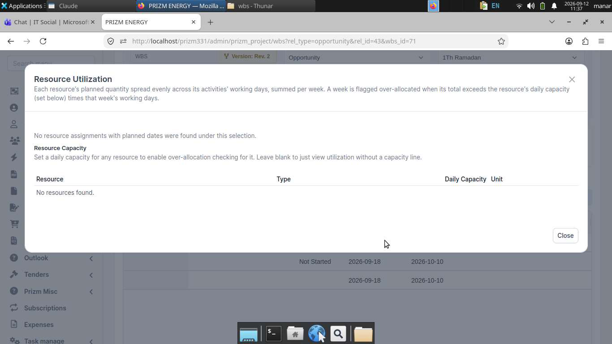

Spreads each resource's planned quantity evenly across the working days of its activities and totals it per week. Any week where the total exceeds the resource's set daily capacity is flagged as **over-allocation**.

### 6.6 Flat View

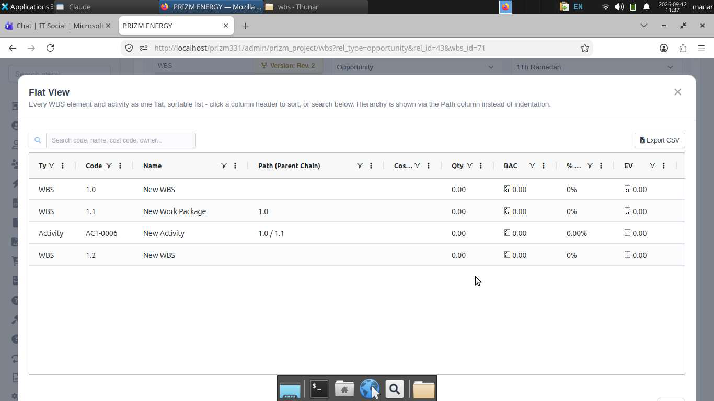

Shows every WBS element and activity as a single flat, sortable list instead of a nested tree. The hierarchy is preserved through a **"Path (Parent Chain)"** column, and any column header can be clicked to sort or filter.

### 6.7 Work Package Register

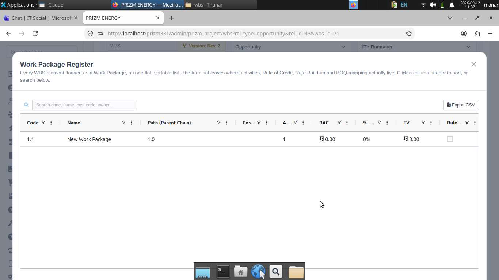

The same flat-list view, filtered to just the elements flagged as **Work Packages** — the terminal leaves where activities, Rule of Credit, Rate Build-up, and BOQ mapping actually live.

### 6.8 WBS Dictionary

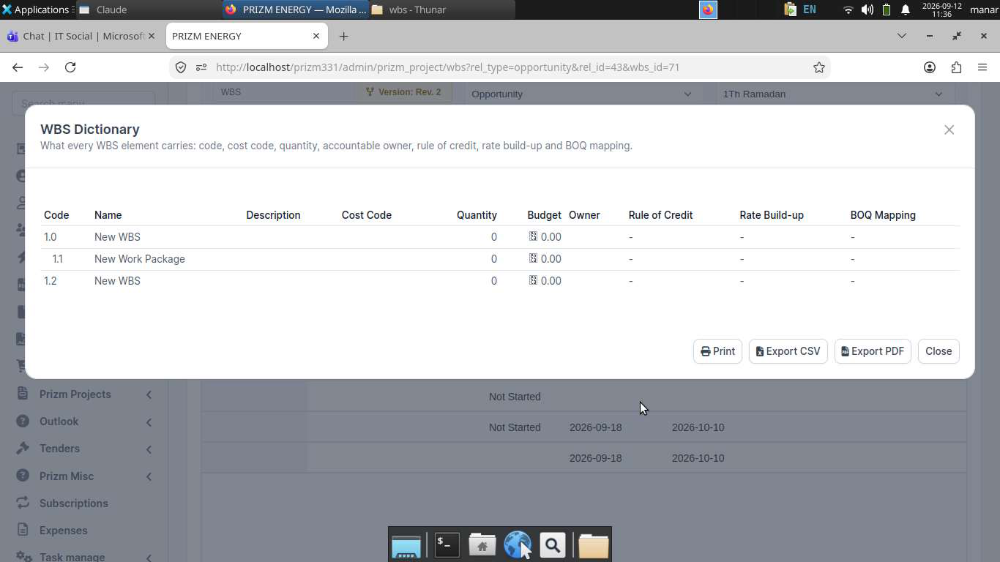

A reference table describing what every WBS element carries — code, description, cost code, quantity, budget, owner, and whether Rule of Credit, Rate Build-up, or BOQ Mapping have been configured. It can be printed or exported to CSV/PDF.

---

## 7. Procurement

### 7.1 Long-Lead Alerts

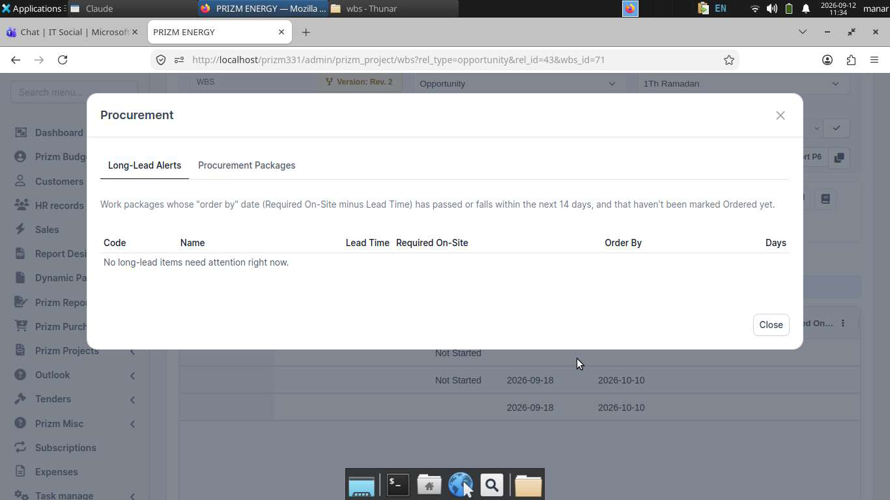

Flags work packages whose **"order by"** date (Required On-Site minus Lead Time) has already passed, or falls within the next 14 days, and has not yet been marked as Ordered. It acts as an early warning for materials that take a long time to arrive.

### 7.2 Procurement Package — New Package

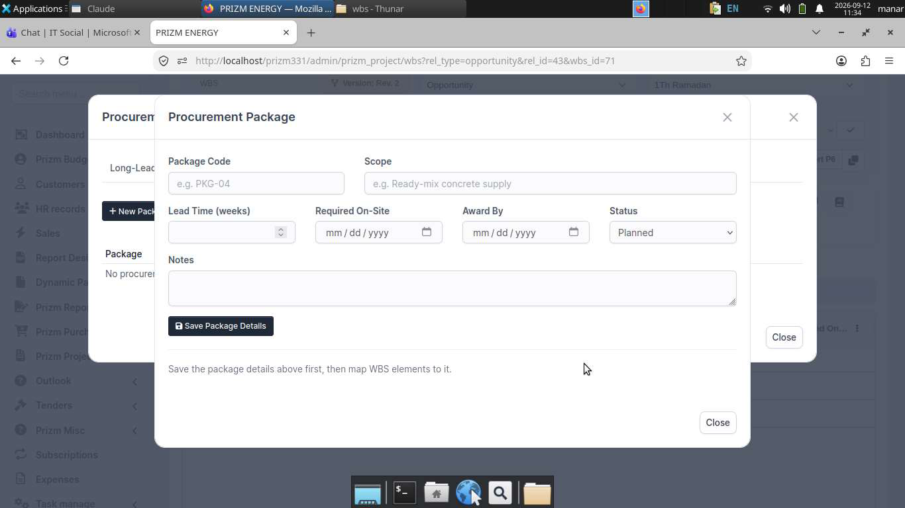

A form for creating a new procurement package: **package code**, **scope of supply**, **lead time** (weeks), **required-on-site** date, **award-by** date, **status**, and free-text **notes**.

### 7.3 Procurement — Packages List

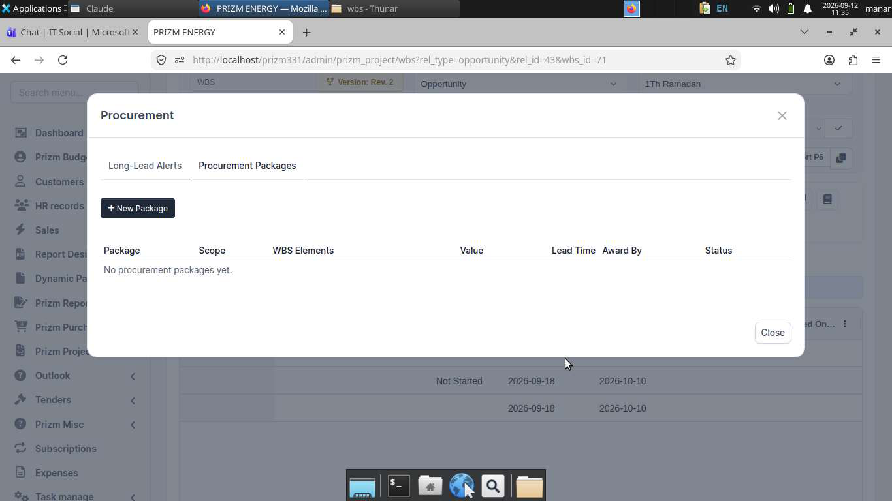

The Procurement Packages tab lists every package created for the project, with its scope, mapped WBS elements, value, lead time, award date, and status.

---

## 8. Progress Periods & Payment Applications

### 8.1 Progress Periods

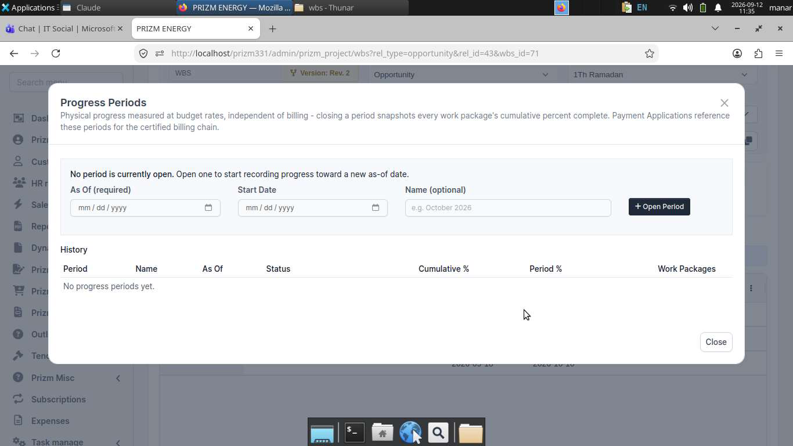

Physical progress is measured at budget rates, independently of billing. Closing a period takes a snapshot of every work package's cumulative percent complete as of a chosen date. Payment Applications later reference these periods to build the certified billing chain.

### 8.2 Payment Applications — History

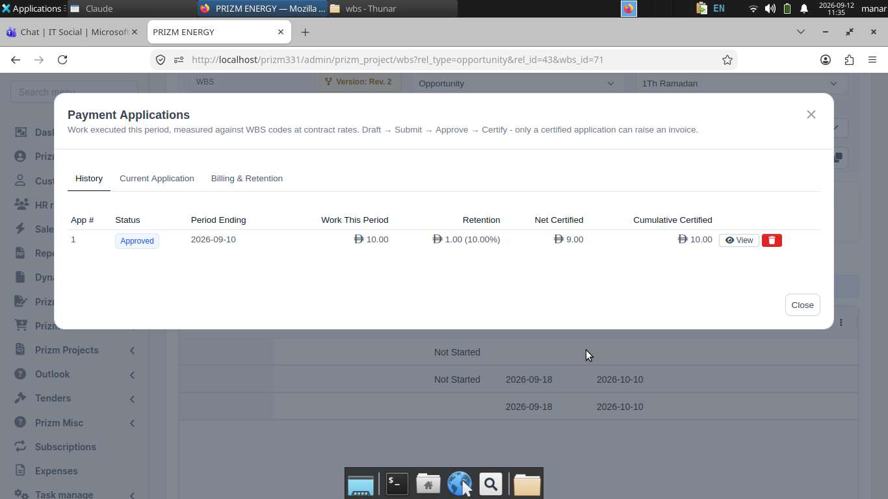

Lists every payment application raised against the WBS, with its status, period-ending date, work executed, retention withheld, net certified amount, and the running cumulative certified total.

### 8.3 Payment Applications — Current Application

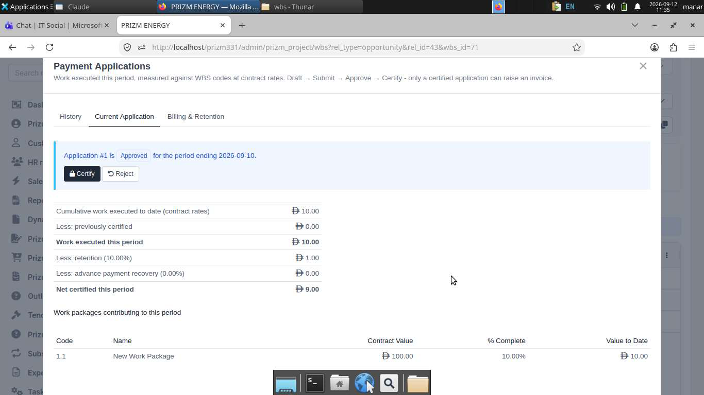

Shows the active application's workflow — **Draft → Submit → Approve → Certify** — with Certify/Reject actions and a full breakdown: cumulative work executed, previously certified, retention withheld, and the net amount certified this period.

### 8.4 Payment Applications — Billing & Retention

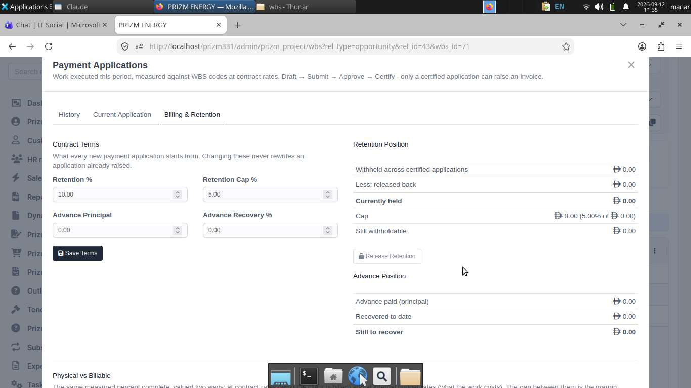

Holds the contract-level billing terms — **retention %**, **retention cap %**, **advance principal**, and **recovery %** — that every new payment application starts from, alongside the current **Retention Position** and **Advance Position** balances.

---

## 9. Baselines, Calendars & Templates

### 9.1 WBS Baselines

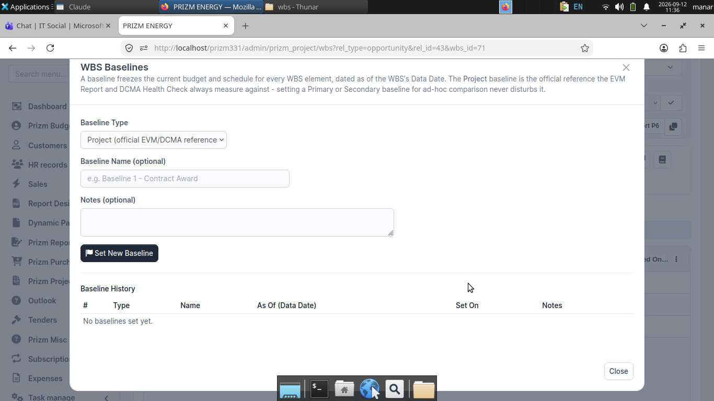

A baseline freezes the current budget and schedule for every WBS element as of the data date. The **"Project"** baseline is the official reference that EVM reports and the DCMA health check always compare against; additional baselines can be set for ad-hoc comparison without disturbing it.

### 9.2 Calendars

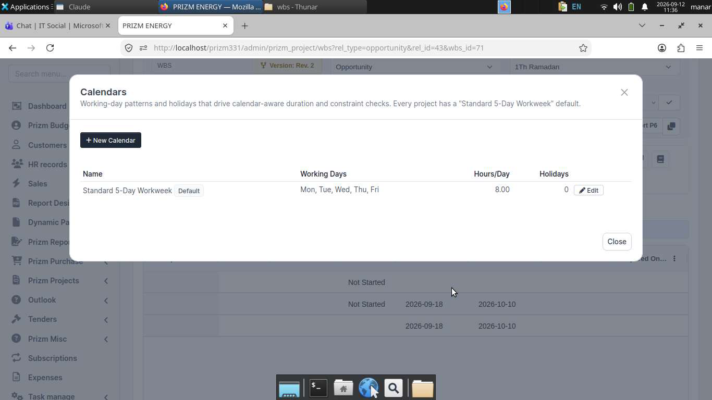

Manages the working-day patterns and holidays that drive calendar-aware duration and constraint checks. Every project starts with a default **"Standard 5-Day Workweek"** calendar (Mon–Fri, 8 hours/day), and more can be added.

### 9.3 Save as Template

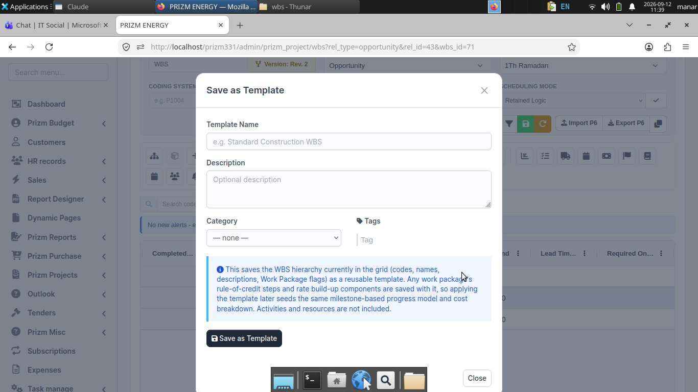

Saves the WBS hierarchy currently in the grid — codes, names, descriptions, Work Package flags, Rule of Credit steps, and rate build-up components — as a reusable template for future projects. Activities and resources are not included.

### 9.4 WBS Template Library

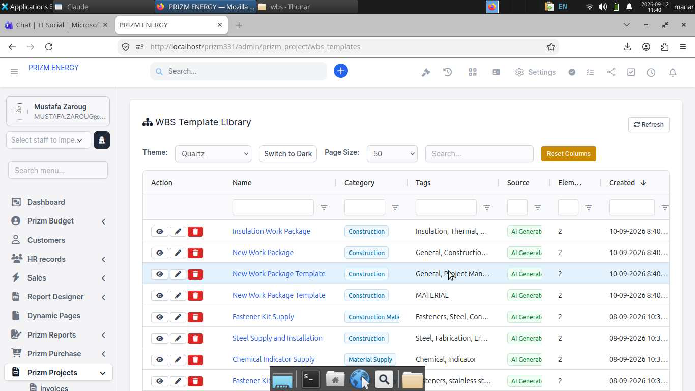

A library of all saved WBS templates, listing each one's name, category, and creation date, with quick actions to view, edit, or delete.

### 9.5 View Template

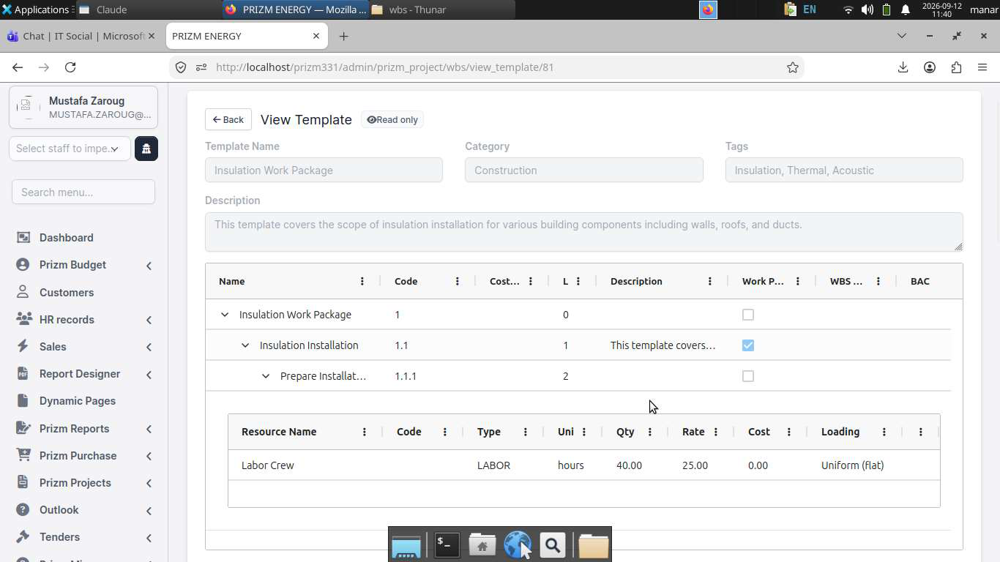

A read-only preview of a saved template's structure — its hierarchy of work packages and activities, plus any pre-configured resources (for example a labour crew with its type, quantity, rate, and cost).

### 9.6 AI Template Generation Queue

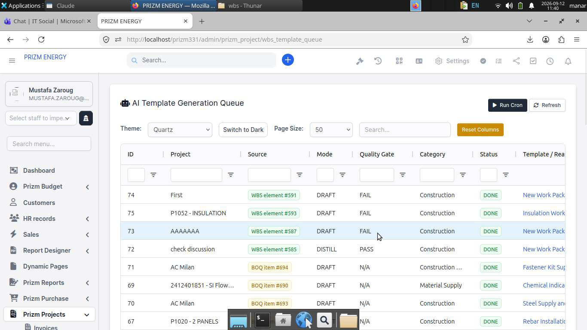

Tracks background jobs where the AI is generating a new WBS template from a source item (a WBS element or a BOQ item). It shows the source, the mode, a quality-gate pass/fail result, and links to the resulting template.

---

## 10. Import & Export

### 10.1 Import WBS from Primavera P6

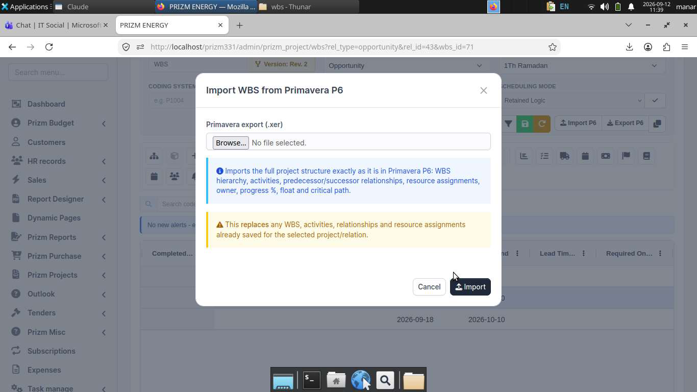

Imports a full project structure from a Primavera P6 `.xer` export — the WBS hierarchy, activities, predecessor/successor relationships, resource assignments, owners, progress %, float, and critical path.

!!! warning "Replaces existing data"
    Importing from P6 replaces any WBS and activities already saved for the project. Use it on a fresh structure, or make sure existing work is baselined first.

### 10.2 Import Activities (AI) — Upload

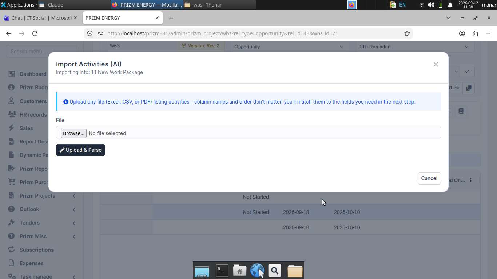

Lets you upload any file (Excel, CSV, or PDF) that lists activities to import into a work package. Column names and order do not matter — they are matched to the right fields in the next step.

### 10.3 Import Activities (AI) — Match Columns

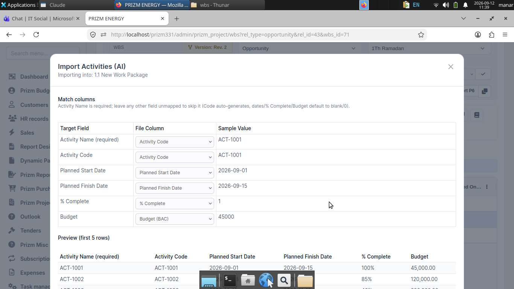

After upload, the AI proposes a match between each uploaded column and the target fields (**Activity Name**, **Code**, **Planned Start/Finish**, **% Complete**, **Budget**), with a live preview of the first five rows before you commit.

---

## 11. Activity Log

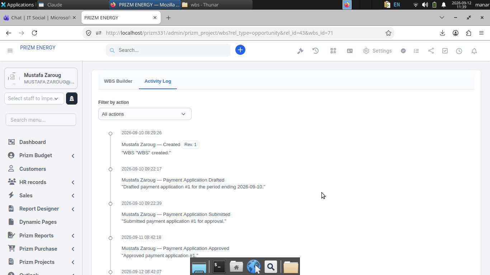

A complete audit trail of everything that has happened on the WBS — creation, revisions, and payment-application drafts, submissions, and approvals, among others. Each entry is timestamped and attributed to the staff member who performed it, and the log can be filtered by action type.
